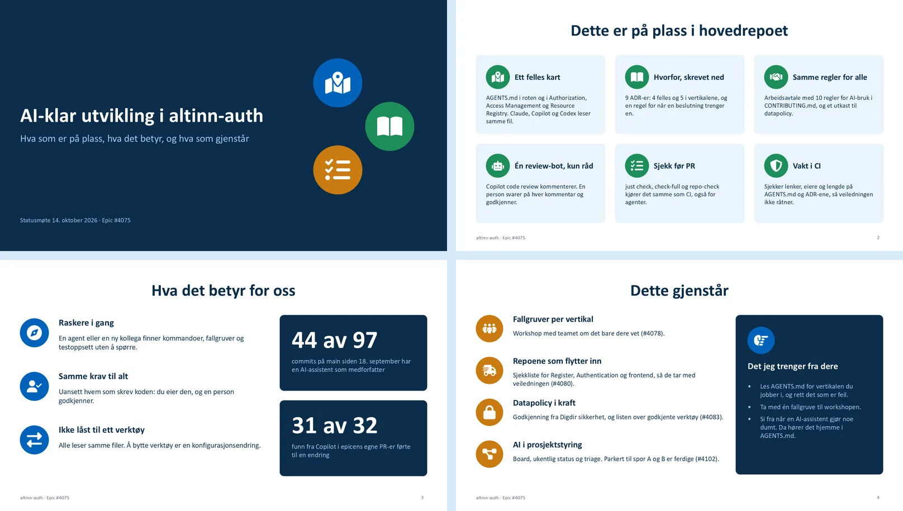

# AI-klar utvikling i altinn-auth

[Last ned PowerPoint-presentasjonen](./ai-klar-utvikling-altinn-auth.pptx)

Fire lysbilder til en statusoppdatering på tre minutter. Presentasjonen viser hva autorisasjonsteamet har på plass for å utvikle med AI-assistanse i hovedrepoet [Altinn/altinn-auth](https://github.com/Altinn/altinn-auth), hva det betyr for teamet, og hva som gjenstår i [epic #4075](https://github.com/Altinn/altinn-auth/issues/4075).

## Dette er på plass

| Område | Hva vi har | Kilde |
| --- | --- | --- |
| Felles kart | `AGENTS.md` i roten og i Authorization, Access Management og Resource Registry. `CLAUDE.md` og instruksjonene til Copilot peker dit. | ADR-0002, #4077, #4078 |
| Hvorfor | Ni ADR-er: fire felles og fem i vertikalene, og en regel for når en beslutning trenger en ADR. | #4076, #4079 |
| Regler | Arbeidsavtalen i `CONTRIBUTING.md` har ti regler for AI-bruk. Datapolicyen er et utkast som gjelder fra Digdir sikkerhet har godkjent den. | #4082, #4083 |
| Review | Copilot code review er eneste review-bot og gir bare råd. En person svarer og godkjenner. | ADR-0003 |
| Sjekk før PR | `just check`, `just check-full` og `just repo-check` kjører det samme som CI. | #4086 |
| Vakt i CI | En kontroll i CI sjekker lenker, eiere og lengde på `AGENTS.md` og ADR-ene. | #4081 |

## Hva det betyr

- En agent eller en ny kollega finner kommandoer, fallgruver og testoppsett uten å spørre.
- Kravene er de samme uansett hvem som skrev koden: forfatteren eier den, og en person godkjenner.
- Alle verktøyene leser de samme filene, så teamet kan bytte verktøy uten å skrive veiledningen på nytt.

To tall underbygger dette. Siden epicen startet 18. september har 44 av 97 commits på `main` en AI-assistent som medforfatter. Tallet er et minimum, fordi ikke alle verktøy legger til medforfatterlinjen. I de ni første pull requestene i epicen ga Copilot 32 kommentarer, og 31 av dem førte til en endring. De pull requestene handlet om dokumentasjon og konfigurasjon, så tallet sier lite om produktkode ennå.

## Dette gjenstår i epicen

1. **Fallgruver per vertikal.** Teamet skriver inn det bare de vet, i en workshop (#4078).
2. **Repoene som flytter inn.** Register, Authentication og frontend trenger en sjekkliste, slik at veiledningen følger med (#4080).
3. **Datapolicy i kraft.** Digdir sikkerhet må godkjenne den, og teamet fyller ut listen over godkjente verktøy (#4083).
4. **AI i prosjektstyring.** Board, ukentlig status og forslag til triage venter til spor A og B er ferdige (#4102).

Mindre punkter står også åpne: macOS og Linux for `just`-oppskriftene (#4086), reglene for PR-beskrivelser (#4084) og lukking av #4085 etter at ADR-0003 kom på plass. Teamet tar labels og issue-modellen i en egen epic (#4354, ADR-0004).

## Filer og kilder

- `ai-klar-utvikling-altinn-auth.pptx` har redigerbar tekst og presentatørnotater med kilder for hvert lysbilde.
- `preview.webp` viser alle fire lysbildene samlet.

Issuenumrene viser til [Altinn/altinn-auth](https://github.com/Altinn/altinn-auth). Commit-tallene kommer fra `git log` på `main` 13. oktober 2026. Copilot-tallene kommer fra ADR-0003.

Mappen er ikke koblet til navigasjonen på dokumentasjonssiden.
