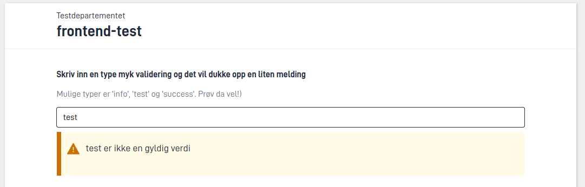

With validation, the app checks that the data the user fills in is valid. The user sees a message next to the field that is wrong, and cannot submit until the errors are fixed.

The app validates both in the browser and on the server. In the browser, the user gets quick feedback while filling in the form. On the server, the app runs the validations before the user can move on in the process. This also applies when another system sends data straight to the app's API, without going through the browser. Some of the validations on the server must be turned on. See [Validation on the server](#validation-on-the-server).

## Choosing an approach

Use the simplest approach that solves the task. Rules you can set up without code are easier to maintain, and the app can show the error in the browser straight away.

| What do you want to check? | Approach | Do you need C#? |
| --- | --- | --- |
| That the user has filled in a field | [Required fields]() | No |
| Length, format, number limits and similar for a single field | [Constraints in the data model]() | No |
| Rules you can write using values from the data model | [Validation using expressions]() | No |
| File type, file size and number of attachments | Settings on the data type in `applicationmetadata.json` | No |
| The contents of a file before the app stores it | [Extended file validation]() | Yes |
| Anything else, for example lookups in other systems or rules across data models | [A custom validator in C#]() | Yes |

## Questions to ask the developers

The validation rules decide what the user is allowed to submit. As a service owner, you should know which rules the app has, and why. Consider asking the developers:

- Which rules stop the submission, and which are only warnings or information?
- Are the error messages available in all the languages the service supports?
- Does the user see the error next to the field they need to fix, or only in the summary when they try to submit?
- Do the error messages explain what is wrong, and how the user can fix it?
- Does the app look up information in other systems to validate? What happens if a system does not respond – can the user end up unable to submit?
- Have you tested the rules with repeating groups and with submissions through the API? Can a field that is hidden from the user stop the submission?

## When the user sees validation messages

The user sees validation messages next to the field the message is about, and in an error summary at the bottom of the page.

### While the user fills in the form

The app shows most messages next to the field straight away, both when the user opens the form and just after they have changed something. This applies to errors, warnings and information alike.

The app shows errors about [required fields]() only when the user tries to submit, or to change page if the app is set up to check on page change. That way the user does not see errors for fields they have not reached yet. You can change which messages the app shows straight away. See [Choosing which messages the app shows straight away](#choosing-which-messages-the-app-shows-straight-away).

That is why you usually let `required` check whether a field is filled in, and let the other rules accept empty fields. The user then sees an error only once they have filled in something that is wrong, or when they try to move on without filling in a required field. A rule that triggers on an empty field shows the error before the user has had a chance to fill in anything.

### When the user tries to move on

When the user tries to submit, the app shows all the errors that stop them. The errors appear next to the fields and in an error summary at the bottom of the page. The app also shows the error summary at other times when there are errors the user can see, for example errors from the data model as soon as the form opens.

{}
In v9, the app shows the error summary only after the user has tried to submit or change page.
{}

Only errors stop the user. The user can read warnings, information and confirmations and still move on.

Some errors the user only sees when they try to submit:

- errors from rules that only run on submission, because they are slow to run or check the whole task
- errors that are not about a specific field, for example that a deadline has passed
- errors in fields that are hidden from the user

The app shows the last two only in the error summary, because there is no visible field to show them next to.

You can also set up the app to check for errors when the user changes page. See [Specifying validation on page change](#specifying-validation-on-page-change).

When the user fixes the errors, the app removes them from the summary. The summary disappears when there are no more errors. If a new error that `showValidations` allows appears later, the app shows it both next to the field and in the summary straight away. The app does not show errors about required fields until the user tries to change page or submit again.

### When the user saves a row in a repeating group

You can make the app check a row in a repeating group when the user saves the row. If there are errors in the row, the user cannot close the row until the errors are fixed.

```json {hl_lines=[6]}
{
  "id": "demo-group",
  "type": "RepeatingGroup",
  "children": [...],
  "dataModelBindings": {...},
  "validateOnSaveRow": ["All"]
}
```

`validateOnSaveRow` contains the types of validation the app should check. See [Validation types](#validation-types).

### When the user uploads attachments

When the user uploads a file, the app checks the file type, file size and number of uploaded files against the settings on the data type. If you have set up [extended file validation](), the app runs it too. If the file does not meet the requirements, the app does not store the file, and the user sees the error straight away.

## Choosing which messages the app shows straight away

With `showValidations` on a component, you decide which validation messages the app shows straight away.

```json {hl_lines=[6]}
{
  "id": "first-name",
  "type": "Input",
  "textResourceBindings": {...},
  "dataModelBindings": {...},
  "showValidations": ["AllExceptRequired"]
}
```

If `showValidations` is not set, the app uses `["AllExceptRequired"]`. If you do not want to show any messages straight away, set `showValidations` to an empty list, `[]`.

### Validation types

You use the same validation types in `showValidations`, `validateOnSaveRow` and [`validationOnNavigation`](#specifying-validation-on-page-change):

| Type | Means |
| --- | --- |
| `Schema` | [Constraints in the data model]() |
| `Component` | Rules in the component itself, for example date format |
| `Expression` | [Validation using expressions]() |
| `CustomBackend` | [Custom validators in C#]() that run while the user fills in the form |
| `Required` | [Required fields]() |
| `AllExceptRequired` | All types except `Required` |
| `All` | All types |

{}
v9 also has the `Invalid` type, for values the app cannot store in the data model, for example text in a number field.
{}

C# validators that only run on submission are not included in any of the types. The app shows errors from them only when the user tries to submit.

## Soft validations

Soft validations are validation messages that do not stop the user from submitting or moving on to the next task in the process. You can use them to ask the user to double-check a value that looks wrong but is not invalid, or to give useful information for the rest of the form.

There are three types of soft validation: warning, information and confirmation. You create them by setting the severity of the validation, either in [validation using expressions]() or in [a C# validator](#severity).

This is what the three types look like:




## Validation on the server

The app runs the validations on the server before the user can move on in the process. That way nobody can submit data that breaks the rules, not even other systems that use the app's API. However, the server only checks required fields and validation using expressions if you have turned them on. We recommend turning on both. The server only checks required fields in tasks that have a layout set.

{}
In v9, `RequiredValidation` and `ExpressionValidation` are turned on by default.
{}

### Built-in validations

The app has these built-in validations:

| Validation | What it checks | How to turn it on or off |
| --- | --- | --- |
| [Required fields]() | That visible components with `required` have a value, in tasks that have a layout set | `RequiredValidation` (off by default) |
| [Validation using expressions]() | The rules in `models/[data-type-ID].validation.json` | `ExpressionValidation` (off by default) |
| [Data model]() | Attributes on the C# model, for example `[Range]` and `[RegularExpression]` | Always on |
| XSD | That the form data is valid against `models/[data-type-ID].xsd` | `XsdValidation` (off by default) |
| Attachments and other data elements | File type (`allowedContentTypes`), file size (`maxSize`) and virus scanning (`enableFileScan`) | Settings on the data type |
| Number of data elements | `minCount` and `maxCount` for the data types in the task | Settings on the data type |
| Signing | That everyone who should sign has signed | `runDefaultValidator` in the signing task |
| Signed data | That the data has not changed after the user signed | Always on in signing tasks |

The browser also checks required fields, validation using expressions and the data model while the user fills in the form. The other built-in validations only run on the server when the user moves on in the process. The user therefore sees errors from them only when they try to submit. The exception is file type, file size and maximum number of files (`maxCount`), which the app also checks when the user uploads a file. The app checks the minimum number of files (`minCount`) only when the user moves on.

You turn the validations on under `AppSettings` in `App/appsettings.json`:


App/appsettings.json


```json
{
  "AppSettings": {
    "RequiredValidation": true,
    "ExpressionValidation": true,
    "XsdValidation": false
  }
}
```

### Custom validators

If you need rules that the built-in validations and validation using expressions do not cover, you or your developer can write custom validators in C#, for example to

- check the contents of attachments, for example that a PDF has the right number of pages
- look up information in other systems, such as checking that an organisation number exists
- check data across several data models in the same task

[How to create validators in C#]().
