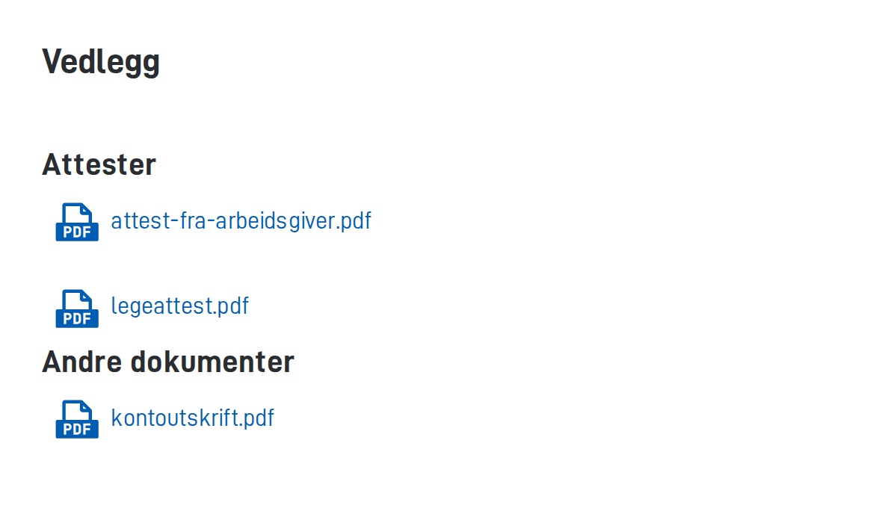

Hver vedleggstype er en datatype i listen `dataTypes` i filen `App/config/applicationmetadata.json`. Egenskapene under gjelder datatyper for vedlegg. Egenskapene for virusskanning står på siden [Egenskaper og tekstnøkler for virusskanning]().

## Egenskaper

| Egenskap              | Hva den gjør                                                                                                                                                                                                                                                                                                                                                |
| --------------------- | ----------------------------------------------------------------------------------------------------------------------------------------------------------------------------------------------------------------------------------------------------------------------------------------------------------------------------------------------------------- |
| `id`                  | Navnet på vedleggstypen.                                                                                                                                                                                                                                                                                                                                    |
| `taskId`              | Hvilket prosessteg i `process.bpmn` (filen som beskriver stegene i prosessen) brukeren eller systemet skal laste opp vedlegget i. Verdien må være lik id-en til et av prosesstegene.                                                                                                                                                                        |
| `maxSize`             | Største tillatte filstørrelse i MB.                                                                                                                                                                                                                                                                                                                         |
| `maxCount`            | Høyeste antall vedlegg av denne typen per instans.                                                                                                                                                                                                                                                                                                          |
| `minCount`            | Laveste antall vedlegg av denne typen per instans. Er verdien 0, er det ikke obligatorisk å laste opp.                                                                                                                                                                                                                                                      |
| `allowedContentTypes` | Hvilke filtyper appen godtar, oppgitt som MIME-typer, for eksempel `application/pdf`, `text/xml` og `image/jpeg`. Setter du ingen verdi, godtar appen alle filtyper.                                                                                                                                                                                        |
| `allowedContributors` | Hvem som kan opprette og endre vedlegg av denne typen. Se [Verdier i allowedContributors](#verdier-i-allowedcontributors).                                                                                                                                                                                                                                  |
| `grouping`            | Valgfritt navn på en gruppe. Vedlegg med samme gruppe kommer i samme liste når du viser dem med komponenten [`AttachmentList`]() og setter `groupByDataTypeGrouping` til `true` på komponenten. Du kan bruke en tekstnøkkel hvis appen skal støtte flere språk. |

Du kan lese mer om MIME-typer i [oversikten fra MDN](https://developer.mozilla.org/en-US/docs/Web/HTTP/Basics_of_HTTP/MIME_types/Common_types).

## Verdier i allowedContributors

Med `allowedContributors` bestemmer du hvem som kan opprette og endre vedlegg av en datatype. Hvert valg skriver du på formen `{nøkkelord}:{verdi}`:

- `org:{kortnavn}` gir en tjenesteeier tilgang. Kortnavnet er forkortelsen til tjenesteeieren, for eksempel `nav`.
- `orgNo:{organisasjonsnummer}` gir en organisasjon tilgang ut fra organisasjonsnummeret.
- `app:owned` gir bare appen selv tilgang. Eksterne systemer kan da ikke opprette eller endre vedleggene via API. Du bruker dette for data som appen lager selv, for eksempel signaturer.

Du kan bare oppgi organisasjoner som er registrert som tjenesteeiere.

Før versjon 8.6 het egenskapen `allowedContributers` (med feil stavemåte). Den gamle stavemåten er foreldet. Bruk `allowedContributors`. Har datatypen verdier i begge egenskapene, bruker appen `allowedContributers`. Fjern derfor den gamle egenskapen når du bytter.
