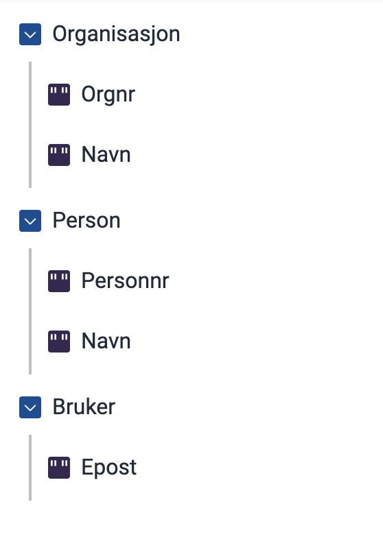

Du kan sette opp forhåndsutfylling i Designer eller skrive konfigurasjonsfilen selv. Begge deler gir den samme filen i appen.

## Sett opp forhåndsutfylling i Designer

1. Åpne appen i Designer, og gå til **Datamodell**.
2. Velg feltet du vil fylle ut automatisk.
   - Du kan bare forhåndsutfylle enkeltfelt. Objekter og lister har ikke denne innstillingen.
3. Velg hvor dataene skal komme fra i **Kilde** under **Forhåndsutfylling**:
   - **Brukerprofil**
   - **Enhetsregisteret (ER)**
   - **Folkeregisteret (DSF)**
   - **Spørringsparameter**
4. Velg hvilket felt fra kilden du vil bruke, i **Felt**.
   - Har du valgt **Spørringsparameter**, skriver du navnet på parameteren i **Navn på spørreparameter** i stedet.

Designer lagrer valgene dine i filen `App/models/{datamodell}.prefill.json`. Designer har ingen innstilling for `allowOverwrite`. Står den ikke i filen, overskriver forhåndsutfyllingen ikke felt som allerede har en verdi. Vil du endre det, legger du til `"allowOverwrite": true` i filen selv.

## Skrive konfigurasjonsfilen selv

Du kan også lage og redigere filen selv, for eksempel hvis du jobber i app-repoet på egen maskin.

### 1. Opprett en ny fil

   Gå til mappen `App/models` i appen din og opprett en ny fil med navn `{datatype-ID}.prefill.json`. Datatype-ID-en er `id` for datatypen i `applicationmetadata.json`. I apper du har laget i Studio, er den det samme som navnet på datamodellen.

   Hvis datamodellen din heter _appModel_ skal du ha disse filene:
   - `appModel.cs` 
   - `appModel.schema.json` 
   - `appModel.prefill.json`  &larr; *den nye filen*

### 2. Legg til grunnkonfigurasjon

   Kopier denne konfigurasjonskoden inn i den nye filen:

   ```json
   {
      "$schema": "https://altinncdn.no/schemas/json/prefill/prefill.schema.v1.json",
      "allowOverwrite": true,
      "ER": {},
      "DSF": {},
      "UserProfile": {}
   }
   ```

### 3. Konfigurer hvilke data som skal fylles ut automatisk

   De tre gruppene i koden speiler de tre kildene som er tilgjengelige:
   - `ER` - Enhetsregisteret
   - `DSF` - Folkeregisteret
   - `UserProfile` - Brukerens Altinn-profil

   Du velger hvilke av kildene du ønsker å bruke. Hvis en (eller flere) av kildene ikke skal brukes, lar du dem stå tomme.

   Inne i gruppen for den aktuelle kilden legger du til linjer som forteller:
   - Hvilket felt (fra kilden) du vil hente data fra
   - Hvilket felt i skjemaet som skal fylles ut

   Formatet er `"datafelt": "skjemafelt"`, der:
   - `datafelt` er navnet på feltet _fra kilden_
   - `skjemafelt` er navnet på feltet i skjemaets datamodell.

   Se [fullstendig liste over tilgjengelige datafelt for alle kildene]().

## Eksempler

Alle eksemplene tar utgangspunkt i datamodellen vist under:



### Eksempel: Hent organisasjonsnummer fra Enhetsregisteret (ER)

Dette fyller ut feltet `Organisasjon.Orgnr` med organisasjonsnummeret fra 
Enhetsregisteret:

```json
"ER": {
  "OrgNumber": "Organisasjon.Orgnr"
}
```

### Eksempel: Hent personnummer fra Folkeregisteret (DSF)

Dette fyller ut feltet `Person.Personnr` med personnummer fra Folkeregistret.

 ```json
"DSF": {
  "SSN": "Person.Personnr"
}
```

### Eksempel: Hent e-post fra brukerens Altinn-profil

Dette fyller ut feltet `Bruker.Epost` med e-post hentet fra brukerens Altinn-profil.

```json
"UserProfile": {
  "Email": "Bruker.Epost"
}
```
