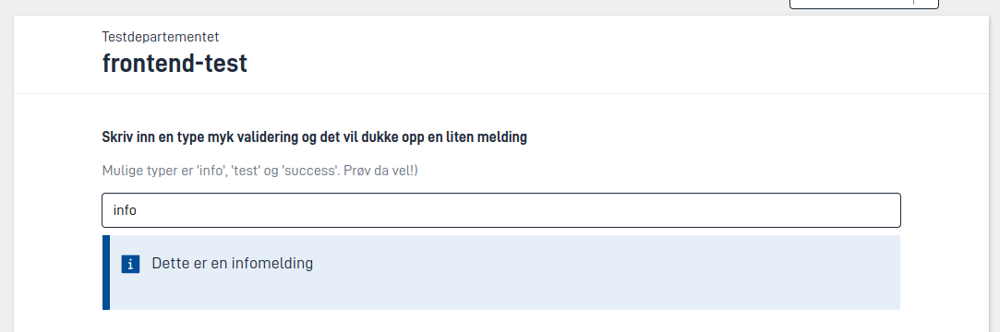
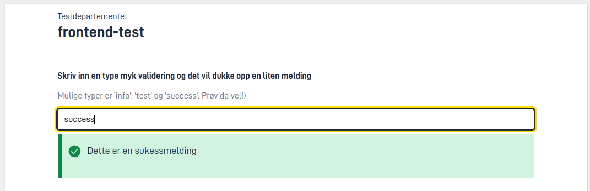

Med validering kontrollerer appen at dataene brukeren fyller inn, er gyldige. Brukeren ser en melding ved feltet som er feil, og får ikke sende inn før feilene er rettet.

Appen validerer både i nettleseren og på serveren. I nettleseren får brukerne raske tilbakemeldinger mens de fyller ut. På serveren kjører appen alle valideringene før brukeren får gå videre i prosessen. Det gjelder også når et annet system sender data rett til API-et til appen, uten å gå gjennom nettleseren.

## Velge fremgangsmåte

Bruk den enkleste fremgangsmåten som løser oppgaven. Regler du kan sette opp uten kode, er enklere å vedlikeholde, og appen kan vise feilen i nettleseren med en gang.

| Hva vil du sjekke? | Fremgangsmåte | Trenger du C#? |
| --- | --- | --- |
| At brukeren har fylt ut et felt | [Påkrevde felt]() | Nei |
| Lengde, format, tallgrenser og liknende for ett felt | [Begrensninger i datamodellen]() | Nei |
| Regler du kan skrive med verdier fra datamodellen | [Validering med uttrykk]() | Nei |
| Filtype, filstørrelse og antall vedlegg | Innstillinger på datatypen i `applicationmetadata.json` | Nei |
| Innholdet i en fil før appen lagrer den | [Utvidet filvalidering]() | Ja |
| Alt annet, for eksempel oppslag i andre systemer eller regler på tvers av datamodeller | [En egen validator i C#]() | Ja |

## Dette bør du avklare med utviklerne

Valideringsreglene bestemmer hva brukeren får lov til å sende inn. Som tjenesteeier bør du vite hvilke regler appen har, og hvorfor. Spør gjerne utviklerne om dette:

- Hvilke regler stopper innsendingen, og hvilke er bare advarsler eller informasjon?
- Finnes feilmeldingene på alle språkene tjenesten støtter?
- Ser brukerne feilen ved feltet de må rette, eller bare i oppsummeringen når de prøver å sende inn?
- Forklarer feilmeldingene hva som er feil, og hvordan brukeren retter det?
- Henter appen opplysninger fra andre systemer for å validere? Hva skjer hvis systemet ikke svarer – kan brukeren da bli stående uten å få sendt inn?
- Har dere testet reglene med repeterende grupper og innsending gjennom API-et? Kan et felt som er skjult for brukeren, stoppe innsendingen?

## Når brukeren ser valideringsmeldingene

Brukeren ser valideringsmeldingene ved feltet meldingen gjelder, og i en feiloppsummering nederst på siden.

### Mens brukeren fyller ut

Appen viser de fleste meldingene ved feltet med en gang, både når brukeren åpner skjemaet og like etter at brukeren har endret noe. Det gjelder både feil, advarsler og informasjon.

Feil om [påkrevde felt]() viser appen først når brukeren prøver å sende inn, eller å bytte side hvis appen er satt opp til å sjekke ved sidebytte. Da slipper brukeren å se feil for felt brukeren ikke har kommet til ennå. Du kan endre hvilke meldinger appen viser med en gang. Se [Velge hvilke meldinger appen viser med en gang](#velge-hvilke-meldinger-appen-viser-med-en-gang).

Vanligvis lar du derfor `required` sjekke om et felt er fylt ut, og lar de andre reglene godta tomme felt. Da ser brukeren en feil først når brukeren har fylt ut noe som er feil, eller når brukeren prøver å gå videre uten å ha fylt ut et påkrevd felt. En regel som slår til på et tomt felt, viser feilen før brukeren har rukket å fylle ut noe.

### Når brukeren prøver å gå videre

Når brukeren prøver å sende inn, viser appen alle feilene som stopper brukeren. Feilene står ved feltene og i en feiloppsummering nederst på siden.

Bare feil stopper brukeren. Advarsler, informasjon og bekreftelser kan brukeren lese og likevel gå videre.

Noen feil kommer først når brukeren prøver å sende inn:

- feil fra regler som bare kjører ved innsending, fordi de er tunge å kjøre eller sjekker hele steget
- feil som ikke gjelder et bestemt felt, for eksempel at en frist har gått ut
- feil i felt som er skjult for brukeren

De to siste viser appen bare i feiloppsummeringen, fordi det ikke finnes noe synlig felt å vise dem ved.

Du kan også sette opp appen til å sjekke feilene når brukeren bytter side. Se [Angi validering ved sidebytte](#angi-validering-ved-sidebytte).

Når brukeren retter feilene, fjerner appen dem fra oppsummeringen. Oppsummeringen forsvinner når det ikke er flere feil. Oppstår en feil på nytt senere, viser appen den ved feltet slik `showValidations` er satt på komponenten, men ikke i oppsummeringen før brukeren prøver å bytte side eller sende inn igjen.

### Når brukeren lagrer en rad i en repeterende gruppe

Du kan få appen til å sjekke en rad i en repeterende gruppe når brukeren lagrer raden. Hvis det er feil i raden, kan ikke brukeren lukke raden før feilene er rettet.


App/ui/{taskId}/layouts/{page}.json


```json {hl_lines=[6]}
{
  "id": "demo-gruppe",
  "type": "RepeatingGroup",
  "children": [...],
  "dataModelBindings": {...},
  "validateOnSaveRow": ["All"]
}
```

`validateOnSaveRow` inneholder hvilke typer valideringer appen skal sjekke. Se [Valideringstyper](#valideringstyper).

### Når brukeren laster opp vedlegg

Når brukeren laster opp en fil, sjekker appen filtype, filstørrelse og antall opplastede filer mot innstillingene på datatypen. Har du satt opp [utvidet filvalidering](), kjører appen den også. Hvis filen ikke oppfyller kravene, lagrer ikke appen filen, og brukeren ser feilen med en gang.

Vil du stoppe en opplasting ut fra egne regler, kan du også [stoppe lagringen i en dataprosessor](#stoppe-en-lagring).

## Velge hvilke meldinger appen viser med en gang

Med `showValidations` på en komponent bestemmer du hvilke valideringsmeldinger appen viser med en gang.


App/ui/{taskId}/layouts/{page}.json


```json {hl_lines=[6]}
{
  "id": "fornavn",
  "type": "Input",
  "textResourceBindings": {...},
  "dataModelBindings": {...},
  "showValidations": ["AllExceptRequired"]
}
```

Er `showValidations` ikke satt, bruker appen `["AllExceptRequired"]`. Vil du ikke vise noen meldinger med en gang, setter du `showValidations` til en tom liste, `[]`.

### Valideringstyper

Du bruker de samme valideringstypene i `showValidations`, `validateOnSaveRow` og [`validationOnNavigation`](#angi-validering-ved-sidebytte):

| Type | Betyr |
| --- | --- |
| `Schema` | [Begrensninger i datamodellen]() |
| `Invalid` | Verdier appen ikke kan lagre i datamodellen, for eksempel tekst i et tallfelt |
| `Component` | Regler i selve komponenten, for eksempel datoformat |
| `Expression` | [Validering med uttrykk]() |
| `CustomBackend` | [Egne validatorer i C#]() som kjører mens brukeren fyller ut |
| `Required` | [Påkrevde felt]() |
| `AllExceptRequired` | Alle typene unntatt `Required` |
| `All` | Alle typene |

Validatorer i C# som bare kjører ved innsending, er ikke med i noen av typene. Feil fra dem viser appen først når brukeren prøver å sende inn.

## Myke valideringer

Myke valideringer er valideringsmeldinger som ikke stopper brukeren fra å sende inn eller gå videre til neste steg i prosessen. Du kan bruke dem til å be brukeren dobbeltsjekke en verdi som virker feil, men som ikke er ugyldig, eller til å gi nyttig informasjon for resten av utfyllingen.

Det finnes tre typer myke valideringer: advarsel, informasjon og bekreftelse. Du lager dem ved å sette alvorlighetsgraden på valideringen, enten i [validering med uttrykk]() eller i [en validator i C#](#alvorlighetsgrad).

Slik ser de tre typene ut:






## Validering på serveren

Appen kjører alltid valideringene på serveren før brukeren får gå videre i prosessen. Derfor kan ingen sende inn data som bryter reglene, heller ikke andre systemer som bruker API-et til appen.

### Innebygde valideringer

Appen har disse valideringene innebygd:

| Validering | Hva den sjekker | Slår du den av eller på? |
| --- | --- | --- |
| [Påkrevde felt]() | At synlige komponenter med `required` har en verdi | `RequiredValidation` (på som standard) |
| [Validering med uttrykk]() | Reglene i `models/[datatype-ID].validation.json` | `ExpressionValidation` (på som standard) |
| [Datamodell]() | Attributter på C#-modellen, for eksempel `[Range]` og `[RegularExpression]` | Alltid på |
| XSD | At skjemadataene er gyldige mot `models/[datatype-ID].xsd` | `XsdValidation` (av som standard) |
| Vedlegg og andre dataelementer | Filtype (`allowedContentTypes`), filstørrelse (`maxSize`) og virusskanning (`enableFileScan`) | Innstillinger på datatypen |
| Antall dataelementer | `minCount` og `maxCount` for datatypene i steget | Innstillinger på datatypen |
| Signering | At alle som skal signere, har signert | `runDefaultValidator` i signeringssteget |
| Signerte data | At dataene ikke er endret etter at brukeren signerte | Alltid på i signeringssteg |

Påkrevde felt, validering med uttrykk og datamodellen sjekker nettleseren også mens brukeren fyller ut. De andre innebygde valideringene kjører bare på serveren når brukeren går videre i prosessen. Feil fra dem ser brukeren derfor først når brukeren prøver å sende inn. Unntaket er filtype og filstørrelse, som appen også sjekker når brukeren laster opp en fil.

Du slår valideringene av og på under `AppSettings` i `App/appsettings.json`:


App/appsettings.json



App/ui/{taskId}/layouts/{page}.json


```json
{
  "AppSettings": {
    "RequiredValidation": true,
    "ExpressionValidation": true,
    "XsdValidation": false
  }
}
```

### Egne validatorer

Trenger du regler som de innebygde valideringene og validering med uttrykk ikke dekker, kan du eller utvikleren din skrive egne validatorer i C#, for eksempel for å

- sjekke innholdet i vedlegg, for eksempel at en PDF har riktig antall sider
- slå opp i andre systemer, som å sjekke at et organisasjonsnummer finnes
- sjekke data på tvers av flere datamodeller i samme steg

[Slik lager du validatorer i C#]().
