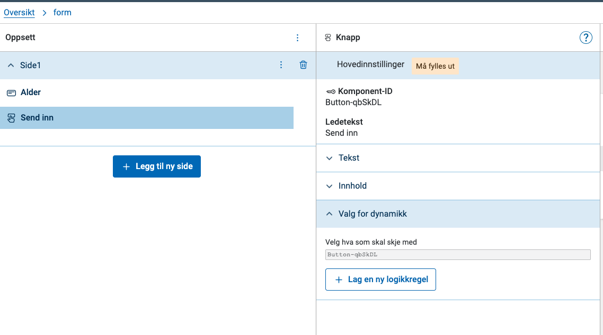
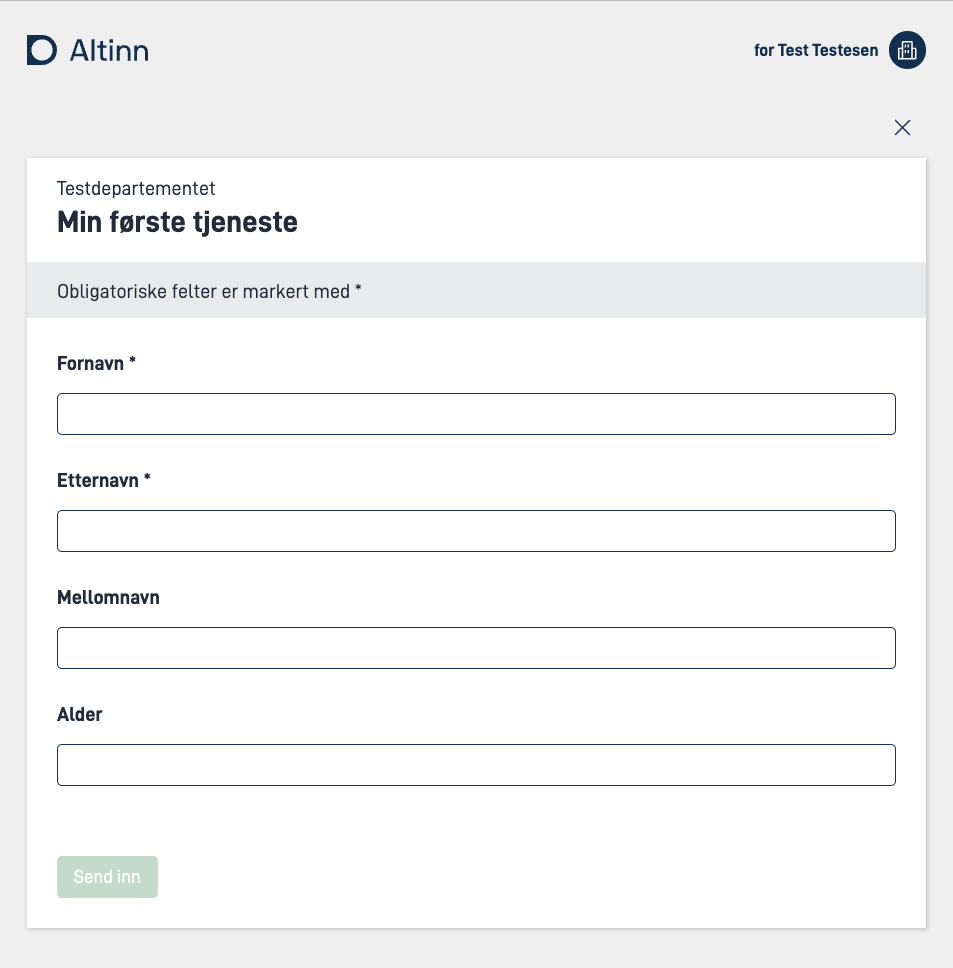
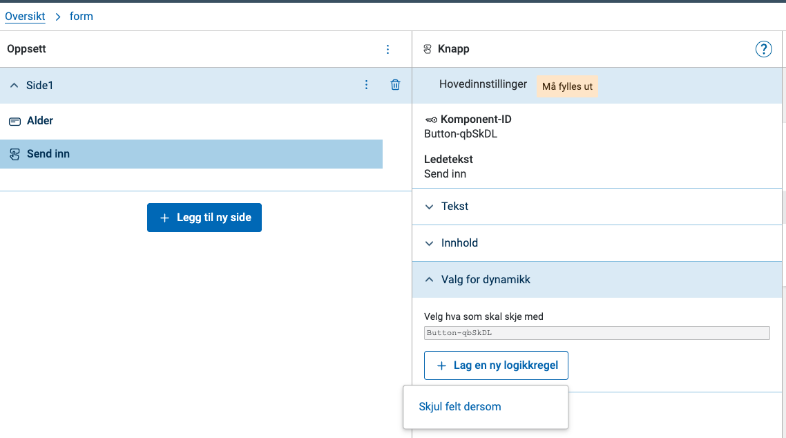
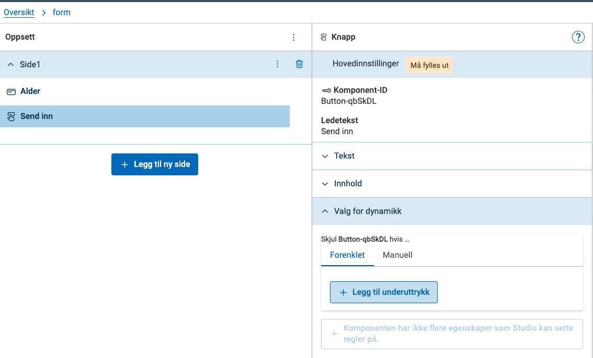
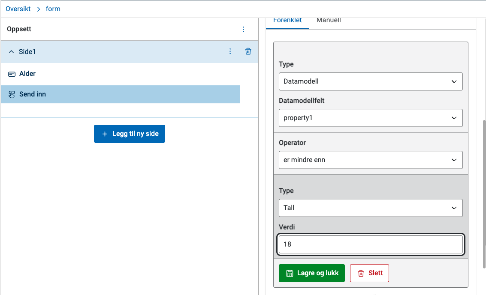
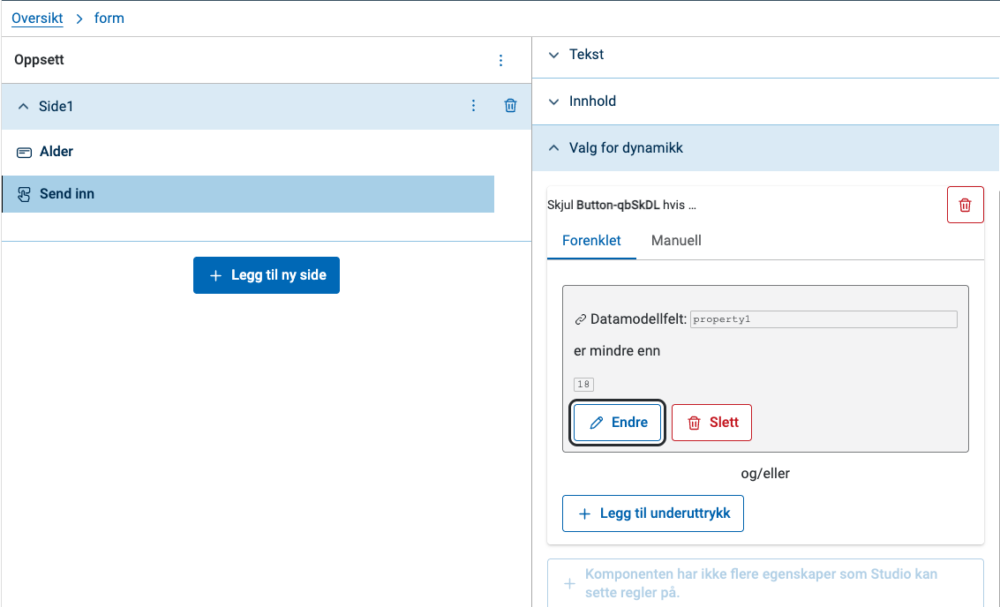
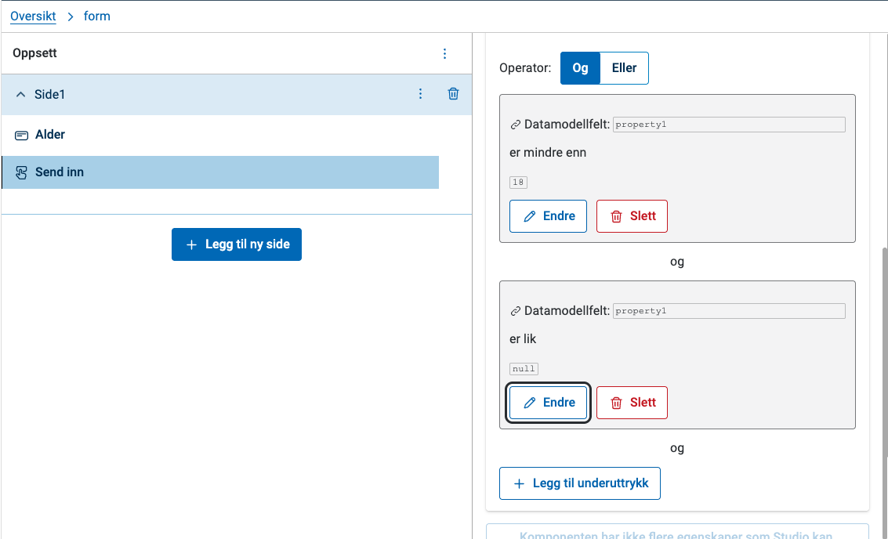

Med dynamikk kan du for eksempel skjule et felt eller gjøre det skrivebeskyttet ut fra det brukeren har fylt ut. Du setter det opp med uttrykk i **Valg for dynamikk**.

Med uttrykk kan du gi egenskaper verdier som endrer seg ut fra data i skjemaet. Se [hva du kan bruke uttrykk til, og hvordan syntaksen fungerer]().

## Terminologi

I Altinn Studio heter konseptet _logikk_, og et uttrykk heter _logikkregel_.

{}
En enhet som består av et boolsk komponentfelt og selve uttrykket, som gir en boolsk verdi (sann eller usann) når appen kjører. Det enkleste uttrykket kan bestå av ett enkelt underuttrykk, mens et mer avansert uttrykk kan bestå av flere underuttrykk kombinert med en operator.
{}

{}
En komponent har mange egenskaper du kan stille inn. Disse egenskapene kan du styre med uttrykk:
- Skjul feltet (`hidden`).
- Sett skrivebeskyttelse på feltet (`readOnly`).
- Feltet må fylles ut (`required`).
{}

{}
Den minste delen av et uttrykk. Et underuttrykk består av en funksjon og to verdier. En verdi kan være en fast verdi, eller en kilde og et sted i kilden, for eksempel et felt i datamodellen.

For eksempel:

```
["equals", "a", "b"]
```

er et underuttrykk som sjekker om verdien `"a"` og verdien `"b"` _er like_ ved hjelp av _funksjonen_ `"equals"`. Underuttrykket gir verdien «usann» (`false`), fordi «a» og «b» er ulike.
{}

{}
En verdi i et underuttrykk. Den kan være
  - _tall_: en fastsatt tallverdi
  - _tekst_: en fastsatt tekstverdi
  - _sann/usann_
  - _komponent_: verdi som er satt i en bestemt skjemakomponent
  - _datamodell_: verdi som er satt i et bestemt datamodellfelt
  - _kontekst for eksemplaret_: informasjon om eksemplaret (instansen), som app-ID, eksemplar-ID eller ID-en til den som eier eksemplaret
  - _ikke satt_: tomt felt, ingen verdi er satt

{}

{}
Funksjonen som sammenligner de to operandene, for eksempel:
  - **er lik**
  - **er ikke lik**
  - **er større enn**
  - **er mindre enn**
{}

{}
Du bruker **Og** og **Eller** til å koble sammen flere underuttrykk:
- **Og**: Alle underuttrykkene må være oppfylt samtidig.
- **Eller**: Minst ett av underuttrykkene må være oppfylt.
{}

## Bygge uttrykk i Altinn Studio

Før du starter, må du

- være inne på siden **Utforming** for appen
- ha åpnet en side i skjemaet og valgt komponenten du vil sette opp dynamikk for
- ha åpnet **Valg for dynamikk** i panelet til høyre



Eksempelet nedenfor bruker dette skjemaet. Det bruker feltet **Alder** fra datamodellen, så oppgaven må ha en datamodell. Hvis kortet for oppgaven under **Oversikt** viser «Datamodell:» uten navn, er listen over datamodellfelt tom.



**Oppgaven**:
> Skjemaet skal bare la brukeren sende inn hvis feltet **Alder** er fylt ut og verdien er 18 eller mer. Ellers skal knappen **Send inn** være skjult.

### Grunnleggende uttrykk

1. Klikk på **Lag en ny logikkregel** og velg hva som skal skje med komponenten. For en knapp er det eneste alternativet **Skjul felt dersom**.

   

   Når knappen ikke har flere egenskaper du kan sette regler på, blir **Lag en ny logikkregel** grå med teksten «Komponenten har ikke flere egenskaper som Studio kan sette regler på.»

2. Klikk på **Legg til underuttrykk** for å begynne å bygge opp uttrykket.

   

   Studio legger til et nytt underuttrykk. Det starter som «0 er lik 0», og du endrer det i neste steg.

3. Klikk på **Endre** for å redigere underuttrykket.

4. Sett opp at verdien i **Alder** skal være mindre enn 18:
   - **Øverst** velger du **Datamodell** i **Type** og feltet for alder i **Datamodellfelt**.
   - I **Operator** velger du **er mindre enn**.
   - **Nederst** velger du **Tall** i **Type** og skriver `18` i **Verdi**.

   

5. Klikk på **Lagre og lukk** for å lagre underuttrykket.

   

6. Sett opp et underuttrykk som sjekker om **Alder** er tomt:
   - Klikk på **Legg til underuttrykk**.
   - Sjekk at **Operator** øverst i regelen står på **Eller** (da må minst ett være oppfylt).
   - Gjenta stegene i punkt 4, men med disse endringene:
     - I **Operator**: Velg **er lik** i stedet for **er mindre enn**.
     - **Nederst**: Velg **Ikke satt** i **Type**. Ikke sett opp noe mer.

   

7. Test dynamikken i forhåndsvisningen:
   - Knappen **Send inn** er skjult når feltet **Alder** er tomt.
   - Hvis du skriver inn for eksempel 20 i feltet **Alder**, ser du knappen **Send inn**.
   - Hvis du skriver inn for eksempel 12 i feltet **Alder**, forsvinner knappen **Send inn**.

### Redigere uttrykket manuelt

Hver regel har fanene **Forenklet** og **Manuell**. I **Forenklet** bygger du uttrykket med valgene over. I **Manuell** kan du skrive uttrykket selv, i samme format som appen bruker.

Hvis Studio ikke kan vise et uttrykk i **Forenklet**, for eksempel et [nøstet uttrykk](#Nøsting), kan du bare redigere det i **Manuell**.

## Begrensninger i Altinn Studio

Altinn Studio har noen begrensninger når du lager uttrykk.

### Tilgjengelige komponentfelter

Studio kan bare bygge uttrykk for noen av komponentfeltene. Vi jobber med å få støtte for uttrykk knyttet til

- tekstressursbindinger på komponenter
- prosess

### <a name="Nøsting"></a>Nøsting

Studio kan bare bygge uttrykk med ett nøstenivå. En verdi i et underuttrykk kan bare være en direkte eller indirekte verdi, ikke et nytt underuttrykk. Hvis verdien er et underuttrykk, kan du bare redigere uttrykket i fanen **Manuell**.

### Egenskaper som allerede har en verdi

Hvis en egenskap på komponenten allerede har verdien `true` eller `false`, viser Studio den som en egen regel med valgene **Sann** og **Usann**. Klikk på **Gjør om til logisk uttrykk** hvis du vil bygge et uttrykk for egenskapen i stedet.

## Lagre et uttrykk

Klikk på **Lagre og lukk** for å lagre et underuttrykk. Hvis uttrykket er ugyldig, lagrer ikke Studio det, men viser en liste over feilene du må rette.
