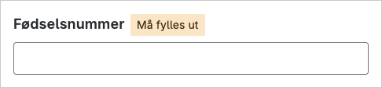
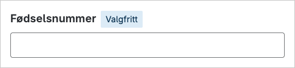
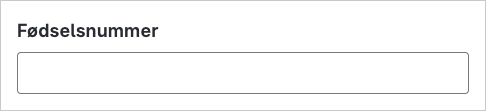

Du setter opp disse innstillingene manuelt i layoutfilen for feltet.

## Skjule etiketten for valgfrie felt

Appen merker alle felt som enten påkrevde eller valgfrie, slik at det er tydelig for brukerne hva de må fylle ut og hva de kan hoppe over:

- Påkrevde felt får etiketten **Må fylles ut**.
- Felt som ikke er påkrevde, får etiketten **Valgfritt**.
- Skrivebeskyttede felt får ikke etiketten **Valgfritt**.





Vil du skjule etiketten **Valgfritt** på et felt, setter du `optionalIndicator` til `false` i `labelSettings` på komponenten i layoutfilen:


App/ui/{taskId}/layouts/{page}.json


```json
{
  "id": "input-felt1",
  "type": "Input",
  "labelSettings": {
    "optionalIndicator": false
  }
}
```



Du kan ikke skjule **Må fylles ut** på et påkrevd felt.

## Aktivere tegngrense

Du kan sette en tegngrense for et tekstfelt ved å legge til `maxLength`-egenskapen på en komponent i layoutfilen. Da viser appen en teller med antall gjenværende tegn. Her er et eksempel på en `Input`-komponent med en tegngrense på 10 tegn:


App/ui/{taskId}/layouts/{page}.json


```json
{
  "id": "input-felt1",
  "type": "Input",
  "maxLength": 10
}
```

_Merk_: `maxLength` i layoutfilen viser bare hvor mange tegn som gjenstår. Den kontrollerer ikke antallet tegn, så brukeren kan fortsatt sende inn skjemaet selv om teksten er lengre enn grensen.
Skal du kontrollere selve antallet tegn, må du også legge til `maxLength`-egenskapen i datamodellen til skjemaet. Se [validering]() for mer informasjon.

## Konfigurere automatisk lagring

`Input`, `TextArea` og `Address` oppdaterer skjemadataene mens brukeren skriver. Som standard skjer dette 400 millisekunder etter at brukeren sist skrev noe. Med standardinnstillingen `autoSaveBehavior: "onChangeFormData"` lagrer appen endringene på serveren. Med `onChangePage` lagres de ved sideskifte. Se [innstillinger for automatisk lagring]().

Du styrer dette med `saveWhileTyping`-egenskapen på en komponent i layoutfilen. I eksempelet under oppdaterer feltet skjemadataene to sekunder etter at brukeren slutter å skrive i feltet.


App/ui/{taskId}/layouts/{page}.json


```json {hl_lines=[4]}
{
  "id": "input-felt1",
  "type": "Input",
  "saveWhileTyping": 2000
}
```

`saveWhileTyping` er en forsinkelse i millisekunder og kan ikke slå av automatisk lagring. En høy verdi er heller ikke en pålitelig måte å unngå lagring på. Andre felt og navigasjon kan føre til at appen lagrer dataene.
