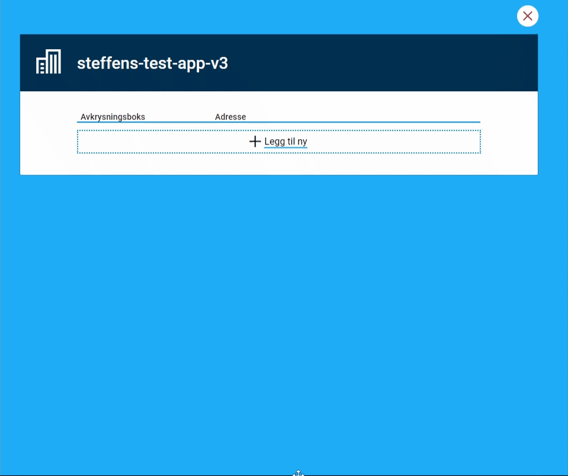

En repeterende gruppe lar brukeren fylle ut de samme feltene flere ganger i skjemaet. Brukeren kan for eksempel legge til ett familiemedlem om gangen, med navn og adresse for hver person. Hver gang brukeren legger til noe nytt, lager appen en ny rad i gruppen.

Brukeren ser radene i en tabell og kan legge til, endre og slette rader. Du bestemmer selv

- hvilke felter hver rad skal ha
- hvor mange rader brukeren kan eller må legge til
- hvordan tabellen og redigeringen av en rad skal se ut
- hvilke knapper brukeren skal se

Hvis hver oppføring har mange felter eller trenger egne steg, passer et [underskjema]() ofte bedre. Siden om underskjema forklarer hvordan du velger mellom de to.

## Slik henger gruppen sammen med datamodellen

En repeterende gruppe må være knyttet til en liste i datamodellen. Hvert element i listen er én rad i gruppen, og alle elementene har de samme feltene. Du knytter gruppen til listen og feltene i gruppen til feltene i hvert element. Siden om datamodellbindinger forklarer [bindinger i repeterende grupper]().

I JSON er listen en liste med objekter, der hvert objekt er én rad. I XML er listen et element som kan gjentas, der hvert element er én rad.

## Eksempel på et skjema med en repeterende gruppe

Skjemaet under har en repeterende gruppe som

- har to komponenter: en avkrysningsboks og en adresse
- lar brukeren legge til opptil tre rader
- er knyttet til listen `GruppeListe` i datamodellen



{}


App/ui/{taskId}/layouts/{page}.json


```json {linenos=inline}
{
  "data": {
    "layout": [
      {
        "id": "gruppe",
        "type": "RepeatingGroup",
        "children": [
          "avkrysningsboks",
          "adresse"
        ],
        "maxCount": 3,
        "dataModelBindings": {
          "group": "GruppeListe"
        }
      },
      {
        "id": "avkrysningsboks",
        "type": "Checkboxes",
        "textResourceBindings": {
          "title": "Avkrysningsboks"
        },
        "dataModelBindings": {
          "simpleBinding": "GruppeListe.Avkrysning"
        },
        "options": [
          {
            "label": "Navn",
            "value": "Verdi1"
          },
          {
            "label": "Adresse",
            "value": "Verdi2"
          }
        ],
        "required": true
      },
      {
        "id": "adresse",
        "type": "Address",
        "dataModelBindings": {
          "address": "GruppeListe.Adresse",
          "zipCode": "GruppeListe.Postnr",
          "postPlace": "GruppeListe.Poststed"
        },
        "simplified": true,
        "readOnly": false,
        "required": true
      }
    ]
  }
}
```

{}

## Sette opp en repeterende gruppe

Du kan legge til komponenten **Repeterende gruppe** i Altinn Studio Designer, eller skrive oppsettet direkte i layoutfilen til siden. Layoutfilene ligger i `App/ui/{taskId}/layouts/`.

En repeterende gruppe trenger minst

- en ID
- typen `RepeatingGroup`
- en liste over komponentene i gruppen
- en binding til listen i datamodellen

Slik ser det ut:


App/ui/{taskId}/layouts/{page}.json


```json
{
  "id": "personer",
  "type": "RepeatingGroup",
  "children": ["person-navn"],
  "dataModelBindings": {
    "group": "personer"
  }
}
```

## Egenskaper

Tabellen viser de viktigste egenskapene. [Komponentsiden for `RepeatingGroup`]() har den fullstendige listen.

| Egenskap                                                        | Påkrevd | Beskrivelse                                                                                                                                                  |
|-----------------------------------------------------------------|---------|--------------------------------------------------------------------------------------------------------------------------------------------------------------|
| `id`                                                            | Ja      | Unik ID for komponenten. Må være unik på tvers av alle sidene i layoutsettet.                                                                                |
| `type`                                                          | Ja      | Må være `RepeatingGroup`.                                                                                                                                    |
| `children`                                                      | Ja      | Listen over ID-ene til komponentene i gruppen. Appen viser komponentene én gang for hver rad.                                                               |
| `dataModelBindings`                                             | Ja      | Må ha nøkkelen `group`, som peker på listen i datamodellen.                                                                                                  |
| [`textResourceBindings`](#tekster)                              | Nei     | Tekster for tittel, beskrivelse, hjelpetekst og knapper.                                                                                                     |
| `maxCount`                                                      | Nei     | Det høyeste antallet rader brukeren kan legge til. Når gruppen har så mange rader, forsvinner **Legg til ny**-knappen.                                        |
| [`minCount`](#kontrollere-radene)                               | Nei     | Det laveste antallet rader brukeren må legge til. Gruppen viser en valideringsfeil hvis den har for få rader.                                                |
| [`edit`]()                                                 | Nei     | Innstillinger for hvordan brukeren redigerer en rad, og hvilke knapper brukeren ser.                                                                        |
| [`tableHeaders`]()                                        | Nei     | Listen over komponentene brukeren ser som kolonner i tabellen. Hvis du ikke setter den, viser tabellen alle skjemakomponentene i `children`.               |
| [`tableColumns`]()         | Nei     | Innstillinger for hver kolonne i tabellen.                                                                                                                   |
| [`rowsBefore`]() | Nei | Faste rader før de repeterende radene i tabellen.                                                                                                            |
| [`rowsAfter`]()  | Nei | Faste rader etter de repeterende radene i tabellen.                                                                                                          |
| [`stickyHeader`]()        | Nei     | Fester overskriftene i tabellen øverst mens brukeren ruller nedover.                                                                                         |
| [`pagination`](#dele-radene-inn-i-sider)                        | Nei     | Deler radene inn i sider.                                                                                                                                    |
| [`hiddenRow`](#skjule-rader)                                    | Nei     | Skjuler rader. Kan være `true`, `false` eller et uttrykk som appen vurderer for hver rad.                                                                     |
| [`showValidations`](#kontrollere-radene)                        | Nei     | Valideringstypene appen viser med en gang de oppstår.                                                                                                       |
| [`validateOnSaveRow`](#kontrollere-radene)                      | Nei     | Valideringstypene appen skal sjekke når brukeren lagrer en rad.                                                                                             |

## Tekster

Med `textResourceBindings` kan du gi gruppen en tittel og overstyre standardtekstene på knappene. Verdien er en nøkkel til en tekstressurs. Du kan bruke disse nøklene:

| Nøkkel                   | Hva teksten er til                                                                                                                  |
|--------------------------|--------------------------------------------------------------------------------------------------------------------------------------|
| `title`                  | Tittelen over gruppen. Appen viser den også over hver rad i oppsummeringen.                                                         |
| `description`            | Beskrivelsen under tittelen.                                                                                                         |
| `help`                   | Hjelpeteksten brukeren får opp ved å klikke på hjelpeknappen ved siden av tittelen.                                                |
| `summaryTitle`           | Tittelen i oppsummeringen. Overstyrer `title` der.                                                                                   |
| `summaryAccessibleTitle` | Tittelen skjermlesere leser opp for redigeringsknappen i oppsummeringen. Overstyrer både `title` og `summaryTitle`.                  |
| `addButton`              | Tekst som kommer etter standardteksten på **Legg til ny**-knappen, for eksempel «person», slik at knappen viser «Legg til ny person». |
| `addButtonFull`          | Hele teksten på **Legg til ny**-knappen. Overstyrer `addButton` hvis du har satt begge.                                              |
| `saveButton`             | Teksten på **Lagre og lukk**-knappen når brukeren redigerer en rad.                                                                  |
| `saveAndNextButton`      | Teksten på **Lagre og åpne neste**-knappen. Brukeren ser bare knappen når `edit.saveAndNextButton` er `true`.                              |
| `editButtonOpen`         | Teksten på knappen i tabellen når raden er lukket. Standardteksten er **Rediger**.                                                   |
| `editButtonClose`        | Teksten på knappen i tabellen når raden er åpen. Standardteksten er **Lagre og lukk**.                                              |
| `paginationNextButton`   | Teksten på **Neste**-knappen når radene er delt inn i sider.                                                                         |
| `paginationBackButton`   | Teksten på **Tilbake**-knappen når radene er delt inn i sider.                                                                       |
| `multipageNextButton`    | Teksten på **Neste**-knappen når redigeringen av en rad går over [flere sider]().                                          |
| `multipageBackButton`    | Teksten på **Tilbake**-knappen når redigeringen av en rad går over [flere sider]().                                        |

{}
Nøklene har nye navn i v9. De heter nå `addButton`, `addButtonFull`, `saveButton`, `saveAndNextButton`, `editButtonOpen` og `editButtonClose`. I v8 het de `add_button`, `add_button_full`, `save_button`, `save_and_next_button`, `edit_button_open` og `edit_button_close`. Når du oppgraderer appen med `studioctl app upgrade v9`, gir verktøyet nøklene de nye navnene.
{}

## Skjule rader

Med `hiddenRow` kan du skjule rader som oppfyller bestemte krav. Du skriver kravet som et [dynamisk uttrykk](). Appen vurderer uttrykket for hver rad og skjuler raden når uttrykket gir `true`. Hvis du setter `hiddenRow` til `true`, skjuler appen alle radene.

Eksempelet skjuler alle rader der fornavnet er «John»:


App/ui/{taskId}/layouts/{page}.json


```json {hl_lines=[4]}
{
  "id": "personer",
  "type": "RepeatingGroup",
  "hiddenRow": ["equals", ["dataModel", "personer.fornavn"], "John"],
  "children": ["person-fornavn"],
  "dataModelBindings": {
    "group": "personer"
  }
}
```

Inne i en repeterende gruppe trenger du ikke å oppgi radnummeret i uttrykket. Appen finner selv riktig rad.

Hvis du vil skjule en hel kolonne i tabellen i stedet for en rad, kan du [skjule kolonner]().

## Dele radene inn i sider

Hvis gruppen kan få mange rader, kan du dele radene inn i sider. Brukeren blar da mellom sidene med knapper under radene. Du setter antallet rader per side i `pagination.rowsPerPage`:


App/ui/{taskId}/layouts/{page}.json


```json {hl_lines=["8-10"]}
{
  "id": "personer",
  "type": "RepeatingGroup",
  "children": ["person-fornavn", "person-etternavn"],
  "dataModelBindings": {
    "group": "personer"
  },
  "pagination": {
    "rowsPerPage": 5
  }
}
```

Dette skjer når du deler radene inn i sider:

- Brukeren ser sideknappene først når gruppen har flere rader enn `rowsPerPage`.
- Skjulte rader teller ikke med.
- Sideinndelingen virker både i tabellvisningen og når du viser alle radene åpne med `"mode": "showAll"`.
- Når brukeren åpner en rad som ligger på en annen side, går appen til den siden.
- Når brukeren bytter side, lukker appen raden som er åpen.

Du kan endre tekstene på knappene med `paginationNextButton` og `paginationBackButton`, se [Tekster](#tekster).

## Kontrollere radene

Du kan kontrollere radene i gruppen på tre måter:

- Med `minCount` bestemmer du hvor mange rader brukeren må legge til. Gruppen viser en valideringsfeil hvis den har for få rader.
- Med `validateOnSaveRow` kontrollerer appen raden når brukeren lagrer den. Hvis raden har valideringsfeil, må brukeren rette feilene før det går an å lukke raden. Se [gruppevalidering]().
- Med `showValidations` viser appen valideringsfeil med en gang de oppstår. Appen venter ikke til brukeren går videre. Se [enkeltfeltvalidering]().


App/ui/{taskId}/layouts/{page}.json


```json {hl_lines=["8-9"]}
{
  "id": "personer",
  "type": "RepeatingGroup",
  "children": ["person-fornavn", "person-etternavn"],
  "dataModelBindings": {
    "group": "personer"
  },
  "minCount": 1,
  "validateOnSaveRow": ["All"]
}
```

## Spørsmål du kan stille utviklerne

- Er listen i datamodellen satt opp slik at den passer med feltene i gruppen?
- Hva skjer hvis brukeren sletter en rad med mye data? Bør brukeren bekrefte slettingen?
- Har vi testet gruppen med mange rader, også på mobil?
- Hvordan ser radene ut i oppsummeringen og i PDF-en?
- Hvis gruppen har vedlegg: Klarer mottakeren å se hvilket vedlegg som hører til hvilken rad?


