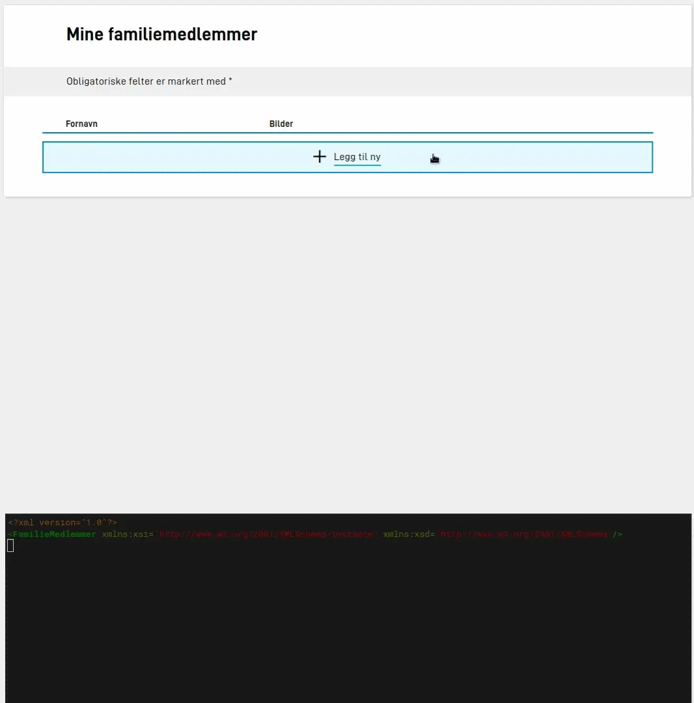

Du kan la brukeren laste opp vedlegg i hver rad i en repeterende gruppe, for eksempel et bilde av hvert familiemedlem. Da må mottakeren kunne se hvilket vedlegg som hører til hvilken rad. Derfor må vedleggskomponenten i gruppen være knyttet til et felt i datamodellen. Appen fyller inn den unike ID-en til vedlegget i feltet og sender den med resten av dataene.

Du kan også knytte et vedlegg til datamodellen utenfor en repeterende gruppe, hvis mottakeren skal ha en referanse til vedlegget sammen med skjemadataene.



## Sett opp vedlegg i Altinn Studio Designer

1. Legg til et felt i datamodellen for hvert element i listen. Feltet skal inneholde ID-en til vedlegget, og typen er tekst.
2. Legg til komponenten **Vedlegg** i den repeterende gruppen.
3. Åpne **Datamodeller** i egenskapene til komponenten, og velg feltet fra steg 1.
4. Hvis brukeren skal kunne laste opp flere filer i samme komponent, slår du på **Legg til knytning for flere vedlegg**. Feltet i datamodellen må da være en liste.

Når vedleggskomponenten ligger i en repeterende gruppe, minner Designer deg på at komponenten må ha en knytning til datamodellen. Uten knytningen gir appen en feil.

## Sette opp vedlegg i koden

Datamodellen under har et felt, `Bilde`, som skal inneholde ID-en til vedlegget for hvert familiemedlem:


App/models/{model}.xsd


```xml {hl_lines=[12]}
<xsd:schema xmlns:xsd="http://www.w3.org/2001/XMLSchema" elementFormDefault="qualified" attributeFormDefault="unqualified">
  <xsd:element name="FamilieMedlemmer" type="Skjema" />
  <xsd:complexType name="Skjema">
    <xsd:sequence>
      <xsd:element name="FamilieMedlem" type="FamilieMedlem" maxOccurs="99" />
    </xsd:sequence>
    <xsd:anyAttribute />
  </xsd:complexType>
  <xsd:complexType name="FamilieMedlem">
    <xsd:sequence>
      <xsd:element name="Fornavn" type="xsd:string" />
      <xsd:element name="Bilde" type="xsd:string" />
    </xsd:sequence>
  </xsd:complexType>
</xsd:schema>
```

Du knytter vedleggskomponenten i gruppen til feltet med `simpleBinding`:


App/ui/{taskId}/layouts/{page}.json


```json {hl_lines=[8]}
{
  "id": "bilde",
  "type": "FileUpload",
  "textResourceBindings": {
    "title": "bilde.tittel"
  },
  "dataModelBindings": {
    "simpleBinding": "FamilieMedlem.Bilde"
  },
  "maxFileSizeInMB": 25,
  "maxNumberOfAttachments": 1,
  "minNumberOfAttachments": 1,
  "displayMode": "simple",
  "required": true
}
```

### Flere filer i samme komponent

Hvis brukeren kan laste opp flere filer i samme vedleggskomponent, må feltet i datamodellen være en liste, og du bruker bindingen `list`:


App/models/{model}.xsd


```xml {hl_lines=[4]}
<xsd:complexType name="FamilieMedlem">
  <xsd:sequence>
    <xsd:element name="Fornavn" type="xsd:string" />
    <xsd:element name="Bilder" type="xsd:string" maxOccurs="5" />
  </xsd:sequence>
</xsd:complexType>
```


App/ui/{taskId}/layouts/{page}.json


```json {hl_lines=[5]}
{
  "id": "bilder",
  "type": "FileUpload",
  "dataModelBindings": {
    "list": "FamilieMedlem.Bilder"
  }
}
```

Mottakeren får da en liste med én unik ID for hvert vedlegg.
