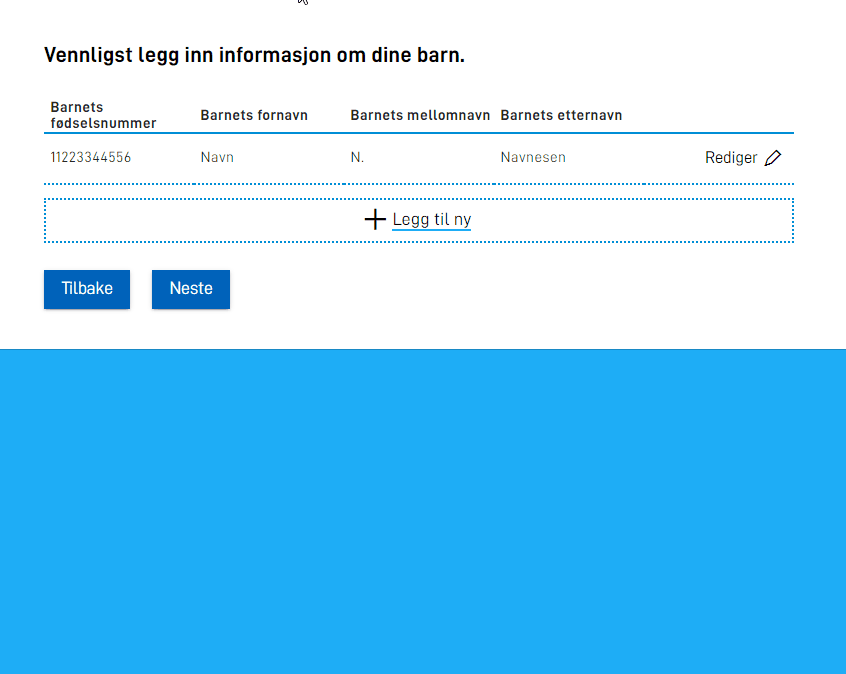

Har hver rad mange felter, må brukeren rulle mye og mister lett oversikten. Da kan du dele feltene i raden inn i flere sider. Brukeren blar mellom sidene med knappene **Neste** og **Tilbake**.

Sidene finnes bare inne i raden. Resten av skjemaet endrer seg ikke når brukeren blar.

## Del raden inn i sider

1. Sett `"multiPage": true` i `edit` på gruppen.
2. Sett et sidenummer og et kolon foran hver komponent-ID i `children`. Appen viser sidene i rekkefølge etter nummeret. Det vanlige er å starte på `0`, slik at den første siden har nummer `0`, den andre `1` og så videre. En komponent på den første siden skriver du altså som `0:komponent-id`.


App/ui/{taskId}/layouts/{page}.json


```json {hl_lines=["5-8", "14-15"]}
{
  "id": "barn",
  "type": "RepeatingGroup",
  "children": [
    "0:fnr",
    "1:fornavn",
    "1:mellomnavn",
    "1:etternavn"
  ],
  "dataModelBindings": {
    "group": "familie.barn"
  },
  "edit": {
    "multiPage": true,
    "mode": "hideTable"
  }
}
```

Når `multiPage` er `true`, må alle ID-ene i `children` ha et sidenummer. Hvis én ID mangler sidenummer, gir appen en feil.

Eksempelet bruker også [`"mode": "hideTable"`](), som skjuler tabellen mens brukeren redigerer en rad. Resultatet ser slik ut:



## Slik oppfører sidene seg

- Hvis alle komponentene på en side er skjult, hopper appen over siden.
- Du kan endre tekstene på knappene med `multipageNextButton` og `multipageBackButton` i `textResourceBindings`, se [Tekster]().
