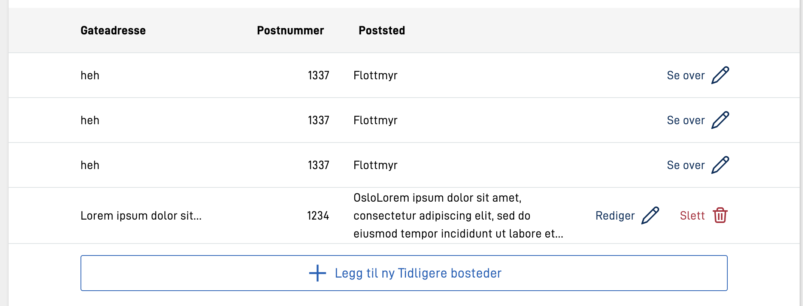
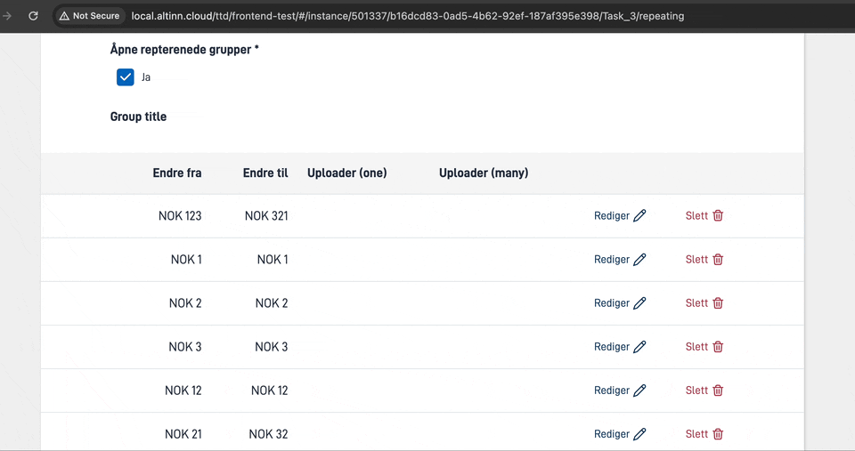
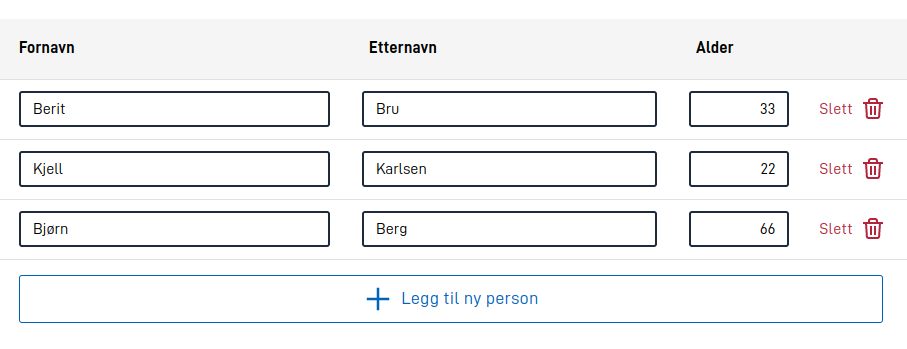
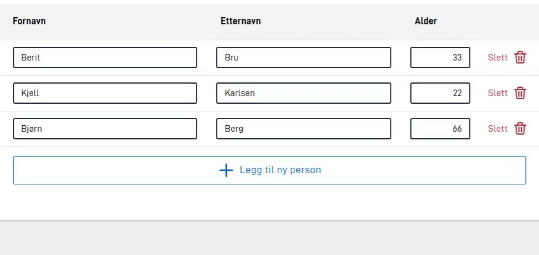
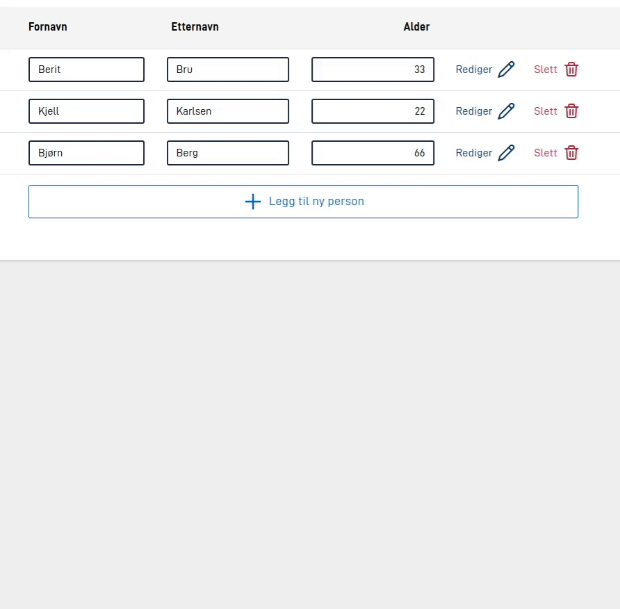
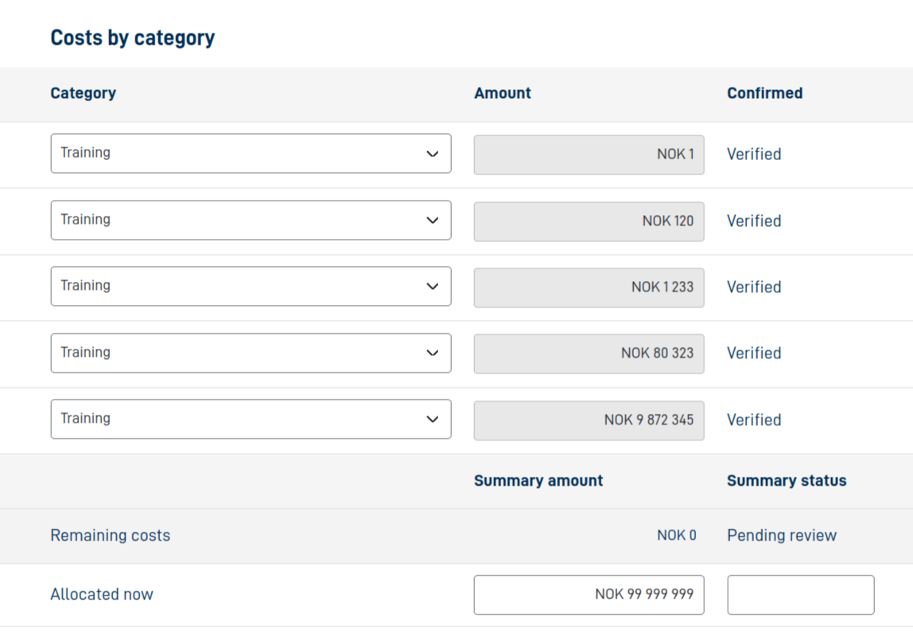

Når radene i en repeterende gruppe ikke er åpne, viser appen dem i en tabell. Med [`edit.mode` satt til `"showAll"`]() viser appen ingen tabell, og innstillingene på denne siden har ingen virkning. Komponentene i gruppen blir kolonner i tabellen. Du bestemmer selv hvilke kolonner brukeren ser, hvor brede de er, og om brukeren kan redigere direkte i tabellen.

På mobil og nettbrett viser appen ingen overskriftsrad. Hver rad blir én celle der verdiene står under hverandre, med tittelen på kolonnen foran. Komponenter brukeren redigerer i tabellen, viser appen som hele komponenter med ledetekst.

## Velge kolonner

Med `tableHeaders` bestemmer du hvilke komponenter brukeren ser som kolonner i tabellen, og i hvilken rekkefølge. Hvis du ikke setter `tableHeaders`, viser tabellen alle skjemakomponentene i `children`, altså komponentene brukeren fyller ut. I tillegg tar tabellen med komponentene `Text`, `Number`, `Date` og `Option`.


App/ui/{taskId}/layouts/{page}.json


```json {hl_lines=[5]}
{
  "id": "adresser",
  "type": "RepeatingGroup",
  "children": ["gateadresse", "postnummer", "poststed", "kommentar"],
  "tableHeaders": ["gateadresse", "postnummer", "poststed"],
  "dataModelBindings": {
    "group": "adresser"
  }
}
```

## Gi kolonnene kortere titler

Tabellen har lite plass til lange ledetekster. Du kan gi en komponent en kortere tittel i tabellen med nøkkelen `tableTitle` i `textResourceBindings` på komponenten:


App/ui/{taskId}/layouts/{page}.json


```json {hl_lines=[6]}
{
  "id": "fullt-navn",
  "type": "Input",
  "textResourceBindings": {
    "title": "fullt-navn.tittel",
    "tableTitle": "fullt-navn.tabelltittel"
  },
  "dataModelBindings": {
    "simpleBinding": "personer.navn"
  }
}
```

## Bredde, justering og lang tekst

Med `tableColumns` kan du sette egenskaper for hver kolonne. Nøkkelen er ID-en til komponenten i kolonnen. Du kan bruke disse innstillingene:

- `width` er bredden på kolonnen i prosent, for eksempel `"25%"`, eller `"auto"`. Standardverdien er `"auto"`.
- `alignText` plasserer teksten i cellene til venstre (`"left"`), i midten (`"center"`) eller til høyre (`"right"`). Standard er venstre. Et `Input`-felt med tallformat (`formatting.number`) står til høyre hvis kolonnen er med i `tableColumns`.
- `textOverflow` bestemmer hva som skjer når teksten er for lang for cellen:
  - `lineWrap` bestemmer om appen skal korte ned lang tekst. Med `false` viser appen hele teksten. Standardverdien er `true`.
  - `maxHeight` er antallet linjer appen viser før den kutter resten av teksten og setter inn tre prikker (…). Standardverdien er `2`. Med `0` viser appen hele teksten.
- `hidden` skjuler kolonnen, se [Skjule kolonner](#skjule-kolonner).
- `editInTable` lar brukeren redigere komponenten direkte i tabellen. Standardverdien er `false`. Se [Redigere direkte i tabellen](#redigere-direkte-i-tabellen).
- `showInExpandedEdit` bestemmer om komponenten skal være med når brukeren åpner raden. Standardverdien er `true`. Se [Redigere noen felter i tabellen](#redigere-noen-felter-i-tabellen).

Appen korter bare ned tekst i kolonner som er med i `tableColumns`. Overskriftene og felter brukeren redigerer i tabellen, korter den ikke ned.


App/ui/{taskId}/layouts/{page}.json


```json
{
  "tableHeaders": ["gateadresse", "postnummer", "poststed"],
  "tableColumns": {
    "gateadresse": {
      "width": "20%",
      "alignText": "left",
      "textOverflow": {
        "lineWrap": true,
        "maxHeight": 1
      }
    },
    "postnummer": {
      "alignText": "right"
    },
    "poststed": {
      "width": "auto",
      "alignText": "left",
      "textOverflow": {
        "lineWrap": true,
        "maxHeight": 3
      }
    }
  }
}
```



## Skjule kolonner

Du kan skjule en kolonne ved å sette `hidden` til `true` i `tableColumns`. Du kan også bruke et [dynamisk uttrykk](). Appen skjuler da kolonnen når uttrykket gir `true`.

Uttrykket gjelder hele kolonnen, ikke hver rad. Appen vurderer det én gang for tabellen, ikke for hver rad slik den gjør med [`hiddenRow`]().


App/ui/{taskId}/layouts/{page}.json


```json
{
  "tableHeaders": ["navn", "fodselsnummer", "adresse"],
  "tableColumns": {
    "fodselsnummer": {
      "hidden": ["equals", ["component", "er-person"], false]
    },
    "adresse": {
      "hidden": true
    }
  }
}
```

## Feste overskriftene i tabellen

Med `"stickyHeader": true` blir overskriftene i tabellen liggende øverst mens brukeren ruller nedover. Det er nyttig i tabeller med mange rader, der brukeren ellers mister oversikten over hvilken kolonne som er hvilken.



## Redigere direkte i tabellen

Du kan la brukeren redigere komponenter direkte i tabellen, uten å åpne raden. Det passer for små komponenter, der det er unødvendig å åpne raden for å endre en verdi. Tabellen kan ligne på [Grid-komponenten](), men brukeren kan legge til og fjerne rader. Appen lagrer dataene i listen i datamodellen.



Brukeren kan ikke redigere alle typer komponenter i tabellen. Disse skjemakomponentene virker i tabellen:

- `Input`
- `TextArea`
- `Dropdown`
- `MultipleSelect`
- `Checkboxes`
- `RadioButtons`
- `Datepicker`
- `TimePicker`
- `ImageUpload`
- `Custom`

Andre komponenter, for eksempel `Address` og `FileUpload`, viser bare verdien i tabellen. Brukeren må da åpne raden for å endre dem.

### Redigere alle felter i tabellen

Hvis brukeren skal redigere alle feltene i tabellen, setter du [`edit.mode` til `"onlyTable"`](). Da kan brukeren redigere alle feltene i tabellen som er av en type som støtter det, og **Rediger**-knappen forsvinner. De andre feltene viser bare verdien. Hvis det er én kolonne brukeren ikke skal redigere, setter du `editInTable` til `false` for den kolonnen i `tableColumns`.



### Redigere noen felter i tabellen

Du kan også la brukeren redigere noen felter i tabellen og resten når raden er åpen. Slik gjør du det i `tableColumns`:

- Sett `editInTable` til `true` på komponentene brukeren skal kunne redigere i tabellen.
- Sett `showInExpandedEdit` til `false` på komponentene som ikke skal være med når brukeren åpner raden.

Setter du `showInExpandedEdit` til `false` uten å sette `editInTable` til `true`, kan brukeren ikke fylle ut komponenten noe sted. Appen regner den da som skjult og kontrollerer den ikke. Dette gjelder ikke når `mode` er `"onlyTable"` eller `"showAll"`.



I eksempelet over kan brukeren redigere fornavn og etternavn bare i tabellen. Alder kan brukeren redigere både i tabellen og når raden er åpen. Adressen kan brukeren bare redigere når raden er åpen.

Slik ser oppsettet for eksempelet ut:


App/ui/{taskId}/layouts/{page}.json


```json
{
  "id": "personer",
  "type": "RepeatingGroup",
  "children": ["fornavn", "etternavn", "alder", "fullt-navn", "adresse"],
  "tableHeaders": ["fornavn", "etternavn", "alder"],
  "tableColumns": {
    "fornavn": {
      "editInTable": true,
      "showInExpandedEdit": false
    },
    "etternavn": {
      "editInTable": true,
      "showInExpandedEdit": false
    },
    "alder": {
      "editInTable": true
    }
  },
  "textResourceBindings": {
    "addButton": "person"
  },
  "dataModelBindings": {
    "group": "RepGroup.Personer"
  }
}
```

## Faste rader før og etter de repeterende radene

Med `rowsBefore` og `rowsAfter` kan du legge til faste rader i tabellen:

- `rowsBefore` kommer før de repeterende radene.
- `rowsAfter` kommer etter de repeterende radene.

Faste rader passer for innhold som bare hører hjemme i tabellen, for eksempel summer, forklaringer eller en ekstra overskriftsrad. Med `rowsAfter` kan du for eksempel lage en bunnlinje med summer eller totaler.

Radene og cellene har samme oppbygning som i [Grid-komponenten](). Hver rad har en liste med celler i `cells`, og du kan sette disse egenskapene på raden:

- `header` gjør raden til en overskriftsrad. Standardverdien er `false`.
- `readOnly` gir raden grå bakgrunn. Brukeren kan fortsatt endre komponentene i raden. Hvis en komponent ikke skal kunne endres, setter du `readOnly` på selve komponenten. Standardverdien er `false`.

En celle kan være

- en tekst, med `{ "text": "tekstnøkkel" }`
- en komponent, med `{ "component": "komponent-id" }`
- ledeteksten til en annen komponent, med `{ "labelFrom": "komponent-id" }`
- tom, med `{}` eller `null`

Komponentene i cellene må være komponenter som kan vises i en tabell. Det gjelder komponentene i listen under [Redigere direkte i tabellen](#redigere-direkte-i-tabellen), og i tillegg blant annet `Text`, `Number`, `Date`, `Paragraph`, `Heading`, `Image`, `Link` og `Button`. Appen viser ikke andre komponenter i cellene.

Dette gjelder for de faste radene:

- De følger de samme kolonnene som resten av tabellen. Hvis du skjuler en kolonne i `tableColumns`, skjuler appen den også i de faste radene.
- Appen viser dem ikke når gruppen er tom.
- På mobil og nettbrett viser appen bare komponentene i de faste radene, ikke tekstcellene.


App/ui/{taskId}/layouts/{page}.json


```json
{
  "id": "kostnader",
  "type": "RepeatingGroup",
  "children": ["kategori", "belop", "bekreftet"],
  "tableHeaders": ["kategori", "belop", "bekreftet"],
  "tableColumns": {
    "kategori": {
      "width": "50%"
    },
    "belop": {
      "width": "30%",
      "editInTable": true
    },
    "bekreftet": {
      "width": "20%",
      "editInTable": true
    }
  },
  "dataModelBindings": {
    "group": "kostnader"
  },
  "rowsAfter": [
    {
      "header": true,
      "cells": [
        {},
        { "text": "sum-belop" },
        { "text": "sum-status" }
      ]
    },
    {
      "readOnly": true,
      "cells": [
        { "text": "gjenstaende-kostnader" },
        { "component": "gjenstaende-belop" },
        { "component": "gjenstaende-bekreftet" }
      ]
    },
    {
      "readOnly": false,
      "cells": [
        { "text": "fordelt-na" },
        { "component": "fordelt-belop" },
        { "component": "fordelt-status" }
      ]
    }
  ]
}
```



### Slå sammen celler og skjule kolonner i de faste radene

En celle i en fast rad kan strekke seg over flere kolonner. Det gjør du med `cellStyle.colSpan`. Cellene som den sammenslåtte cellen dekker, må du fjerne fra listen. Hvis du setter dem til `null`, blir de tomme celler i en ekstra kolonne.

Hvis du vil skjule en kolonne bare i de faste radene, setter du `columnOptions.hidden` på cellen i den første overskriftsraden (`"header": true`) i `rowsBefore` eller `rowsAfter`. Innstillingen gjelder bare radene i samme liste. Du kan bruke `true` eller et uttrykk.

Eksempelet under hører til tabellen med kolonnene `kategori`, `belop` og `bekreftet`. Raden i `rowsBefore` har en celle som dekker de to første kolonnene. I `rowsAfter` skjuler appen den siste kolonnen:


App/ui/{taskId}/layouts/{page}.json


```json
{
  "rowsBefore": [
    {
      "header": true,
      "cells": [
        { "text": "oppsummering", "cellStyle": { "colSpan": 2 } },
        { "text": "status" }
      ]
    }
  ],
  "rowsAfter": [
    {
      "header": true,
      "cells": [
        {},
        { "text": "sum-belop" },
        { "text": "sum-status", "columnOptions": { "hidden": true } }
      ]
    }
  ]
}
```

{}
Unngå å la en sammenslått celle dekke en skjult kolonne. Appen viser fortsatt tabellen, men oppsettet blir kanskje ikke slik du venter. Appen skriver da en advarsel i loggen i utviklerverktøyene (DevTools) som forteller hvilken celle som dekker en skjult kolonne.
{}
