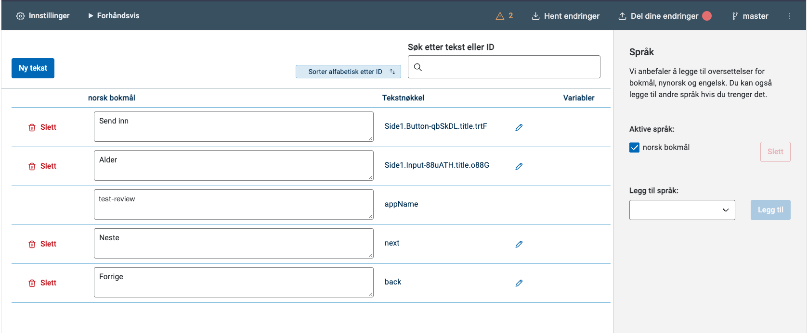
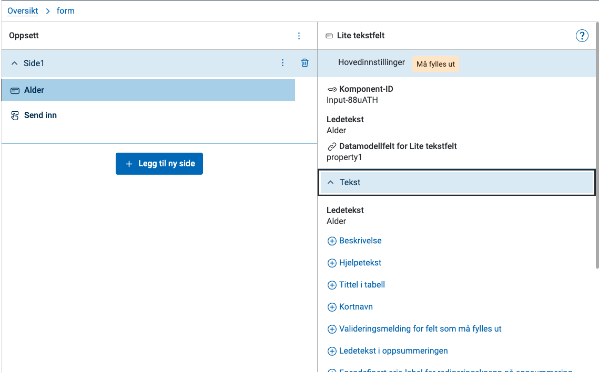
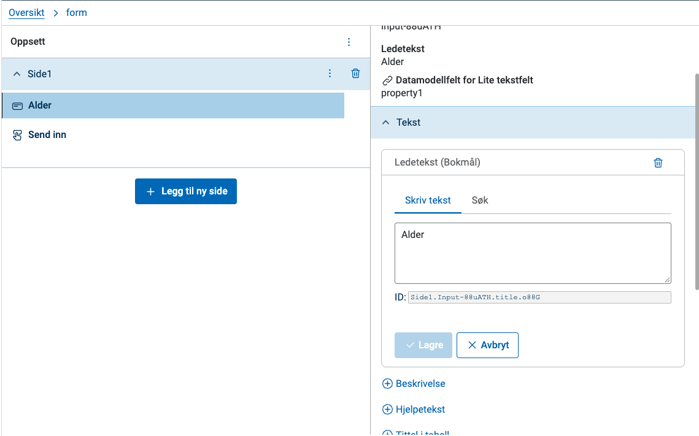
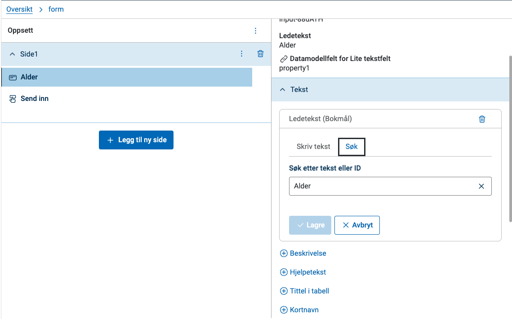
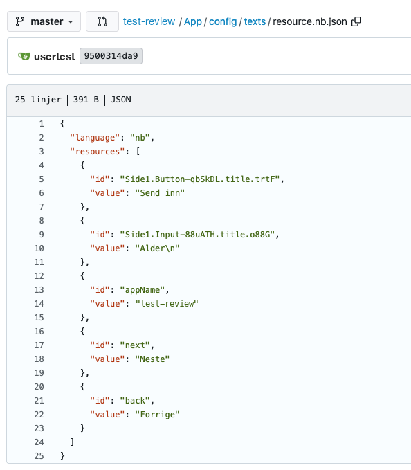
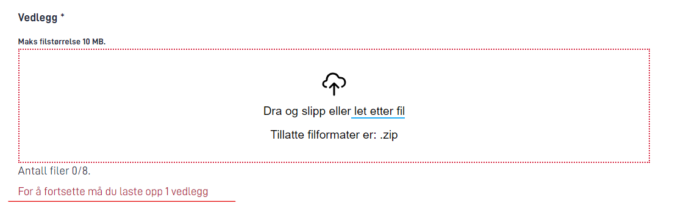
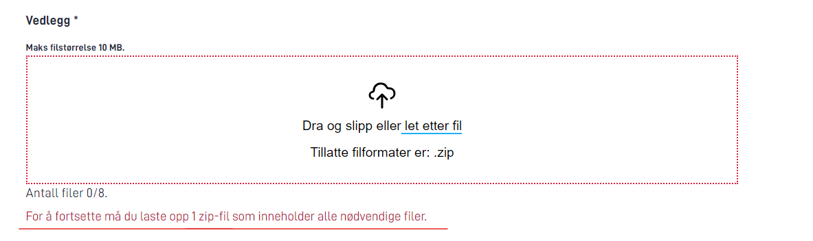
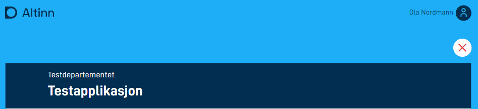
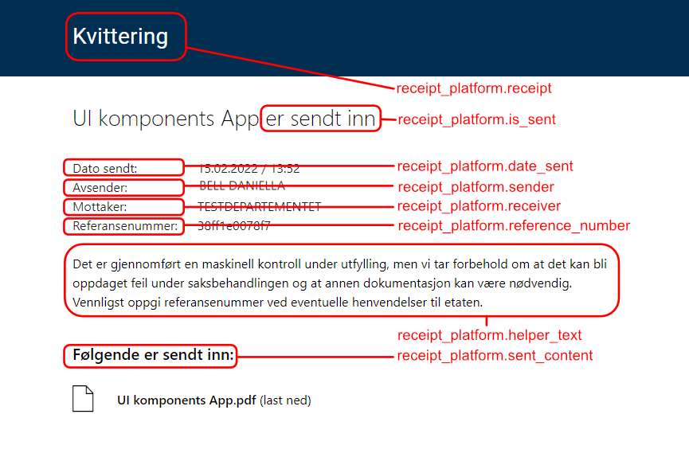

Du lagrer tekster i ressursfiler i katalogen `App/config/texts`. Tekstene kan komme fra felles bibliotek, datamodellen, eller du kan legge dem inn manuelt.

Tekstressursene er tilgjengelige når du redigerer komponenter i skjemaet i Altinn Studio Designer, og appen viser dem til brukeren når brukeren åpner skjemaet.

Tekstene ligger i JSON-filer, én fil per språk. Filnavnet følger formatet `resource.[språk].json`, for eksempel _resource.nb.json_.

Du kan redigere tekstene lokalt, direkte i JSON-filene, eller i teksteditoren i Designer.

## Formatere tekster

Du kan formatere alle tekster med markdown. Under ser du de vanligste formateringene.

Se [Markdown Cheatsheet](https://github.com/adam-p/markdown-here/wiki/Markdown-Cheatsheet) for flere formateringer og tips.

### Uthevede tekster

Slik gjør du ord eller setninger fete eller kursive:

```markdown
Dette er en _kursiv tekst_ laget med understrek.
Dette er også en *kursiv tekst* laget med stjerne.
```

```markdown
Dette er __fet tekst__ laget med understrek.
Dette er også **fet tekst**, men laget med stjerner!
```

### Linjeskift

Et enkelt `\n` gir ikke synlig linjeskift. Appen viser teksten på én linje. Vil du at teksten skal fortsette på en ny linje, bruker du to linjeskift etter hverandre (`\n\n`):

```markdown
Dette er en tekst.\n\nDette er en tekst på neste linje. 
```

Alternativt kan du bruke HTML:
```markdown
Dette er en tekst.<br/>Dette er en tekst på neste linje.
```

### Lenker

For enkle lenker kan du bruke markdown-syntaks:

```markdown
Åpne [forsiden av Altinn](https://altinn.no).
```

Lenker åpner i en ny fane som standard. Vil du at lenken skal åpne i samme fane, bruker du HTML med klassen `same-window`:

```html
Gå til <a href="https://altinn.no" class="same-window">forsiden av Altinn</a>.
```

Når du velger at lenken skal åpne i samme fane, forlater brukerne skjemaet idet de klikker på lenken. Appen lagrer tilstanden til skjemaet i instansen, slik at brukerne kan vende tilbake senere.

### Overskrifter

Slik lager du overskrifter:

```markdown
# Dette er en stor heading (H1)

## Dette er en litt mindre heading (H2)

### Og enda litt mindre (H3)

#### Bitteliten heading (H4)
```

## Legge til og endre tekster i en app

Du har to alternativer når du skal endre tekster i en app: i Altinn Studio Designer eller direkte i repoet.

### Altinn Studio Designer

#### Teksteditor

I toppmenyen i Altinn Studio Designer velger du **Språk** for å redigere tekster. Der får du en oversikt over tekstene som allerede er tilgjengelige for appen.

På denne siden kan du redigere eksisterende tekster og legge til nye tekstressurser. Du legger til en ny tekst ved å klikke på **Ny tekst**. Altinn Studio lager en unik tekstnøkkel automatisk. Du kan endre den ved å klikke på blyantikonet ved siden av nøkkelen. Altinn Studio lagrer endringene underveis.

I panelet til høyre, under **Aktive språk**, velger du hvilke språk tabellen skal vise. Det gjør det enklere å oversette. Under **Legg til språk** kan du legge til nye språk du vil oversette appen til.



#### Direkte i komponentredigeringen

Når du konfigurerer en komponent på siden **Utforming**, kan du legge til, redigere og oversette tekster for komponenten direkte i panelet til høyre, under **Tekst**.

Legg til en tekst ved å klikke på teksten du vil legge til, for eksempel **Beskrivelse** eller **Hjelpetekst**.


Rediger en tekst ved å klikke på den, for eksempel **Ledetekst**. Skriv teksten i fanen **Skriv tekst**, og klikk på **Lagre**.


Bruk en tekst som finnes fra før ved å klikke på fanen **Søk**. Søk etter teksten eller ID-en, velg teksten og klikk på **Lagre**.


### Legge til og endre tekster i repoet

Skal du endre mange tekster samtidig, anbefaler vi at du redigerer dem direkte i repoet — enten i Gitea eller i en lokal klone i kodeeditoren du selv velger.

Du finner tekstene i `App/config/texts`.



## Endre standardtekster og feilmeldinger i appen

Du kan endre standardtekster og feilmeldinger som appen viser.
Du finner nøklene og standardverdiene i filene for [engelsk](https://github.com/Altinn/altinn-studio/blob/main/src/common/ts/language/src/texts/en.ts),
[norsk bokmål](https://github.com/Altinn/altinn-studio/blob/main/src/common/ts/language/src/texts/nb.ts) og [nynorsk](https://github.com/Altinn/altinn-studio/blob/main/src/common/ts/language/src/texts/nn.ts).

Noen standardtekster har en plassholder for et tall. Et eksempel er `form_filler.file_uploader_validation_error_file_number`, som appen viser hvis brukeren har lastet opp for få vedlegg: «For å fortsette må du laste opp {0} vedlegg». Appen erstatter `{0}` med minimum antall vedlegg for komponenten.



Hvis du endrer en slik tekst, fyller ikke appen inn tallet. Skriv derfor hele teksten, inkludert tallet.

Legg til tekstnøkkelen og den nye verdien i `App/config/texts/resource.{språk}.json`. Bruk hele nøkkelen, inkludert prefikset (for eksempel `form_filler.`).


App/config/texts/resource.{language}.json


```json
    {
      "id": "form_filler.file_uploader_validation_error_file_number",
      "value": "For å fortsette må du laste opp 1 zip-fil som inneholder alle nødvendige filer."
    }
```

Dette gir en feilmelding som vist under:


## Variabler i tekster

Du kan sette inn variabler i tekster ved å følge oppsettet under. Appen setter inn variablene i samme rekkefølge som plassholderne i teksten. Den første variabelen erstatter `{0}`, den andre `{1}` og så videre.


App/config/texts/resource.{language}.json


```json
{
  "id": "good.text.id",
  "value": "Hello, {0}! Here is a second variable {1}.",
  "variables": [
    {
      "key": "<datamodelField>",
      "dataSource": "dataModel.<dataModelName>"
    },
    {
      "key": "<settings key>",
      "dataSource": "applicationSettings"
    },
    {
      "key": "<instance value key>",
      "dataSource": "instanceContext"
    },
    {
      "key": "<custom text parameter key>",
      "dataSource": "customTextParameters"
    }
  ]
}
```

### Datakilder

Du kan hente verdier fra fire ulike datakilder:

1. **Datamodell**  
   Ved å angi `dataModel.<dataModelNavn>` som datakilde kan du hente verdier fra felt i skjemaet som brukeren fyller ut. Du kan hente data fra felt uavhengig av om de er synlige eller ikke. Endrer brukeren data i et felt en variabel refererer til, oppdaterer appen teksten når brukeren slutter å skrive i feltet. Bruk `dataModel.default` for å hente fra standarddatamodellen til oppgaven.
2. **Innstillinger**  
   Ved å angi `applicationSettings` som datakilde kan du hente verdier fra en egen seksjon i `appsettings.{miljø}.json`-filene, kalt `FrontEndSettings`. Du kan legge til nye verdier uten å endre koden, og ha ulike verdier i hvert miljø. Skriv nøkkelen nøyaktig slik den står i `FrontEndSettings`. Legg merke til at `FrontEndSettings` og `applicationSettings` bruker stor forbokstav forskjellig.

   
   App/appsettings.json
   

   ```json
   "FrontEndSettings": {
     "HomeBaseUrl": "https://www.testdirektoratet.no"
   },
   ```
3. **Instans**  
   Ved å angi `instanceContext` som datakilde kan du hente enkelte verdier fra den aktive instansen — du har ikke tilgang til hele instansobjektet. Så langt kan du hente disse egenskapene:
   1. `instanceOwnerPartyId` inneholder aktørens party-ID.
   2. `instanceId` inneholder ID-en til den aktive instansen.
   3. `appId` inneholder ID-en til appen instansen hører til.
   4. `instanceOwnerPartyType` inneholder typen aktør: `org`, `person`, `selfIdentified` eller `unknown`.
   5. `instanceOwnerName` inneholder navnet på aktøren.
4. **Egendefinerte tekstparametere**  
   Ved å angi `customTextParameters` som datakilde kan du hente egendefinerte verdier, der du selv setter dem. I dag kan du sette `CustomTextParameters` i `ValidationIssue` og `InstantiationValidationResult`. Eksempel:
   ```cs
    new ValidationIssue()
    {
        CustomTextKey = "good.text.id",
        CustomTextParameters = new() 
          {
            ["<custom text parameter key>"] = someValue 
          },
        Field = "someField",
        Severity = ValidationIssueSeverity.Error,
    };
   ```

### Standardverdi

Finner ikke appen en variabel i datakilden, viser den i stedet stien til feltet i datakilden. Ønsker du å vise noe annet enn denne stien, kan du gi hver variabel en standardverdi med `defaultValue`.

Vil du at appen ikke skal vise noe for variabelen når den ikke finner feltet, setter du `defaultValue` til en tom streng.


App/config/texts/resource.{language}.json


```json
{
  "id": "good.text.id",
  "value":  "{0}",
  "variables": [
    {
      "key": "someField",
      "dataSource": "dataModel.default",
      "defaultValue": ""
    }
  ]
}
```

### Fullstendig eksempel


App/config/texts/resource.{language}.json


```json
{
  "id": "common.submitinfo",
  "value": "You are submitting for: {0} with organisation number: {1}. The organisations party id is {2}. [Link to our page]({3}).",
  "variables": [
    {
      "key": "skattepliktig.organisasjonsnavn",
      "dataSource": "dataModel.default"
    },
    {
      "key": "skattepliktig.organisasjonsnummer",
      "dataSource": "dataModel.default"
    },
    {
      "key": "instanceOwnerPartyId",
      "dataSource": "instanceContext"
    },
    {
      "key": "HomeBaseUrl",
      "dataSource": "applicationSettings"
    }
  ]
}
```

### Variabler i tekst – repeterende grupper

For at variabler i tekst skal fungere med data i repeterende grupper, må du endre oppsettet ovenfor litt for de aktuelle feltene, slik at du angir hvilken repeterende gruppe dataene ligger i.

Det gjør du ved å legge til `[{0}]` _etter_ den repeterende gruppen når du angir felt i datamodellen i `key`-parameteren. For eksempel:


App/config/texts/resource.{language}.json


```json {hl_lines=[6,10]}
{
  "id": "common.submitinfo",
  "value": "Du leverer nå skjema for: {0} med organisasjonsnummer: {1}.",
  "variables": [
    {
      "key": "skattepliktig[{0}].organisasjonsnavn",
      "dataSource": "dataModel.default"
    },
    {
      "key": "skattepliktig[{0}].organisasjonsnummer",
      "dataSource": "dataModel.default"
    }
  ]
}
```

Du kan fritt kombinere variabler fra felt i en repeterende gruppe med variabler fra felt utenfor den repeterende gruppen. Vi anbefaler ikke å kombinere variabler fra felt i _forskjellige_ repeterende grupper, med mindre du er helt sikker på at rekkefølgen på oppføringene i gruppene alltid blir helt lik.

## Legge til hjelpetekst

En hjelpetekst forklarer kort hva brukeren skal fylle ut i et felt.

I Altinn Studio Designer legger du til en hjelpetekst på siden **Utforming**: Velg komponenten, og klikk på **Hjelpetekst** under **Tekst** i panelet til høyre. Vil du gjøre det i koden, følger du stegene under.

Du kobler hjelpeteksten til komponenten i layoutfilen til siden. Layoutfilene ligger i `App/ui/{oppgave-ID}/layouts/`, for eksempel `App/ui/Task_1/layouts/Side1.json`.

Under ser du et eksempel på en layoutfil uten hjelpetekster.


App/ui/Task_1/layouts/Side1.json


```json
{
  "data": {
    "layout": [
      {
        "id": "616071dc-90b1-4ce5-8d18-492844828a41",
        "type": "Heading",
        "size": "L",
        "textResourceBindings": {
          "title": "appName"
        }
      },
      {
        "id": "08d707a9-2475-4d23-bf76-f209fb434ec2",
        "type": "TextArea",
        "textResourceBindings": {
          "title": "tilleggsopplysninger.label",
          "description": "tilleggsopplysninger.desc"
        },
        "dataModelBindings": {
          "simpleBinding": "omsetningsoppgaverTilleggsopplysninger.value"
        }
      },
      {
        "id": "bd6589b6-e2ab-49ba-b39a-dd3f8b63e5de",
        "type": "Button",
        "textResourceBindings": {
          "title": "Send inn"
        }
      }
    ]
  }
}
```

Slik legger du til en hjelpetekst på en av komponentene:

1. Legg til hjelpeteksten i tekstressursfilen. Se [Legge til og endre tekster i en app](#legge-til-og-endre-tekster-i-en-app).
2. Åpne layoutfilen til siden.
3. Legg til `"help"` under `textResourceBindings`, med nøkkelen til tekstressursen som verdi.

Slik ser hele filen ut etter at du har lagt til en hjelpetekst:


App/ui/Task_1/layouts/Side1.json


```json {linenos=false,hl_lines=[18]}
{
  "data": {
    "layout": [
      {
        "id": "616071dc-90b1-4ce5-8d18-492844828a41",
        "type": "Heading",
        "size": "L",
        "textResourceBindings": {
          "title": "appName"
        }
      },
      {
        "id": "08d707a9-2475-4d23-bf76-f209fb434ec2",
        "type": "TextArea",
        "textResourceBindings": {
          "title": "tilleggsopplysninger.label",
          "description": "tilleggsopplysninger.desc",
          "help": "tilleggsopplysninger.help"
        },
        "dataModelBindings": {
          "simpleBinding": "omsetningsoppgaverTilleggsopplysninger.value"
        }
      },
      {
        "id": "bd6589b6-e2ab-49ba-b39a-dd3f8b63e5de",
        "type": "Button",
        "textResourceBindings": {
          "title": "Send inn"
        }
      }
    ]
  }
}
```

## Endre app-tittel

Når du oppretter en app, får du automatisk en tekstressurs med nøkkelen `appName`.
Dette er tittelen på appen. Altinn viser den flere steder, blant annet når brukeren fyller ut skjemaet og i innboksen i Altinn.

Tittelen på appen skal ligge to steder i app-repoet:
1. I tekstressursene, med nøkkelen `appName`.
2. I `applicationmetadata.json`, under egenskapen `title`. Denne filen ligger under `App/config/`.

Legg inn tittelen på bokmål, nynorsk og engelsk. Mangler `appName` i tekstressursene, viser appen tittelen fra `applicationmetadata.json`.

Endrer du `appName` lokalt, må du også legge den oppdaterte tittelen inn i `applicationmetadata.json`. I Altinn Studio Designer endrer du tittelen to steder: under **Innstillinger** → **Om appen** (`applicationmetadata.json`) og på siden **Språk** (`appName`). Designer synkroniserer ikke disse automatisk, så pass på at tittelen er lik begge steder.

### Eksempel på korrekt konfigurasjon for app-tittel


App/config/applicationmetadata.json


```json
"title": {
    "nb": "Automatisk deploy applikasjonen",
    "nn": "Automatisk deploy applikasjonen",
    "en": "Auto deploy application"
  },
```


App/config/texts/resource.nb.json


```json
{
  "language": "nb",
  "resources": [
    {
      "id": "appName",
      "value": "Automatisk deploy applikasjonen"
    },
    ...
  ]
}
```


App/config/texts/resource.nn.json


```json
{
  "language": "nn",
  "resources": [
    {
      "id": "appName",
      "value": "Automatisk deploy applikasjonen"
    },
    ...
  ]
}
```


App/config/texts/resource.en.json


```json
{
  "language": "en",
  "resources": [
    {
      "id": "appName",
      "value": "Auto deploy application"
    },
    ...
  ]
}
```

## Endre app-eiertekst

Appen viser app-tittelen og app-eieren øverst i skjemaet.



Som standard henter appen app-eieren fra tekstene i [altinn-orgs.json](https://github.com/Altinn/altinn-cdn/blob/master/orgs/altinn-orgs.json).
Vil du endre dette navnet, legger du til nøkkelen `appOwner` i tekstressursene. Teksten din overstyrer da navnet fra `altinn-orgs.json`.

Eksempel:


App/config/texts/resource.en.json


```json
{
  "language": "en",
  "resources": [
    {
      "id": "appOwner",
      "value": "Test Ministry"
    },
    ...
  ]
}
```

## Endre tekster på kvitteringssiden for arkiv

Du kan overstyre tekstene på kvitteringssiden ved å legge til tekstene i `App/config/texts/resource.{språk}.json`.

{}
Når du overstyrer tekster i kvitteringen, påvirker det alle kvitteringer for appen. Det betyr at skjemaer som allerede er sendt inn, også får de oppdaterte tekstene på kvitteringssiden. Dette påvirker ikke den genererte PDF-filen.
{}

Du kan bruke markdown og variabler i kvitteringstekstene. Variablene kan bare hente verdier fra instansen (`instanceContext`). Se [Datakilder](#datakilder).

Dette er tekstnøklene du kan bruke til å overstyre standardtekstene:

```json
receipt_platform.attachments
receipt_platform.date_sent
receipt_platform.helper_text
receipt_platform.is_sent
receipt_platform.receipt
receipt_platform.receiver
receipt_platform.reference_number
receipt_platform.sender
receipt_platform.sent_content

```

Vil du for eksempel overstyre hjelpeteksten, legger du dette til i `App/config/texts/resource.nb.json`:


App/config/texts/resource.nb.json


```json
{
  "language": "nb",
  "resources": [
    {
      "id": "receipt_platform.helper_text",
      "value": "Min egendefinerte hjelpetekst"
    }
  ]
}
```

Bildet under viser hvilke tekstnøkler som styrer hvilken del av brukergrensesnittet:



{}
Du ser ikke disse tekstendringene når du tester appen lokalt, bare i et testmiljø som **TT02**. Åpne et arkivert skjema i arkivet, og klikk på **Se innsendt skjema**. Endringene gjelder bare kvitteringen i arkivet, ikke kvitteringen brukeren ser rett etter innsending. Se [Kvittering](#kvittering) for hvordan du tilpasser tekstene og oppsettet i kvitteringen i appen.
{}


