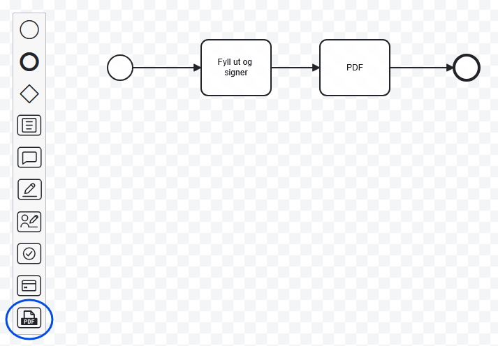
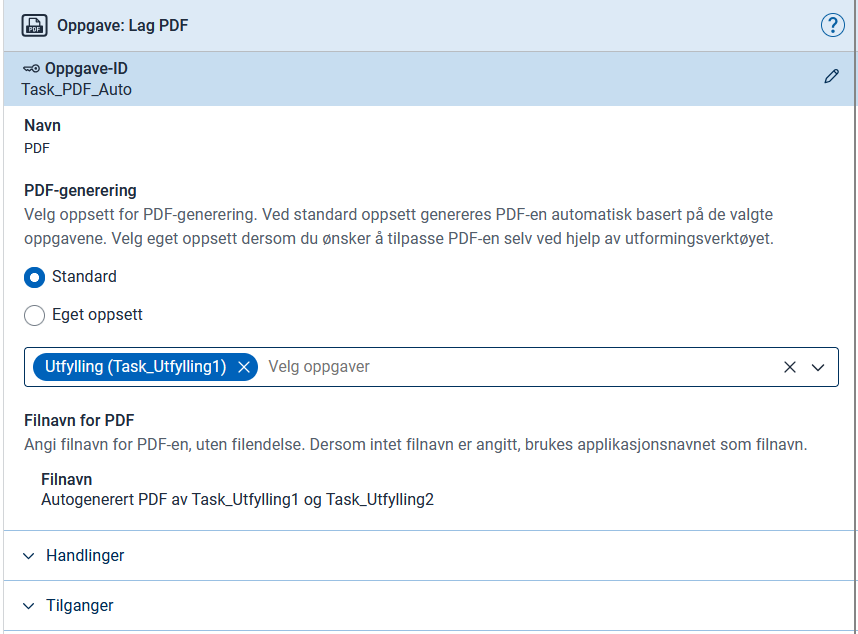
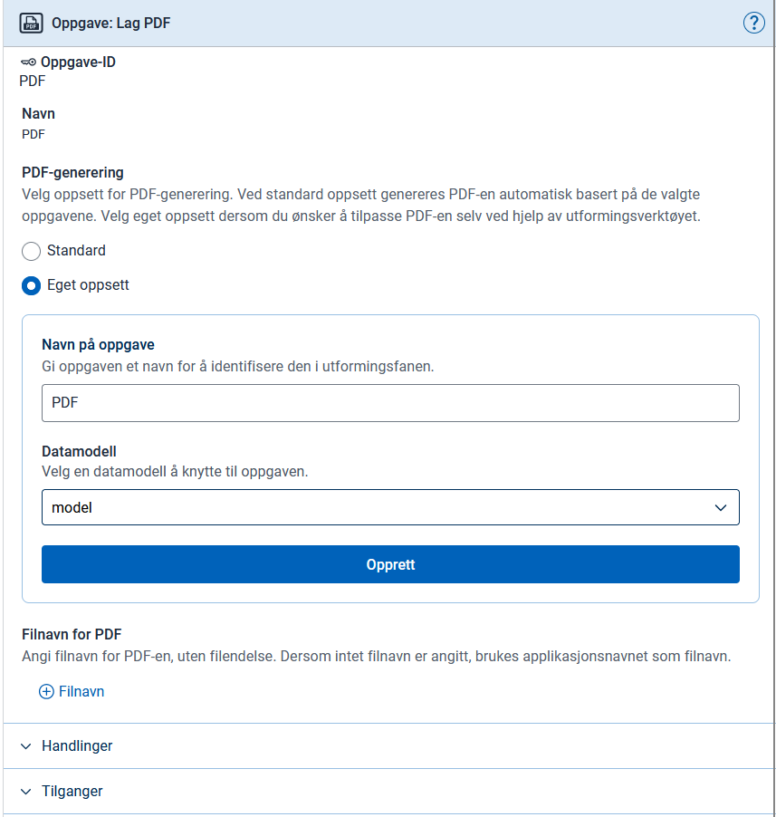

## Oversikt

Appen genererer PDF gjennom en **systemoppgave** du legger til som et steg i prosessen. Oppgaven definerer hvilket innhold PDF-en skal ha, og hvor i prosessen den genereres.

PDF-oppgaven henter innholdet fra ett av to steder:

- Har UI-mappen til oppgaven `pdfLayoutName` i `Settings.json`, blir PDF-en den siden. Da ser appen bort fra `autoPdfTaskIds`.
- Ellers lager appen PDF-en automatisk av oppgavene du lister i `autoPdfTaskIds`. Appen hopper over tomme oppføringer, oppgaver uten egen UI-mappe og PDF-oppgaven selv.

Sidene i `pages.order` blir aldri en del av PDF-en. Brukeren ser dem som en venteside mens oppgaven kjører.

Bygget sjekker oppsettet:

- Har oppgaven verken `pdfLayoutName` eller `autoPdfTaskIds`, stopper bygget med [ALTINNAPP1000]().
- Peker `pdfLayoutName` på en side som ikke finnes i UI-mappen til oppgaven, stopper bygget med [ALTINNAPP1026]().
- Lister `autoPdfTaskIds` en oppgave uten UI-mappe, gir bygget advarselen [ALTINNAPP1002]().
- Lister `autoPdfTaskIds` PDF-oppgaven selv eller en tom oppføring, gir bygget advarselen [ALTINNAPP1025]().

Skal du generere PDF av underskjema, finnes det en egen systemoppgave for det. Se [PDF-generering for underskjema]().

## Oppsett

Du kan bruke arbeidsflyt-fanen i Altinn Studio for å legge til en PDF-systemoppgave.



Dra og slipp PDF-systemoppgaven dit i prosessen der du ønsker å generere en PDF, ofte rett etter en dataoppgave.

Når du har plassert oppgaven, åpner et konfigurasjonspanel seg til høyre i skjermbildet.
Der velger du mellom to tilnærminger: standard eller egendefinert PDF.

{}

Velger du dette alternativet, angir du hvilke tidligere oppgaver som skal inngå i PDF-en. Innholdet bygger på komponentene i de valgte oppgavene, vist i oppsummeringsmodus.



Altinn Studio setter inn en systemoppgave i `process.bpmn`. Resultatet kan avvike noe fra eksempelet nedenfor.


  App/config/process/process.bpmn


```xml
<bpmn:serviceTask id="Pdf" name="PDF">
    <bpmn:extensionElements>
        <altinn:taskExtension>
            <altinn:taskType>pdf</altinn:taskType>
            <altinn:pdfConfig>
                <altinn:filenameTextResourceKey>pdfFileName</altinn:filenameTextResourceKey>
                <altinn:autoPdfTaskIds>
                    <altinn:taskId>Task_Utfylling1</altinn:taskId>
                </altinn:autoPdfTaskIds>
            </altinn:pdfConfig>
        </altinn:taskExtension>
    </bpmn:extensionElements>
    <bpmn:incoming>Flow_0er70tq</bpmn:incoming>
    <bpmn:outgoing>Flow_19ikt1z</bpmn:outgoing>
</bpmn:serviceTask>
```

{}

{}

Velger du dette alternativet, bestemmer du selv innholdet i PDF-en med en egen side i UI-mappen til PDF-systemoppgaven. Siden er den `pdfLayoutName` peker på.

Du oppgir først et navn for PDF-systemoppgaven og velger deretter en datamodell som standardmodell. Du kan f.eks. velge modellen til en av oppgavene som inngår i PDF-en.



Altinn Studio setter inn en systemoppgave i `process.bpmn` og lager UI-mappen til oppgaven med en tom `PdfLayout.json`.


  App/config/process/process.bpmn


```xml
<bpmn:serviceTask id="Pdf" name="PDF">
    <bpmn:extensionElements>
        <altinn:taskExtension>
        <altinn:taskType>pdf</altinn:taskType>
        <altinn:pdfConfig>
            <altinn:filenameTextResourceKey>pdfFileName</altinn:filenameTextResourceKey>
        </altinn:pdfConfig>
        </altinn:taskExtension>
    </bpmn:extensionElements>
    <bpmn:incoming>SequenceFlow_0c458hu</bpmn:incoming>
    <bpmn:outgoing>SequenceFlow_5assd2s</bpmn:outgoing>
</bpmn:serviceTask>
```

### Mappestruktur og filer

PDF-systemoppgaven trenger en egen UI-mappe med siden som blir PDF-en. Bruker du arbeidsflyt-editoren, lager Altinn Studio mappen for deg. Da trenger du bare å redigere innholdet i `PdfLayout.json`.

Filene og mappestrukturen skal se omtrent slik ut:

```text
App/ui/
├── Task_Utfylling1/
│   ├── Settings.json
│   └── layouts/
│       └── ...
└── Pdf/
    ├── Settings.json
    └── layouts/
        └── PdfLayout.json
```

#### Settings.json


  App/ui/Pdf/Settings.json


```json
{
  "$schema": "https://altinncdn.no/schemas/json/layout/layoutSettings.schema.v1.json",
  "defaultDataType": "model",
  "pages": {
    "pdfLayoutName": "PdfLayout",
    "taskNavigation": [
      {
        "taskId": "Task_Utfylling1",
        "name": "Utfylling"
      },
      {
        "type": "receipt"
      }
    ],
    "order": []
  }
}
```

#### PdfLayout.json

I denne filen definerer du innholdet i PDF-en. Du bruker typisk Summary2-komponenten, enten mot enkeltkomponenter eller mot hele sider og prosessteg.


  App/ui/Pdf/layouts/PdfLayout.json


```json
{
  "$schema": "https://altinncdn.no/toolkits/altinn-app-frontend/4/schemas/json/layout/layout.schema.v1.json",
  "data": {
    "layout": [
      {
        "id": "InstanceInformation",
        "type": "InstanceInformation"
      },
      {
        "id": "SummaryTaskUtfylling1",
        "type": "Summary2",
        "target": {
          "type": "layoutSet",
          "taskId": "Task_Utfylling1"
        }
      }
    ]
  }
}
```

#### Venteside

Altinn Studio lager ingen venteside. Mens appen lager PDF-en, ser brukeren den vanlige lastevisningen, og feiler PDF-genereringen, viser appen sin egen feilside med **Prøv igjen**. Vil du vise en egen side mens oppgaven kjører, legger du den til i `pages.order`. Den blir aldri en del av PDF-en. Se [Hva brukeren ser mens en systemoppgave kjører]().

{}

## Filnavn

Det er valgfritt å inkludere `<altinn:filenameTextResourceKey>`. Her oppgir du en tekstressursnøkkel som brukes som filnavn, med støtte for språk og variabler. Utelater du den, får PDF-en applikasjonens navn som filnavn.


App/config/texts/resource.{language}.json


```json
{
  "id": "pdfFileName",
  "value": "Mitt filnavn {0}",
  "variables": [
    {
      "key": "EtDatamodellfelt",
      "dataSource": "dataModel.model"
    }
  ]
}
```


  Ved bruk av standard PDF kan du ikke bruke `dataModel.default`. Du må bruke den faktiske ID-en til datamodellen, f.eks. `dataModel.model`.


## Test

Fyll ut skjemaet og gå videre. Når du når PDF-systemoppgaven i arbeidsflyten, genererer appen PDF-en og går automatisk videre til neste steg i prosessen, for eksempel kvittering.

## Feilsøking

Dersom du får feilmelding om at systemoppgaven feilet under PDF-generering, kan du åpne skjemaet i appen og legge til query-parameteren `pdf=1`. Da ser du det samme innholdet som PDF-en skulle ha vist, og eventuelle feilmeldinger.
