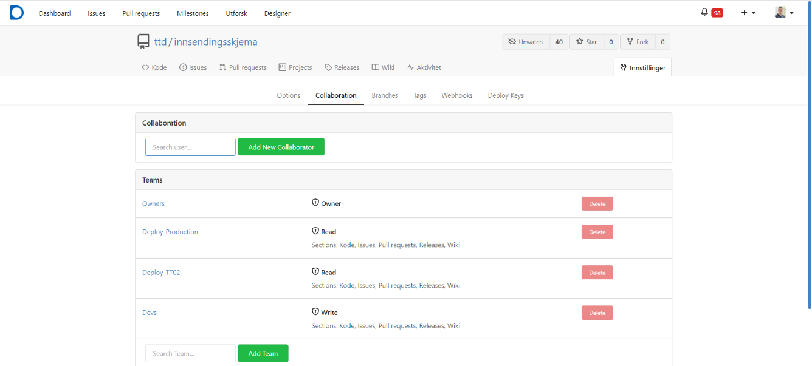

## Tilgangsstyring for organisasjonen

Som eier av en organisasjon i Altinn Studio kan du konfigurere tilgangene til de øvrige brukerne som er knyttet til organisasjonen.

Gå til `https://altinn.studio/repos/org/{org}/teams/` (erstatt `{org}` med organisasjonskoden din).

Altinn Studio har standardteam som legger føringer for hva en bruker har lov til å gjøre i organisasjonen. Ved behov kan du som eier legge til eller fjerne brukere i team, opprette nye team og endre konfigurasjonen til eksisterende team.

## Oversikt over standardteamene

Når Digdir oppretter en ny organisasjon i Altinn Studio, får den disse teamene:

| Team                       | Hva medlemmene kan gjøre                                          |
| -------------------------- | ----------------------------------------------------------------- |
| **Owners**                 | Administrere organisasjonen og tilgangene i den                   |
| **Devs**                   | Utvikle apper og opprette nye repositorier                        |
| **Deploy-TT02**            | Publisere apper til testmiljøet TT02                              |
| **Deploy-Production**      | Publisere apper til produksjonsmiljøet                            |
| **Admin-TT02**             | Følge med på publiserte apper i testmiljøet TT02                  |
| **Admin-Production**       | Følge med på publiserte apper i produksjonsmiljøet                |
| **Resources**              | Jobbe med ressursene til organisasjonen i ressursadministrasjonen |
| **Resources-Publish-TT02** | Publisere ressurser til testmiljøet TT02                          |
| **Resources-Publish-PROD** | Publisere ressurser til produksjonsmiljøet                        |
| **AccessLists-TT02**       | Administrere tilgangslister i testmiljøet TT02                    |
| **AccessLists-PROD**       | Administrere tilgangslister i produksjonsmiljøet                  |

Listen over standardteam har blitt lengre over tid. Eldre organisasjoner har kanskje bare Owners, Devs, Deploy-TT02 og Deploy-Production. Mangler organisasjonen din et team, kan du som eier opprette det selv med navnet fra tabellen.

### Team for andre miljøer

Altinn Studio kjenner igjen teamene på navnet. Navnet består av hva teamet gir tilgang til, og navnet på miljøet:

- `Deploy-{miljø}`
- `Admin-{miljø}`
- `Resources-Publish-{miljø}`
- `AccessLists-{miljø}`

Hvis organisasjonen din har flere miljøer enn TT02 og produksjon, kan du som eier opprette team for dem, for eksempel `Deploy-AT22`. Det spiller ingen rolle om du bruker store eller små bokstaver i navnet.

## Team for å administrere organisasjonen

### Owners (eiere)

Medlemmer i dette teamet er administratorer for organisasjonen. De kan administrere tilgangsstyringen for alle team og repositorier som er knyttet til organisasjonen. De kan også publisere apper til alle miljøer.

Som medlem i teamet kan du blant annet

- opprette og slette team
- legge til og fjerne brukere i ulike team
- endre konfigurasjonen til team

#### Konfigurasjon

Dette teamet finnes som standard i alle organisasjoner, og du kan ikke endre konfigurasjonen til teamet.

#### Anbefaling: Ha rutiner når eiere er borte

Organisasjonen må selv ha rutiner for hvordan den håndterer tilgangsstyring dersom en eller flere eiere er borte – for eksempel ved ferie, permisjon eller endring i rolle.

Digitaliseringsdirektoratet og Altinn kan ikke legge til brukere, endre team eller gjøre andre endringer i tilgangene til organisasjonen. Dette er av sikkerhetshensyn.

## Team for apper

### Devs (utviklere)

Medlemmer i dette teamet utvikler applikasjoner.

#### Konfigurasjon

Eierne kan justere konfigurasjonen til teamet ved behov, avhengig av hvor mye frihet apputvikleren skal ha. Du kan blant annet spesifisere hvilke repositorier teamet skal ha tilgang til.

Standardkonfigurasjonen til teamet gir rettighet til å

- opprette nye repositorier
- skrive til repositoriene teamet har tilgang til
- få tilgang til alle områder i Gitea

### Deploy-TT02 og Deploy-Production

Medlemmer i disse teamene kan publisere applikasjoner til testmiljøet TT02 (Deploy-TT02) eller produksjonsmiljøet (Deploy-Production).

#### Konfigurasjon

Eierne kan justere konfigurasjonen til teamene ved behov. Muligheten til å publisere avhenger bare av at brukeren er medlem av teamet, ikke av den øvrige konfigurasjonen.

Standardkonfigurasjonen til teamene gir rettighet til å

- lese repositoriene teamet har tilgang til
- få tilgang til alle områder i Gitea

Teamene kan ikke opprette nye repositorier.

### Admin-TT02 og Admin-Production

Medlemmer i disse teamene kan følge med på apper som er publisert til testmiljøet TT02 (Admin-TT02) eller produksjonsmiljøet (Admin-Production). I administrasjonen i Altinn Studio kan de blant annet se

- instansene til en app
- varsler og målinger for en app
- rapporter

#### Konfigurasjon

Tilgangen til administrasjonen avhenger bare av at brukeren er medlem av teamet. Standardkonfigurasjonen gir lesetilgang til repositoriene teamet har tilgang til. Teamene kan ikke opprette nye repositorier.

## Team for ressurser og tilgangslister

Disse teamene gir tilgang til ressursadministrasjonen i Altinn Studio. [Les mer om ressursadministrasjon]().

### Resources

Medlemmer i dette teamet kan jobbe med ressursene til organisasjonen. Teamet har skrivetilgang til repositoriet `{org}-resources`, der ressursene ligger.

### Resources-Publish-TT02 og Resources-Publish-PROD

Medlemmer i disse teamene kan publisere ressurser til testmiljøet TT02 (Resources-Publish-TT02) eller produksjonsmiljøet (Resources-Publish-PROD).

### AccessLists-TT02 og AccessLists-PROD

Medlemmer i disse teamene kan opprette og endre tilgangslister i testmiljøet TT02 (AccessLists-TT02) eller produksjonsmiljøet (AccessLists-PROD).

## Tilgangsstyring for et enkelt repositorium

En administrator for organisasjonen kan også styre hvem som har tilgang til det enkelte repositoriet.

Gå til repositoriet i Gitea, og velg fanen **Collaboration** under **Innstillinger**. Du kan gi tilgang til både team og enkeltbrukere. Vi anbefaler at du primært setter opp team for tilgangsstyring, slik at du holder oversikten. For å gi et team tilgang, søk det opp og klikk på **Add Team**.

