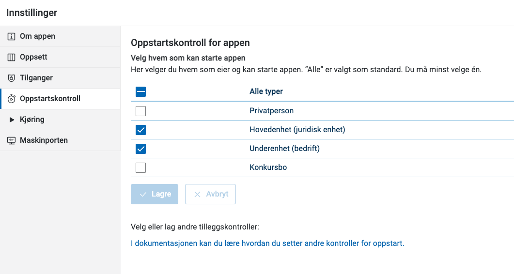

Du kan begrense hvem som kan starte appen ut fra hvilken type aktør brukeren representerer. Som standard kan alle typer aktører starte appen.

Du kan velge mellom

- **Privatperson** (`person`), som også omfatter selvidentifiserte brukere
- **Hovedenhet (juridisk enhet)** (`organisation`), som også omfatter konkursbo
- **Underenhet (bedrift)** (`subUnit`)
- **Konkursbo** (`bankruptcyEstate`)

Når brukeren skal velge aktør, viser appen bare aktørene som har lov til å starte den.

## Velge aktørtyper i Altinn Studio

1. Klikk på **Innstillinger**.
2. Velg **Oppstartskontroll**.
3. Under **Velg hvem som kan starte appen** krysser du av for aktørtypene som skal ha tilgang. **Alle typer** er valgt som standard, og du må velge minst én.
4. Klikk på **Lagre**.



## Velge aktørtyper i koden

Aktørtypene står i egenskapen `partyTypesAllowed` i `App/config/applicationmetadata.json`. Eksempelet gir tilgang til hovedenheter og underenheter, det samme som i skjermbildet over:


App/config/applicationmetadata.json


```json
"partyTypesAllowed": {
  "bankruptcyEstate": false,
  "organisation": true,
  "person": false,
  "subUnit": true
},
```

Er alle verdiene `false`, kan alle aktørtyper starte appen.
