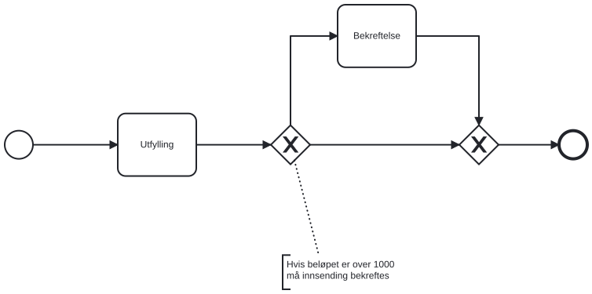

{}
Funksjonaliteten beskrevet på denne siden krever minimum versjon 7.1.0 av Altinn-nugets.
{}

## Forutsetninger

- Applikasjonen din må bruke versjon 7.1.0 eller nyere av Altinn-nugets.
- Du må ha en applikasjon med exclusive gateway(s) definert i prosessen.

## Eksempel på prosess med exclusive gateways


App/config/process/process.bpmn


```xml
<?xml version="1.0" encoding="UTF-8"?>
<bpmn:definitions xmlns:xsi="http://www.w3.org/2001/XMLSchema-instance" xmlns:bpmn="http://www.omg.org/spec/BPMN/20100524/MODEL" xmlns:bpmndi="http://www.omg.org/spec/BPMN/20100524/DI" xmlns:dc="http://www.omg.org/spec/DD/20100524/DC" xmlns:di="http://www.omg.org/spec/DD/20100524/DI" xmlns:altinn="http://altinn.no/process" id="Altinn_SingleDataTask_Process_Definition" targetNamespace="http://bpmn.io/schema/bpmn" exporter="bpmn-js (https://demo.bpmn.io)" exporterVersion="10.2.0">
  <bpmn:process id="SingleDataTask" isExecutable="false">
    <bpmn:startEvent id="StartEvent_1">
      <bpmn:outgoing>Flow_s_t1</bpmn:outgoing>
    </bpmn:startEvent>
    <bpmn:sequenceFlow id="Flow_s_t1" sourceRef="StartEvent_1" targetRef="Task_1" />
    <bpmn:task id="Task_1" name="Utfylling">
      <bpmn:extensionElements>
        <altinn:taskExtension>
          <altinn:taskType>data</altinn:taskType>
        </altinn:taskExtension>
      </bpmn:extensionElements>
      <bpmn:incoming>Flow_s_t1</bpmn:incoming>
      <bpmn:outgoing>Flow_t1_g1</bpmn:outgoing>
    </bpmn:task>
    <bpmn:sequenceFlow id="Flow_t1_g1" sourceRef="Task_1" targetRef="Gateway_1" />
    <bpmn:exclusiveGateway id="Gateway_1">
      <bpmn:incoming>Flow_t1_g1</bpmn:incoming>
      <bpmn:outgoing>Flow_g1_g2</bpmn:outgoing>
      <bpmn:outgoing>Flow_g1_t2</bpmn:outgoing>
    </bpmn:exclusiveGateway>
    <bpmn:sequenceFlow id="Flow_g1_g2" sourceRef="Gateway_1" targetRef="Gateway_2" />
    <bpmn:sequenceFlow id="Flow_g1_t2" sourceRef="Gateway_1" targetRef="Task_2" />
    <bpmn:task id="Task_2" name="Bekreftelse">
      <bpmn:extensionElements>
        <altinn:taskExtension>
          <altinn:taskType>confirmation</altinn:taskType>
          <altinn:actions>
            <altinn:action>confirm</altinn:action>
          </altinn:actions>
        </altinn:taskExtension>
      </bpmn:extensionElements>
      <bpmn:incoming>Flow_g1_t2</bpmn:incoming>
      <bpmn:outgoing>Flow_t2_g2</bpmn:outgoing>
    </bpmn:task>
    <bpmn:sequenceFlow id="Flow_t2_g2" sourceRef="Task_2" targetRef="Gateway_2" />
    <bpmn:exclusiveGateway id="Gateway_2">
      <bpmn:incoming>Flow_g1_g2</bpmn:incoming>
      <bpmn:incoming>Flow_t2_g2</bpmn:incoming>
      <bpmn:outgoing>Flow_g2_end</bpmn:outgoing>
    </bpmn:exclusiveGateway>
    <bpmn:sequenceFlow id="Flow_g2_end" sourceRef="Gateway_2" targetRef="EndEvent_1" />
    <bpmn:endEvent id="EndEvent_1">
      <bpmn:incoming>Flow_g2_end</bpmn:incoming>
    </bpmn:endEvent>
  </bpmn:process>
  <!-- BPMN Diagram del er fjernet -->
</bpmn:definitions>
```

Visuell representasjon av BPMN-definisjonen over



## Skrive og registrere gateway-kode

For å velge riktig sequenceflow ut av en exclusive gateway basert på instansdataene, må du skrive en klasse som bruker `Altinn.App.Core.Features.IProcessExclusiveGateway` og registrere denne med dependency injection-systemet.

Grensesnittet har en string-property `GatewayId` og en metode `Filter`.

Du bruker `GatewayId` for å identifisere gatewayen i prosessen som koden er koblet til.

I eksempelet over vil en implementasjon ha propertien satt til `Gateway_1`, siden dette er verdien på attributtet _id_ i gatewayen vi ønsker å skrive logikk for (den eneste med to sequenceflows ut av seg).

I metoden `Filter` skriver du koden som velger hvilken sequenceflow prosessen skal følge ut av gatewayen, basert på instansens data. Metoden får alle flytene ut av gatewayen, og returnerer den ene flyten prosessen skal følge. Returnerer den ingen flyt, følger prosessen standardflyten til gatewayen, hvis den har en. Se [standardflyt](#standardflyt). Returnerer den flere flyter, eller ingen når gatewayen mangler standardflyt, går ikke prosessen videre.

Koden kjører bare for en gateway der ingen av flytene ut har et betingelsesuttrykk (`conditionExpression`). Har en av flytene et uttrykk, bruker appen uttrykkene i stedet.

For mer dokumentasjon av grensesnittet, se xml-dokumentasjonen [her](https://github.com/Altinn/altinn-studio/blob/main/src/App/backend/src/Altinn.App.Core/Features/IProcessExclusiveGateway.cs).

Etter at du har skrevet logikken, må du registrere den i dependency injection-systemet. Du gjør dette i metoden `RegisterCustomAppServices` i filen `Program.cs`.

Eksempel: 


App/Program.cs


```csharp
void RegisterCustomAppServices(
    IServiceCollection services, 
    IConfiguration config, 
    IWebHostEnvironment env)
{
    services.AddTransient<IProcessExclusiveGateway, GatewayOne>();
}
```