## Datamodeller

### Datamodeller for apper

Datamodeller for apper ligger i [Altinn Studio-repositoriet](https://altinn.studio/repos) under `App/models` i filstrukturen til appen.

En app har fire modellfiler:

- **C# datamodell** (`<model>.cs`): Datamodellen som backend og API-ene i appen bruker til å behandle og kontrollere data.
- **JSON schema** (`<model>.schema.json`): Datamodellen i JSON schema-format som appen bruker i nettleseren (frontend) til å kontrollere data mens brukeren fyller ut. Dette er filen du jobber med i datamodelleringsverktøyet.
- **XSD datamodell** (`<model>.xsd`): Datamodellen i XML-format, som bestemmer hvilke elementer et dokument kan inneholde. Appen bruker den ikke direkte, men du kan laste den opp for å generere de andre modellfilene i Altinn Studio, eller laste den ned ved behov, for eksempel til mottakssystemer.
- **JSON-metadata** (`<model>.metadata.json`): Altinn Studio bruker den til å generere `<model>.cs`-filen. Altinn Studio lager filen bare når den trengs, og lagrer den ikke i appen.

### Datamodeller for organisasjoner

Datamodeller for organisasjoner ligger i [Gitea](https://altinn.studio/repos) i Altinn Studio. For å få tilgang til disse må du logge inn med Altinn Studio-bruker. Hvis du bruker Altinn Studio for første gang, må du [lage en bruker]().

Datamodellene ligger i `<org>-datamodels`-repoet, hvor `<org>` er organisasjonen du tilhører. For eksempel ligger datamodellene til organisasjonen Testdepartementet (ttd) under
https://altinn.studio/repos/ttd/ttd-datamodels.

Du finner repoet på dashbordet i Altinn Studio. Velg organisasjonen i profilmenyen øverst til høyre, så ser du delen **{org}s datamodeller**. Klikk på blyantikonet for å komme til datamodelleringsverktøyet i Altinn Studio. Klikk på Gitea-ikonet (den grønne koppen) for å se filene direkte i repoet.

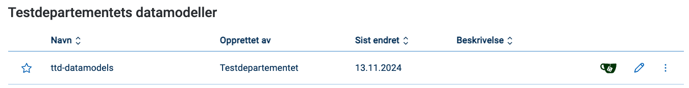

#### Tilgang til datamodellene

Alle kan se datamodellene til en organisasjon som standard. For å få tilgang til å redigere datamodellene må brukeren være del av Datamodels-teamet i organisasjonen. Se [tilgangsstyring]() for mer informasjon.

#### Laste opp XSD til repo

Du kan laste opp XSD direkte i [datamodelleringsverktøyet](#laste-opp-og-vise-datamodell).

Hvis du bare skal laste opp XSD for å lagre, og ikke skal redigere modellen i verktøyet, kan du laste opp XSD-filer direkte til `<org>-datamodels`-repoet:

1. Gå til mappen du vil bruke.
2. Velg **Add File** → **Last opp fil**.
3. Skriv inn navnet på mappen du vil bruke (valgfritt) i tekstfeltet som dukker opp øverst.
4. Last opp filen.
5. Bla ned og skriv eventuelt en melding om hva slags fil det er.
6. Klikk på **Commit endringer** for å bekrefte.

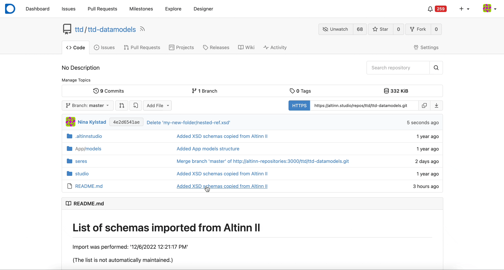

## Datamodelleringsverktøyet

Datamodelleringsverktøyet i Altinn Studio bruker datamodeller i JSON schema-format. Ut fra dette kan verktøyet generere XSD- og C#-modeller (se [datamodeller for apper](#datamodeller-for-apper)).

{}

- [Registrerte feil og mangler for datamodelleringsverktøyet](https://github.com/orgs/Altinn/projects/1/views/10)
- [Planlagt ny funksjonalitet for datamodelleringsverktøyet](https://github.com/orgs/Altinn/projects/1/views/6)
- [Utvikling av datamodell for Altinn 2](/nb/altinn-studio/v8/guides/altinn-2/altinn-2-datamodel/)
- [Overgang fra Seres til Altinn Studio]()
{}

### Åpne datamodelleringsverktøyet

1. Logg inn i Altinn Studio. Hvis du ikke er på dashbordet i Altinn Studio, klikker du på logoen øverst i venstre hjørne eller går til [altinn.studio/dashboard](https://altinn.studio/dashboard).
2. Klikk på blyantikonet ved en app under **Mine apper**, eller ved datamodellrepoet til organisasjonen din.
3. Velg fanen **Datamodell** i toppmenyen.

## Laste opp og vise datamodell

Datamodellen bestemmer hvilke data brukerne kan sende inn med appen, og hvilket format dataene skal ha. Du kan laste opp en XSD-datamodell i verktøyet. Når du laster opp en XSD-modell (`<model>.xsd`), genererer verktøyet filene `<model>.cs` og `<model>.schema.json` (se [datamodellfiler](#datamodeller-for-apper)).

{}
Du må være medlem av en organisasjon for å laste opp datamodeller.
{}

Slik laster du opp en datamodell:

1. Klikk på **Last opp datamodell** på siden **Datamodell** hvis det ikke finnes noen datamodeller, eller **Last opp** på verktøylinjen øverst i verktøyet.
2. Velg en XSD-fil i filvelgeren. Altinn Studio laster opp filen med en gang.

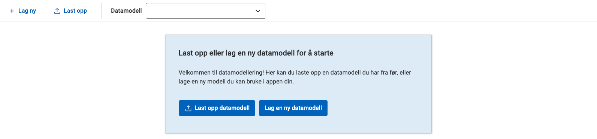

Når Altinn Studio har behandlet datamodellen, finner du de genererte filene under `App/models/` i app-repoet.

Du ser typene i datamodellen i panelet til venstre. Du kan åpne trevisning av datamodellen for å se en visuell representasjon av datamodellen og feltene som er tilgjengelige.

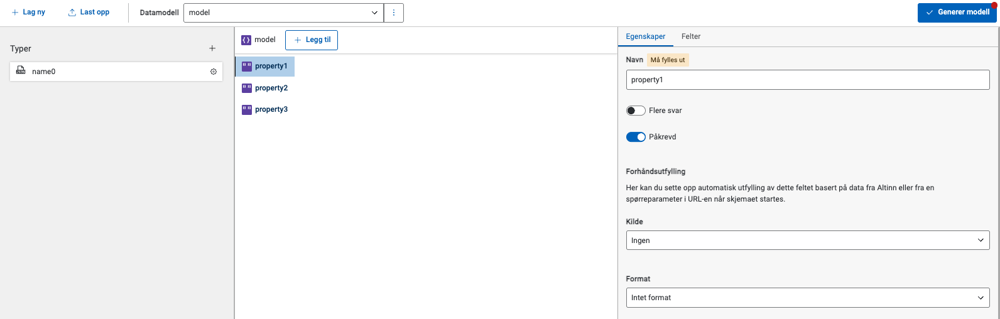

## Velge modell fra nedtrekkslisten

Nedtrekkslisten har to kategorier:

- **JSONSchema**: Datamodeller i JSON schema-format, både modeller du har laget i verktøyet og modeller Altinn Studio har laget fra opplastede XSD-filer.
- **XSD**: Viser XSD-modeller uten tilhørende JSON schema-modellfil. Når du velger en modell fra XSD-listen, importerer verktøyet den automatisk og lager en JSON schema-fil. Deretter kan du jobbe videre med modellen i verktøyet.

{}
Nedtrekkslisten viser bare datamodeller som ligger i `App/models` i repositoriet.
{}

## Erstatte eller slette en datamodell

Klikk på menyen med tre prikker ved siden av nedtrekkslisten **Datamodell** for å se disse valgene:

- **Erstatt XSD**: Last opp en ny XSD-fil som erstatter datamodellen du har valgt.
- **Slett datamodell**: Slett datamodellen du har valgt. Altinn Studio ber deg bekrefte at du vil slette den.

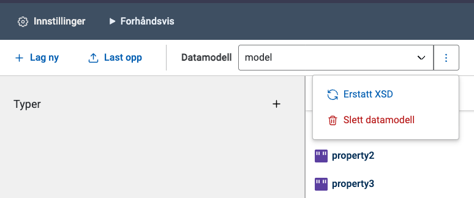

## Lage ny datamodell

Slik lager du en ny datamodell fra bunnen:

1. Klikk på **Lag ny** til venstre på verktøylinjen.
2. Skriv inn navnet på datamodellen.
3. Klikk på **Opprett modell**.

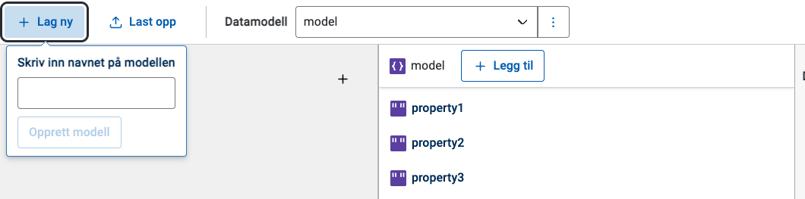

Altinn Studio lager datamodellen med noen eksempelfelt som du kan jobbe videre med eller slette:

- `property1` (tekst, påkrevd)
- `property2` (tekst, påkrevd)
- `property3` (tekst)

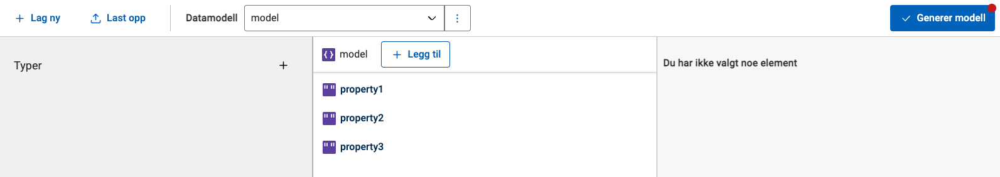

## Redigere datamodell

Velg modellen du vil redigere fra nedtrekkslisten på verktøylinjen.

{}
Altinn Studio lagrer JSON schema-modellen automatisk mens du jobber med den. For å generere andre modellfiler i XSD- og C#-format må du klikke på knappen **Generer modell** på verktøylinjen (se [Generere modellfiler](#generere-og-laste-ned-modellfiler-xsd-og-c)).
{}

### Legge til felt

Klikk på **Legg til** for å legge til et felt på øverste nivå (**1** i bildet nedenfor).

Du kan legge til underfelt på felter av type Objekt ved å klikke på **+**-knappen til høyre for feltnavnet, eller ved å klikke på feltet og velge fanen **Felter** i panelet til høyre.

### Legge til type

Klikk på **+**-tegnet i panelet **Typer** til venstre (**2** i bildet nedenfor).

### Konvertere felt til type

Du kan konvertere et felt til en type ved å klikke på ikonet **Konverter til type** til høyre for feltet (**3** i bildet nedenfor).

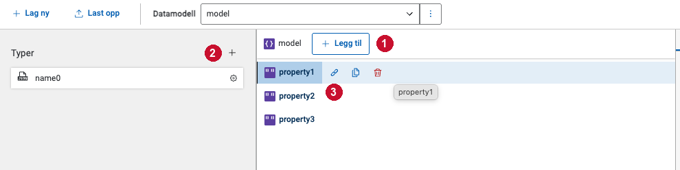

### Rediger en type

1. Klikk på typen du vil redigere. Typen åpner seg i trevisningen i midten.
2. Rediger egenskaper for typen i panelet til høyre.
3. Klikk **Legg til** øverst for å legge til felter på typen.
4. Velg felter fra typen for å redigere egenskapene deres i panelet til høyre.
5. Lukk redigeringen ved å klikke på **Tilbake til datamodell** øverst i modellpanelet.

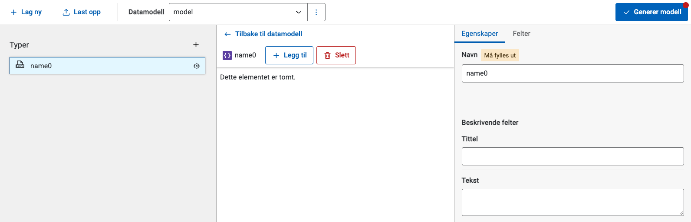

### Slett en type

1. Velg typen i panelet til venstre.
2. Klikk på **Slett**-knappen ved det øverste feltet (rotnoden) på typen.

Du kan ikke slette typer som er i bruk.

### Typereferanser

En typereferanse er et felt som følger strukturen til en type du har laget selv. Hvis du for eksempel har typen `Adresse` med feltene `Gateadresse`, `Postnummer` og `Sted`, legger en referanse til typen automatisk til disse feltene. Du ser typen ved siden av feltnavnet i trevisningen.

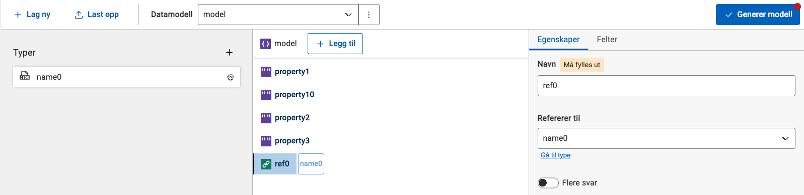

### Legge til typereferanse

Dra og slipp en type fra panelet på venstresiden inn i trevisningen (midtseksjonen). Dette oppretter et nytt felt med den valgte typen.

Du kan også legge en typereferanse til et underordnet felt ved å dra typen inn i det overordnede feltet.

{}
For å legge til elementer under et felt (node) må feltet være av typen Objekt.
{}

### Slette felt

Klikk på **Slett**-knappen til høyre for feltnavnet.

### Kopiere felt

Klikk på **Kopier felt**-ikonet til høyre for feltnavnet for å lage en kopi av feltet.

### Rediger egenskapene til et felt

1. Klikk på noden eller feltet du vil redigere, for å få opp egenskapene i panelet til høyre.
2. Rediger egenskapene til noden eller feltet. Tilgjengelige egenskaper for feltet varierer basert på basistypen for feltet.

### Redigere eller legge til XSD-attributter, namespaces og dataFormatId/dataFormatVersion

Verktøyet støtter ikke dette, så du må gjøre det manuelt. Slik gjør du det:

- [dataFormatId og dataFormatVersion]()
- [XSD-attributter generelt]()
- [XSD namespaces]()

## Generere og laste ned modellfiler (XSD og C#)

Når modellen er klar, kan du generere modellfiler:

1. Klikk på knappen **Generer modell** over det høyre panelet. Verktøyet lager både XSD- og C#-modellfiler.
2. Klikk på **Del dine endringer** til høyre i hovedmenyen til Altinn Studio for å lagre endringene dine.

Slik laster du ned en generert XSD-fil:

1. Klikk på menyen med tre prikker øverst til høyre på siden.
2. Velg **Repositorium**.
3. Gå til filen i `App/models/`.
4. Klikk på nedlastingsikonet.

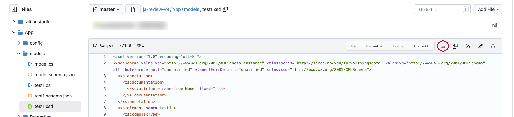
