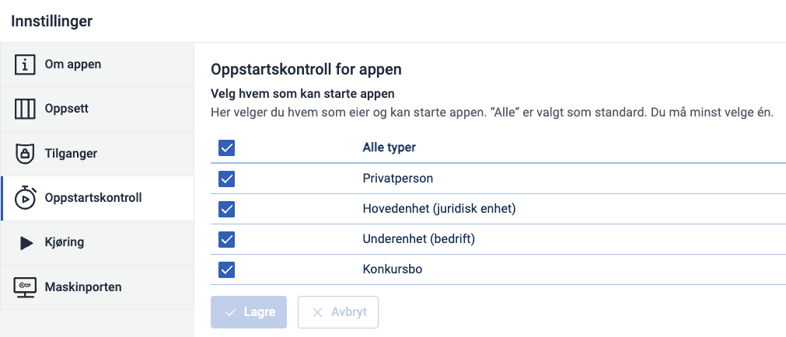
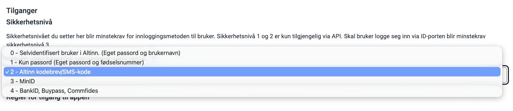
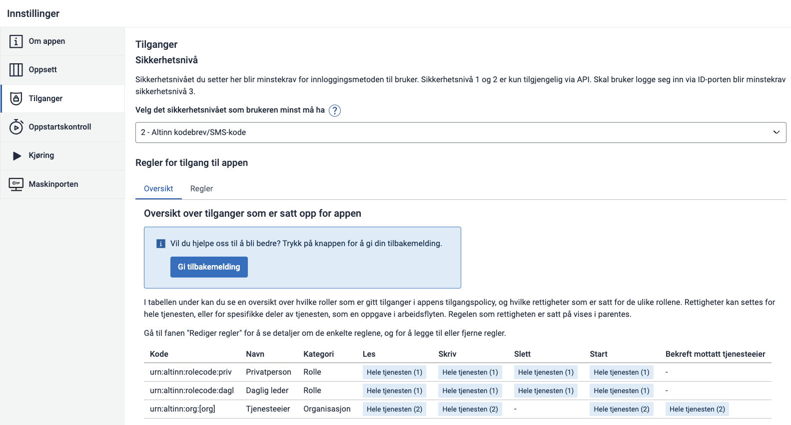
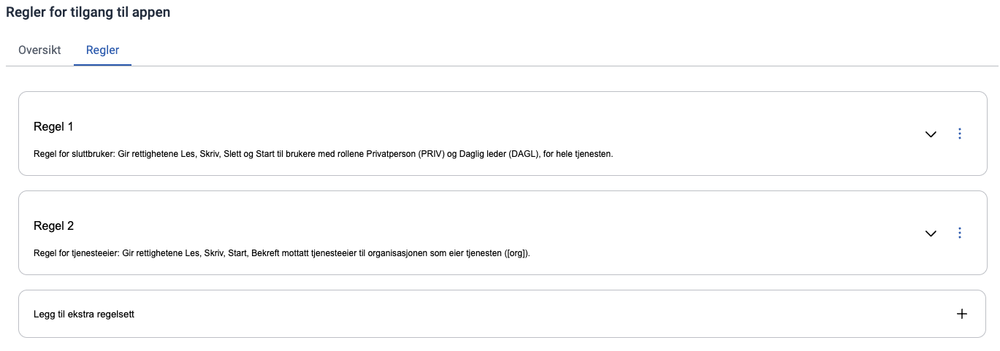

Før du går videre med tjenesten, må du sette opp regler for hvem som skal få bruke den. Altinn Studio har noen standardregler, men du må alltid vurdere dem før du publiserer tjenesten. Standardoppsettet gir både privatpersoner og virksomheter tilgang til tjenesten, også virksomheter som er under konkursbehandling. I tillegg har virksomheten din, som eier tjenesten, tilgang.

## Oppstartskontroll
Først vurderer du hvem som skal få starte tjenesten. Dette finner du under **Innstillinger** og **Oppstartskontroll**.

Her har du fire valg:

- **Privatperson**
- **Hovedenhet (juridisk enhet)**: selskap, forening, enkeltpersonforetak og andre som er registrert i [Enhetsregisteret](https://www.brreg.no/om-oss/registrene-vare/om-enhetsregisteret/)
- **Underenhet (bedrift)**: en underenhet av en hovedenhet som er registrert i [Enhetsregisteret](https://www.brreg.no/bedrift/underenhet/)
- **Konkursbo**: enheter som er under konkursbehandling i [Konkursregisteret](https://www.brreg.no/om-oss/registrene-vare/om-konkursregisteret/)

Bare de du krysser av for, kan starte tjenesten.

---

## Sikkerhetsnivå
Deretter velger du sikkerhetsnivå. Sikkerhetsnivået er minstekravet til hvordan brukeren logger inn. Dette finner du under **Innstillinger** og **Tilganger**. Her har du fem valg:

- **0 - Selvidentifisert bruker i Altinn** (eget passord og brukernavn)
- **1 - Kun passord** (eget passord og fødselsnummer)
- **2 - Altinn kodebrev/SMS-kode**
- **3 - MinID**
- **4 - BankID, Buypass, Commfides**

Altinn kodebrev/SMS-kode er standard sikkerhetsnivå. Hvis brukerne prøver å ta i bruk en tjeneste og har for lavt sikkerhetsnivå, får de beskjed om å logge inn på nytt med en annen innloggingsmetode.

---

## Tilgangsstyring

Oppstartskontroll og sikkerhetsnivå handler om hvem tjenesten er rettet mot, og hva som minst kreves for å logge inn. Det betyr ikke at brukeren nødvendigvis har rettigheter til å bruke tjenesten. Det er tilgangsreglene som bestemmer hvem som får gjøre hva i tjenesten. Du finner reglene under **Innstillinger** og **Tilganger**.

En regel består av tre deler som beskriver

- *hvem* som får tilgang
- *hva* de får tilgang til (ofte kalt en ressurs)
- *hvilke* handlinger, eller rettigheter, de får

Du kan for eksempel gi revisor (hvem) rett til å signere (hvilken handling) i signeringssteget i tjenesten (hva), mens daglig leder (hvem) får skrivetilgang (hvilken handling) til steget der brukeren fyller ut skjemaet (hva).

Alle regler har disse tre delene, men innholdet varierer fra tjeneste til tjeneste. Det avhenger av

- hvilke steg prosessen i tjenesten har, for eksempel om den har et signeringssteg
- hvilke handlinger tjenesten har
- hva slags tjeneste det er
- hvem tjenesten er rettet mot

Tenk derfor nøye gjennom tilgangsreglene *før* du lanserer tjenesten.

Klikk på fanen **Regler** for å endre eller legge til en regel.

Legg merke til at det er to regler her, mens oversiktstabellen viser tre rader. Det er fordi **Regel 1** gjelder to roller: **Privatperson** og **Daglig leder**. Oversikten tar utgangspunkt i *hvem* som har tilgang, og viser derfor én rad for hver rolle.
