### Opprett en ny app

1. Klikk på **Opprett ny app** for å lage en ny app som skal inneholde skjemaet.
2. Velg organisasjonen din som eier av appen hvis du er tilknyttet en organisasjon.
3. Skriv inn et navn som identifiserer appen.
   >*Navnet må være unikt i organisasjonen din. Altinn Studio bruker det også i URL-en til tjenesten når den er publisert.*
4. Klikk på **Opprett app** og vent til appen er opprettet.

---

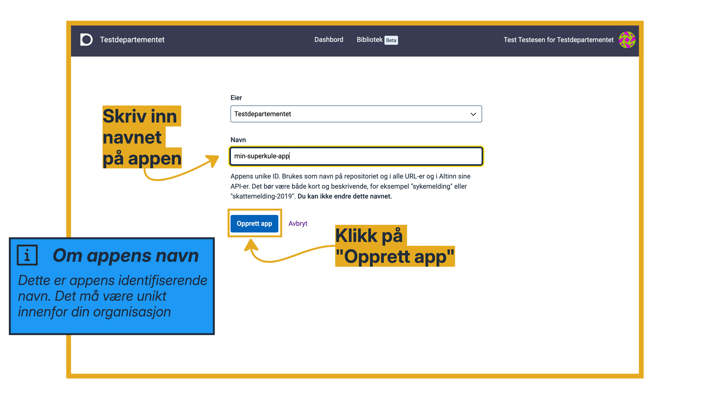

### Redigere informasjon om tjenesten

Når appen er opprettet og lastet inn, kommer du til en oversiktsside for appen. Her ser du dette:

- **Menylinjen**: Her går du til de ulike verktøyene og åpner siden for innstillinger.
- **Appens tittel**: Brukeren ser tittelen når de er inne i appen, og i innboksen i Altinn.
- **Tilgjengelige miljøer**: Her ser du hvilke miljøer organisasjonen din kan publisere apper til. Vanligvis er det et testmiljø (TT02) og et produksjonsmiljø.
  >*Hvis du har laget appen på din egen bruker og ikke på en organisasjon, har du ingen tilgjengelige miljøer.*
- **Lenke til dokumentasjonen**: Her kommer du til dokumentasjonen for Altinn Studio.
- **Nyheter**: Her publiserer vi informasjon om ny funksjonalitet fortløpende.

---

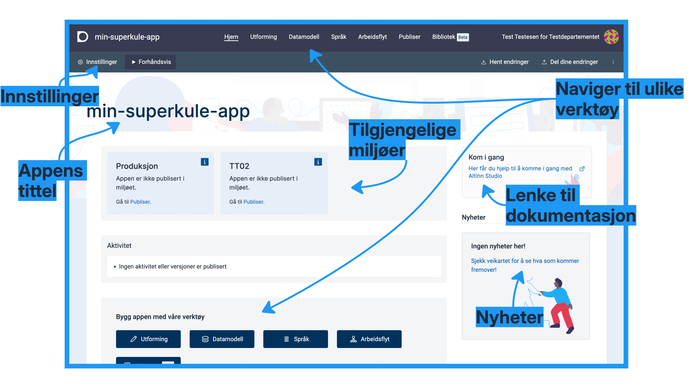


#### Endre informasjon om appen
1. Klikk på **Innstillinger** i menylinjen.
2. Skriv inn tittelen på appen. Velg en beskrivende overskrift.
3. Skriv inn en beskrivelse av appen. Hvem skal bruke den, og hva skal de bruke den til?
4. Klikk på **Lagre** for å lagre endringene.
5. Gå tilbake til oversikten ved å klikke på **Til hjem** i menylinjen.

---

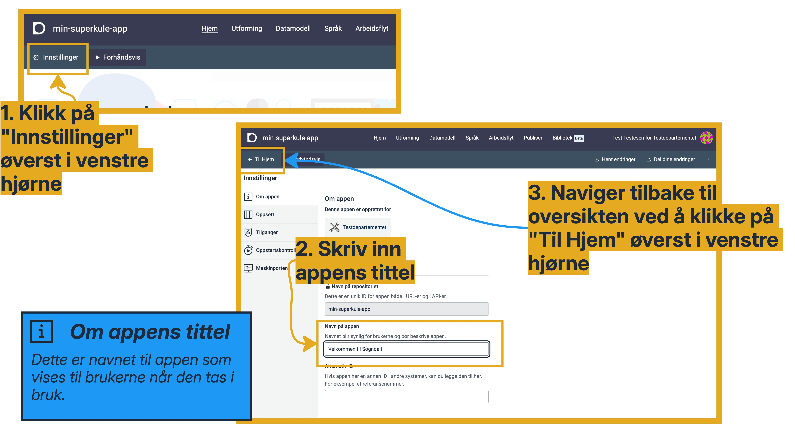

---

Legg inn tittelen på appen både på bokmål og nynorsk.

Når du kommer tilbake til oversiktssiden, ser du at tittelen er oppdatert der også.

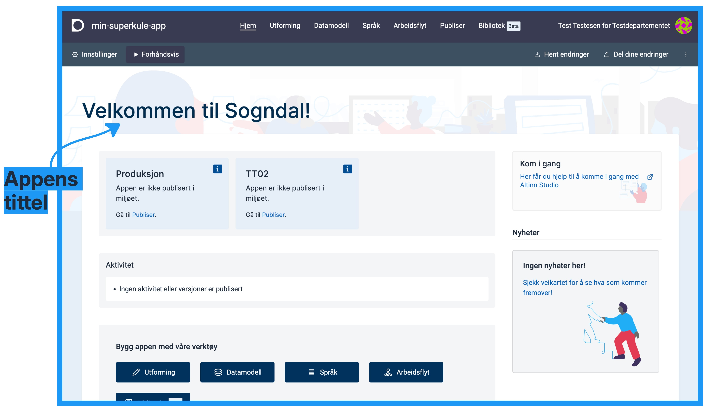

### Lagre og dele endringer

Når du jobber med en app i Altinn Studio, er det to hovedområder:

- **Ditt eget område**: Altinn Studio lagrer alle endringer du gjør i appen her automatisk. Andre kan ikke se disse endringene.
- **Appens sentrale område**: Dette området er tilgjengelig for alle. Når du publiserer tjenesten, bruker Altinn Studio
  dette området som utgangspunkt.

Du må dele endringene fra ditt eget område til appens sentrale område før du kan publisere dem.

---

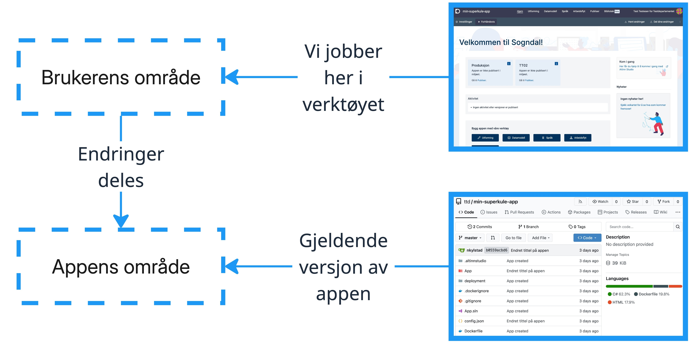

---

Nå som du har endret tittelen på appen, kan du dele endringen til appens sentrale område.
1. Klikk på **Del dine endringer** i menylinjen.
2. Klikk på **Se siste endringer** for å se en oversikt over endringene du har gjort.
3. Se gjennom endringene, og klikk på **X** for å lukke vinduet og gå tilbake til vinduet for å dele endringer.
4. Beskriv endringene i tekstboksen og klikk på **Del endringer**.

---
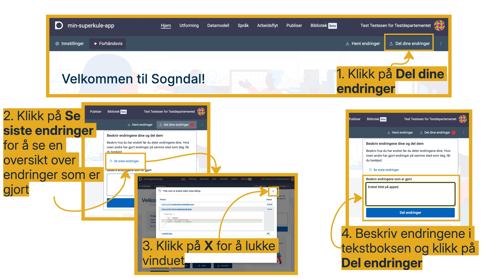

### Lage en informasjonsside
Du starter med å lage en informasjonsside med et bilde og en tekst.

#### Åpne Utforming
1. Klikk på **Utforming** i toppmenyen.
2. Klikk på **Utform** på kortet for oppgaven "Task_1" for å utforme den første delen av skjemaet.

#### Slik er Utforming-siden bygd opp
Utforming-siden har fire kolonner:

- **Komponentlisten**: Her finner du komponentene du kan legge til. Du kan lukke denne kolonnen.
- **Oppsett**: Her legger du inn sider og komponenter i skjemaet.
- **Konfigurasjonskolonnen**: Her setter du opp siden eller komponenten du har valgt.
- **Forhåndsvisningen**: Her ser du det du har satt opp.

---

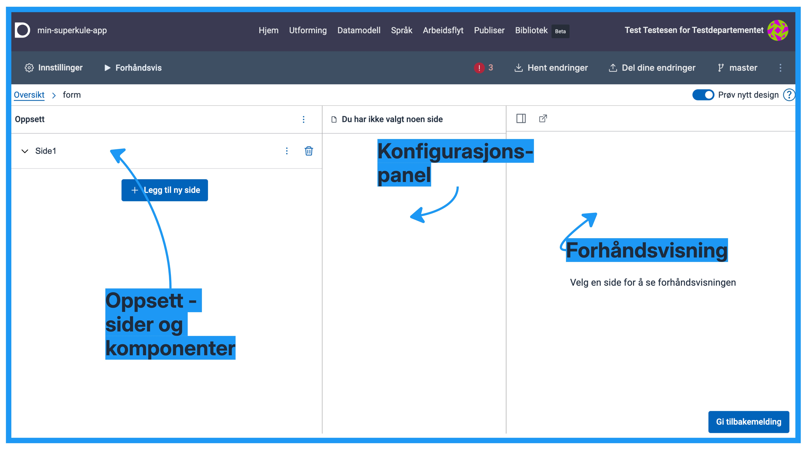

#### Legg til komponenter på infosiden
1. Åpne siden **Side1** ved å klikke på den, og klikk på **Legg til komponent**.
2. Klikk på **Vis alle**, søk etter "Bilde" og klikk på komponenten **Bilde** under **Informasjon**. Klikk på **Legg til** i
  høyrepanelet for å legge til bildekomponenten på siden.
3. Under **Valg for bilde** i konfigurasjonskolonnen klikker du på **Lim inn en URL** og limer inn denne adressen:
   https://docs.altinn.studio/nb/altinn-studio/v8/getting-started/app-dev-course/resources/kommune-logo.png
4. Legg til komponenten **Avsnitt** på siden.
5. Skriv inn en tekst under **Ledetekst**, for eksempel "Vi har registrert at du har meldt flytting til Sogndal kommune - velkommen til oss!".

---

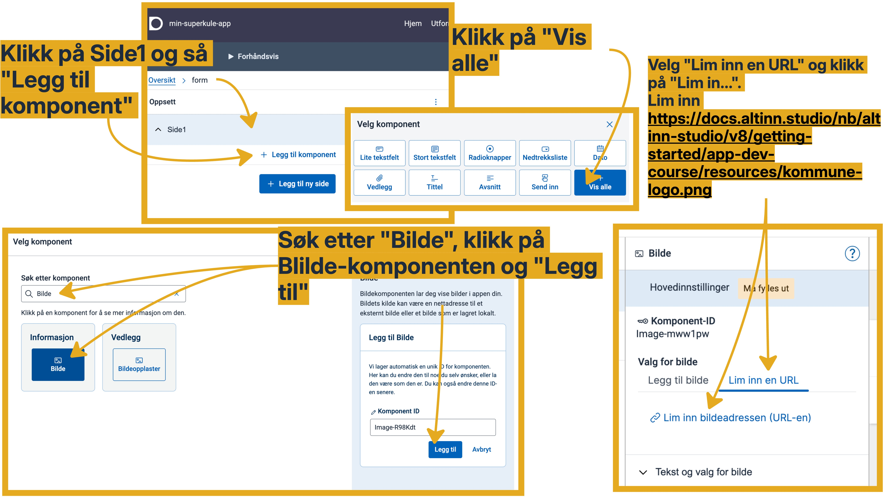

---

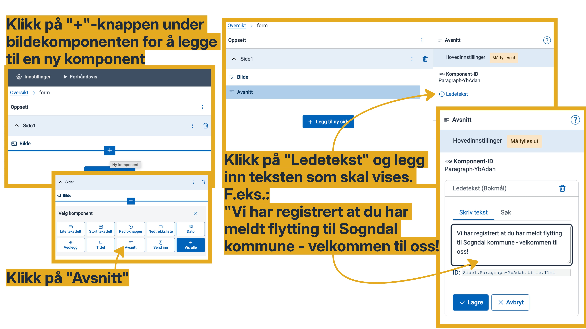

---

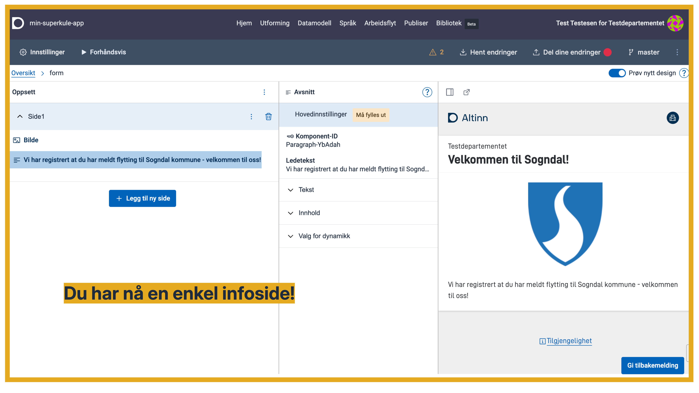

### Sette opp datamodellen
En datamodell er en slags innholdsfortegnelse for skjemaet. Med datamodellen bestemmer du _hva_ du vil hente inn av data,
og _hvordan_ dataene skal se ut.

For et enkelt skjema er det ofte en direkte kobling mellom et felt i datamodellen og et felt i skjemaet. For mer avanserte
skjemaer kan datamodellen og skjemaet være ganske forskjellige.

Når du oppretter en app, følger det med en enkel datamodell med noen eksempelfelter. Du kan endre navnene på feltene
slik at det er tydelig hva de inneholder, og du kan legge til egne felter.

Gå til **Datamodell** i toppmenyen for å komme i gang.

Du kan lese mer i [veiledningen om datamodellering i Altinn Studio]().

---

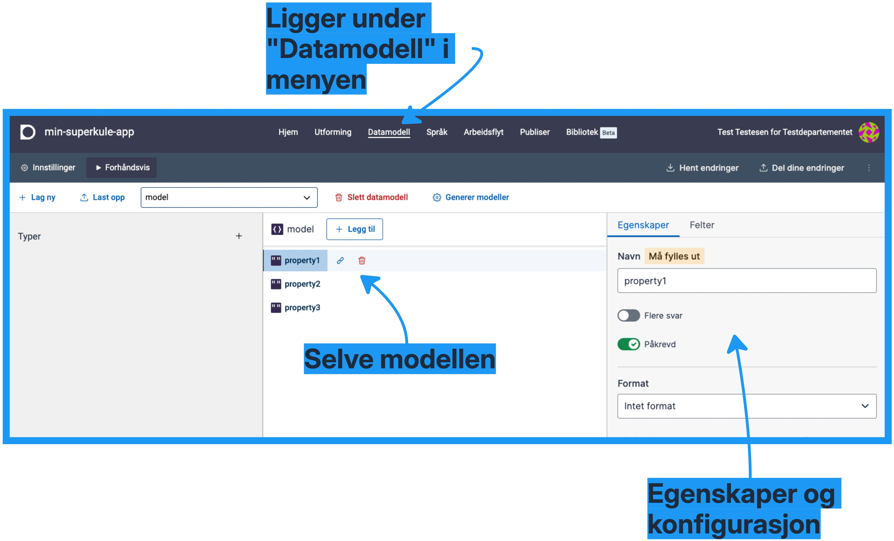


#### Krav fra kommunen
Kommunen vil i første omgang samle inn disse opplysningene om innflyttere:

- **Personinformasjon**
  - fullt navn
  - alder
- **Adresse**
  - gateadresse
  - postnummer
  - poststed
- **Kontaktinformasjon**
  - e-postadresse
  - telefon

#### Lag datamodellen
1. Sjekk at modellen `model` er valgt. Slett de eksisterende feltene i modellen ved å klikke på søppelbøtteikonet (🗑️) ved siden av feltet.
2. Klikk på **Legg til** øverst på siden og velg **Objekt**.
3. Endre navnet på den nye gruppen til "person".
4. Klikk på **Legg til felt** i gruppen `person` og velg **Tekst**.
5. Endre navnet på feltet til `fullt_navn`.

---


---

Fortsett å legge til felter i datamodellen. Du skal ha tre grupper (`object`) med tilhørende felter.
Bruk feltene i kravene fra kommunen som utgangspunkt. Alle feltene kan være av typen **Tekst**, bortsett fra feltet
`alder`, som kan være et heltall.

Når du er ferdig med datamodellen, klikker du på **Generer modeller** for å lage alle modellfilene appen trenger.


---


#### Dele endringene


### Utforme skjemaet

Nå skal du bygge opp skjemaet. Du gjør det nesten på samme måte som da du laget infosiden.

Gå til **Utforming** i toppmenyen, og klikk på **Utform** på kortet for oppgaven "Task_1".

#### Lag en ny side
1. Klikk på **Legg til ny side**. Altinn Studio legger til en ny side med navnet "Side2".
2. Klikk på **Side-ID** i konfigurasjonskolonnen og endre navnet på siden til "om-innflytter". Klikk på **✓** for å lagre.
3. Klikk på **Visningsnavn** og legg inn en visningstekst for siden, for eksempel "Om innflytter". Klikk på **Lagre**.

Altinn Studio legger automatisk til komponenten **Navigasjonsknapper** på sidene, slik at brukeren kan bla mellom sidene med
knappene **Neste** og **Forrige**.

---

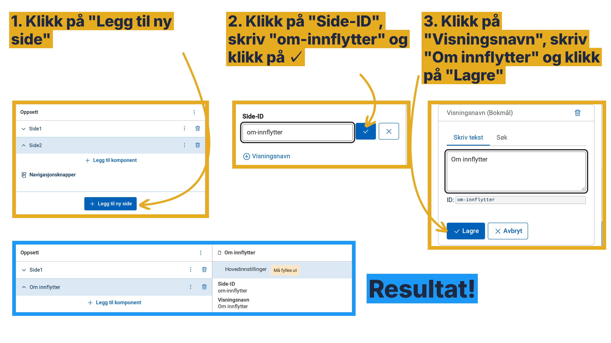

#### Legge til den første skjemakomponenten
Den første komponenten skal samle inn navnet til innflytteren. Til det bruker du komponenten **Lite tekstfelt**, som lar
brukeren skrive inn en kort tekst på én linje.

1. Sjekk at du er på siden **Om innflytter**. Klikk på **Legg til komponent** inne på siden.
2. Velg **Lite tekstfelt** fra komponentlisten.

Komponenten er nå lagt til på siden. Den mangler foreløpig en ledetekst og en kobling til datamodellen, og
forhåndsvisningen viser en feilmelding til du har valgt et datamodellfelt for komponenten.

---

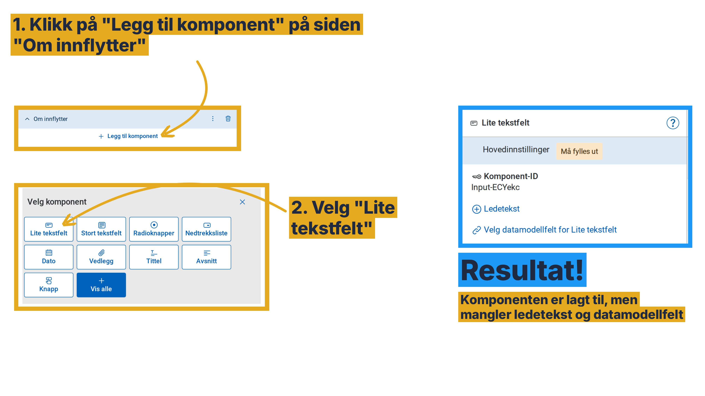

#### Legge inn ledetekst
Ledeteksten er teksten som står over feltet og forteller brukeren hva de skal fylle inn.

Altinn Studio lagrer alle tekstene i appen i en egen tekstfil, og hver tekst får en unik ID. Komponenten peker på tekstens
ID, ikke på selve teksten. Det gjør at du kan bruke samme tekst flere steder, endre teksten uten å endre komponenten og
oversette teksten til nynorsk og engelsk under **Språk** i toppmenyen.

1. Sjekk at komponenten **Lite tekstfelt** er valgt. Klikk på **Ledetekst** i konfigurasjonskolonnen.
2. Skriv "Fullt navn" i tekstfeltet under **Skriv tekst**. Altinn Studio lager en ID for teksten automatisk.
3. Klikk på **Lagre**.

Vil du bruke en tekst som allerede finnes i appen, kan du klikke på **Søk** og velge teksten fra listen i stedet for å
skrive en ny.

---

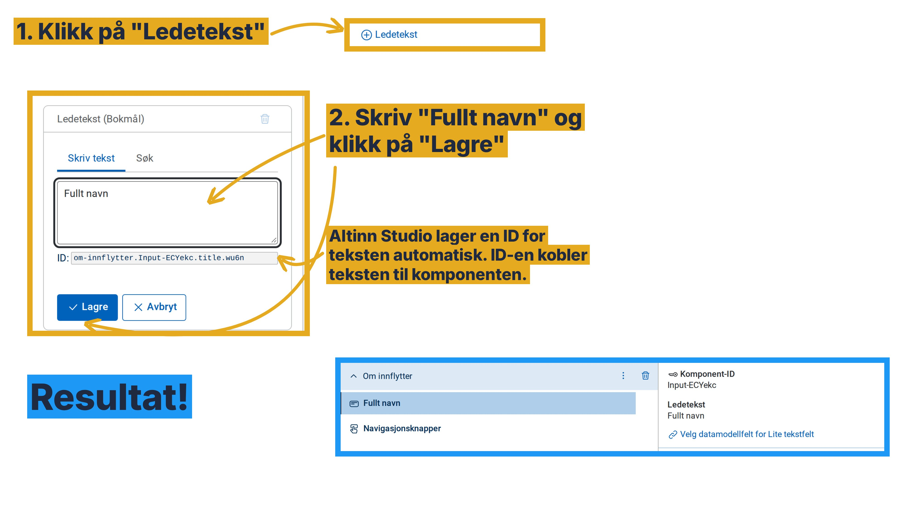

#### Knytte feltet til datamodellen
Når brukeren fyller ut skjemaet, må appen lagre svaret et sted. Det er datamodellen som bestemmer hvor. Du knytter hvert
skjemafelt til et felt i datamodellen, slik at svaret brukeren skriver inn havner i riktig felt. Navnet til innflytteren
skal havne i feltet `fullt_navn` i gruppen `person`.

1. Klikk på **Velg datamodellfelt for Lite tekstfelt** i konfigurasjonskolonnen.
2. Under **Datamodell** er datamodellen `model` allerede valgt. Under **Datamodellfelt** velger du `person.fullt_navn`.
3. Klikk på **Lagre**.

Feilmeldingen i forhåndsvisningen forsvinner, og du ser feltet med ledeteksten "Fullt navn".

---

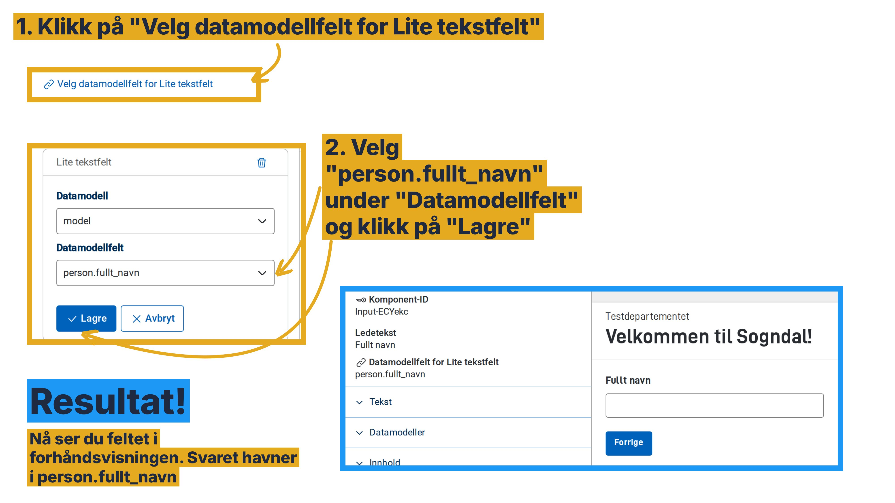

---

{}
Altinn Studio lagrer oppsettet du har laget i filer i appen. Komponenten står i layoutfilen for siden. `textResourceBindings`
viser hvilken tekst komponenten bruker som ledetekst (`title`), og `dataModelBindings` viser hvilket felt i datamodellen
appen lagrer svaret i.


App/ui/{taskId}/layouts/om-innflytter.json


```json
{
  "id": "Input-ECYekc",
  "type": "Input",
  "textResourceBindings": {
    "title": "om-innflytter.Input-ECYekc.title.wu6n"
  },
  "dataModelBindings": {
    "simpleBinding": {
      "field": "person.fullt_navn",
      "dataType": "model"
    }
  }
}
```

Selve teksten ligger i tekstfilen for bokmål, med samme ID som komponenten peker på:


App/config/texts/resource.nb.json


```json
{
  "id": "om-innflytter.Input-ECYekc.title.wu6n",
  "value": "Fullt navn"
}
```

ID-ene slutter med tilfeldige tegn, så ID-ene i appen din blir annerledes.
{}

#### Legge til resten av skjemakomponentene
Du legger til resten av komponentene på samme måte som navnefeltet:

1. Hold musepekeren over komponenten som skal stå foran den nye komponenten, og klikk på **+** som dukker opp under den.
2. Velg komponenttype fra komponentlisten.
3. Legg inn ledetekst og velg datamodellfelt.

Finner du ikke komponenten du leter etter, klikker du på **Vis alle** og søker etter den.

Legg til disse komponentene på siden **Om innflytter**, i denne rekkefølgen:

| Ledetekst     | Komponent      | Datamodellfelt          |
|---------------|----------------|-------------------------|
| Alder         | Lite tekstfelt | `person.alder`          |
| Gateadresse   | Lite tekstfelt | `adresse.gateadresse`   |
| Postnummer    | Lite tekstfelt | `adresse.postnummer`    |
| Poststed      | Lite tekstfelt | `adresse.poststed`      |
| E-postadresse | Lite tekstfelt | `kontaktinfo.epost`     |
| Telefon       | Lite tekstfelt | `kontaktinfo.telefon`   |
| Send inn      | Knapp          | Ingen                   |

Komponenten **Knapp** sender inn skjemaet når brukeren klikker på den. Den trenger derfor ingen kobling til datamodellen.

---

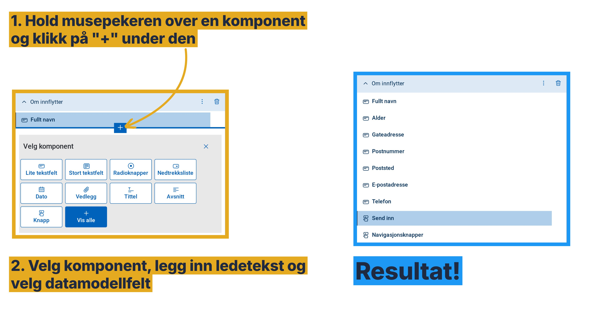

#### Forhåndsvise skjemaet
Nå kan du se hvordan skjemaet ser ut for brukeren.

1. Klikk på **Forhåndsvis** i menylinjen.
2. Forhåndsvisningen starter på infosiden. Klikk på **Neste** for å gå til siden "Om innflytter".

Du kan fylle ut feltene i forhåndsvisningen, men du kan ikke sende inn skjemaet herfra. For å teste hele flyten må du
publisere appen til et testmiljø.

Klikk på **Til Utforming** for å gå tilbake til utformingen.

---

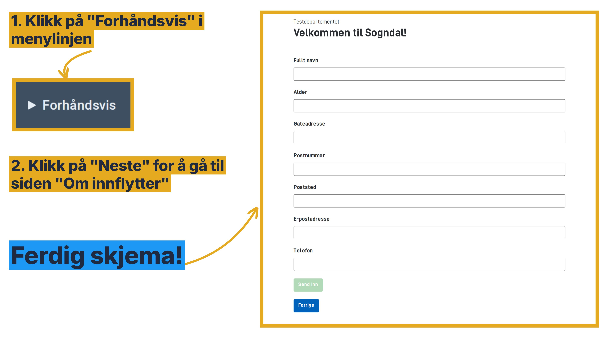

#### Dele endringene

Del endringene dine til appens sentrale område på samme måte som tidligere. Klikk på **Del dine endringer** i menylinjen,
beskriv endringene og klikk på **Del endringer**.

Du kan lese mer i [oversikten over komponentene du kan bruke i Altinn Studio]().
