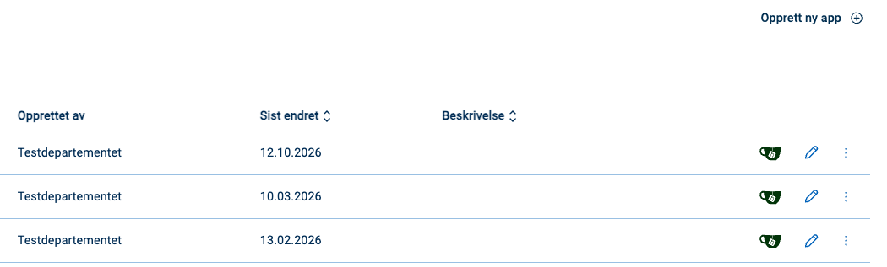
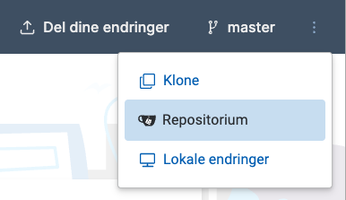
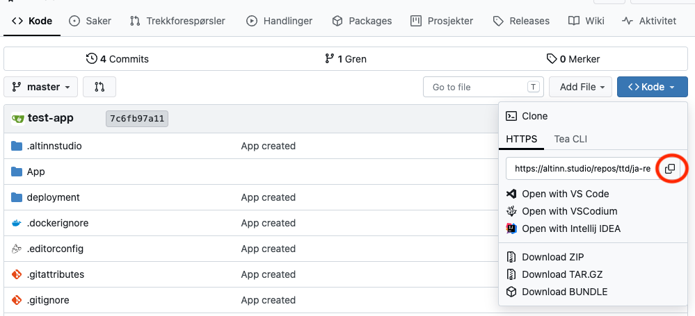
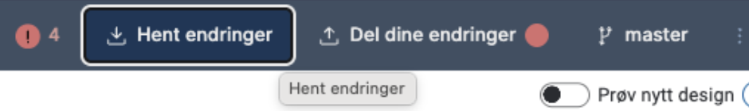
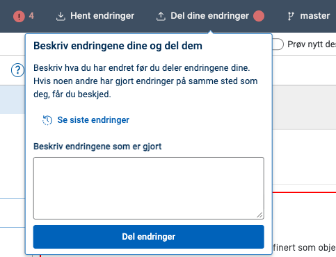
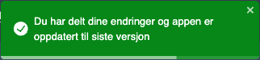

Når du utvikler en app, jobber du både i Altinn Studio og i et lokalt utviklingsmiljø.
Her er en oversikt over hvordan du kommer i gang med lokal utvikling. 

## Slik kloner du appen til et lokalt utviklingsmiljø

{}

{}
{}
{}

{}

{}

1. Gå til repositoriet for appen. Du kan gjøre det på to måter:
    - På dashboardet i Altinn Studio klikker du på repository-ikonet ved siden av appen.
      
    - Inne i appen klikker du på de tre prikkene øverst til høyre og velger **Repositorium**.
      
2. Klikk på **Kode**, og kopier lenken under **HTTPS** med kopieringsknappen (markert med rød sirkel).
    
3. Åpne en terminal i det lokale utviklingsmiljøet ditt, gå til mappen der du vil ha appen, og kjør `git clone` med lenken du kopierte:
    ```cmd
    $ git clone https://altinn.studio/repos/<org>/<app-name>.git
    ```
    Du logger inn i Altinn Studio med Ansattporten og har derfor ikke et eget passord. Hvis Git spør om passord, bruker du et [personlig tilgangstoken fra Gitea](https://altinn.studio/repos/user/settings/applications) i stedet.

    I terminalen ser du et resultat som likner dette:
    ```cmd
    Cloning into 'app-name'...
    remote: Enumerating objects: 982, done.
    remote: Counting objects: 100% (982/982), done.
    remote: Compressing objects: 100% (950/950), done.
    remote: Total 982 (delta 600), reused 0 (delta 0), pack-reused 0
    Receiving objects: 100% (982/982), 166.38 KiB | 1.51 MiB/s, done.
    Resolving deltas: 100% (600/600), done.
    ```

Systemet oppretter en mappe med samme navn som appen og kopierer innholdet i app-repoet inn i mappen.
Nå kan du åpne utviklingsverktøyet du foretrekker, og komme i gang.

{}

## Slik synkroniserer du endringer i lokalt utviklingsmiljø

Du må laste opp (*pushe*) endringer som du gjør lokalt til repoet koden ble klonet fra.
Hvis du gjør endringer i Altinn Studio Designer (og laster disse opp til repoet), må du hente dem ned (*pull*) for å oppdatere den lokale koden.

Du kan synkronisere endringer i det lokale utviklingsmiljøet på flere måter.
Mange utviklingsverktøy har gode integrasjoner for nettopp dette, så sjekk gjerne om verktøyet ditt har den typen støtte.

Under kan du lese mer om hvordan du synkroniserer endringer fra kommandolinjen.

### Laste opp endringer

1. Gå til app-repoet ditt i en terminal.
2. Legg til filene du ønsker å laste opp endringer for (*pushe*) med kommandoen `git add <sti til filen>`. Du kan kjøre kommandoen for enkeltfiler, flere filer samtidig eller en mappe.
3. Lagre (*commit*) endringene med en beskrivende melding med kommandoen `git commit -m <commit-melding>`.
4. Last opp (*push*) endringene til master med kommandoen `git push`.

### Laste ned endringer

Gå til app-repoet ditt i en terminal og kjør kommandoen `git pull`.

Les mer om [git pull i Git-dokumentasjonen](https://git-scm.com/docs/git-pull).

## Slik synkroniserer du endringer i Altinn Studio

I Altinn Studio synkroniserer du endringer med knappene i verktøylinjen øverst på siden.

### Hente endringer

Klikk på **Hent endringer**. Du får beskjed når appen er oppdatert til siste versjon.



### Dele endringer

En rød prikk på **Del dine endringer** viser at du har endringer som ikke er delt ennå.

1. Klikk på **Del dine endringer**.
2. Beskriv hva du har endret, og klikk på **Del endringer**. Vil du se hvilke filer du har endret, klikker du på **Se siste endringer**.
   

Du får en bekreftelse når endringene er delt.



Hvis noen andre har endret appen på samme sted som deg, får du beskjed om at det er en konflikt i appen. Da kan du laste ned endringene dine som en zip-fil, eller velge **Slett mine endringer**.

## Lokal testing

{}
{}

### Følg prosessen i prosessmotoren

Prosessmotoren utfører prosessteg asynkront i v9. Når du tester appen lokalt, kan du bruke kontrollpanelet til å se om en arbeidsflyt venter, kjører, er fullført eller har feilet.

Åpne forsiden til localtest og velg **Workflow engine** i navigasjonen. Du kan også åpne kontrollpanelet direkte på [workflow-engine.local.altinn.cloud:8000](http://workflow-engine.local.altinn.cloud:8000/).

Fanen **Live** viser planlagte, aktive og nylig avsluttede arbeidsflyter. Bruk fanen **Query** hvis du vil søke i eldre arbeidsflyter eller avgrense listen etter status og tidspunkt. Kontrollpanelet er tilgjengelig så lenge den lokale testplattformen kjører.

### Se endringer fortløpende

- Hvis du endrer JSON-filer, holder det å laste inn siden på nytt.
- Hvis du endrer forhåndsutfylling, må du starte en ny instans av appen (gå til [http://local.altinn.cloud:8000](http://local.altinn.cloud:8000) og logg inn igjen).
- Hvis du endrer C#-filer, må du stoppe appen (`ctrl+C`) og starte den på nytt (`studioctl run`).

Du kan oppdatere automatisk ved endring i C#-filer ved å starte appen med `dotnet watch` fra mappen *App*.
Kommandoen starter appen, eller laster den på nytt ([hot reload](https://learn.microsoft.com/en-us/dotnet/core/tools/dotnet-watch#hot-reload)) når du endrer kildekoden.
Appen henter de lokale innstillingene fra `studioctl` selv, så du må ha `studioctl` installert.

{}

{}

{}

{}
