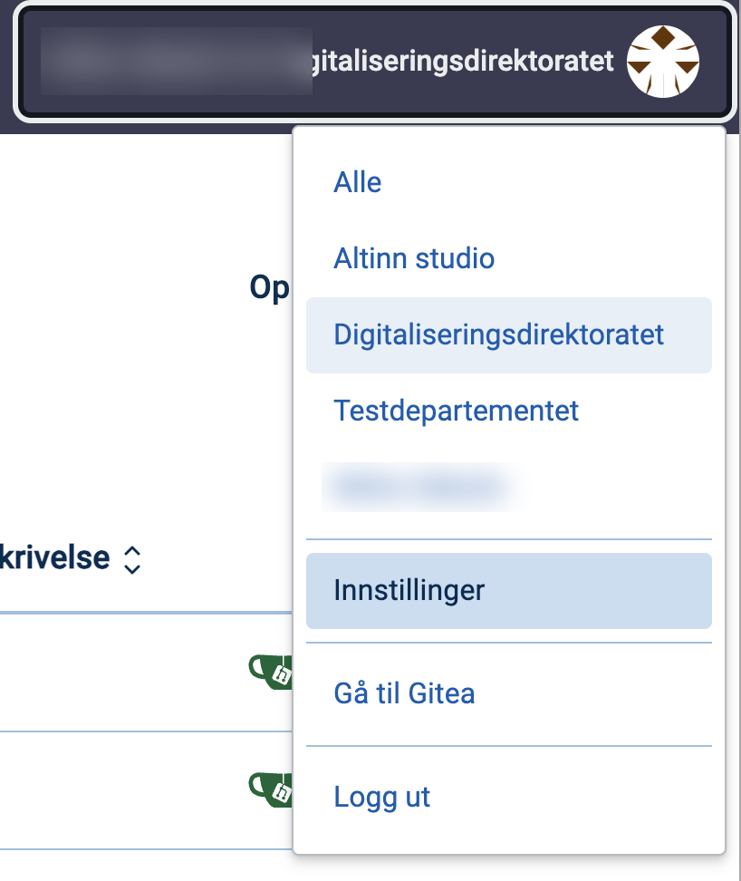
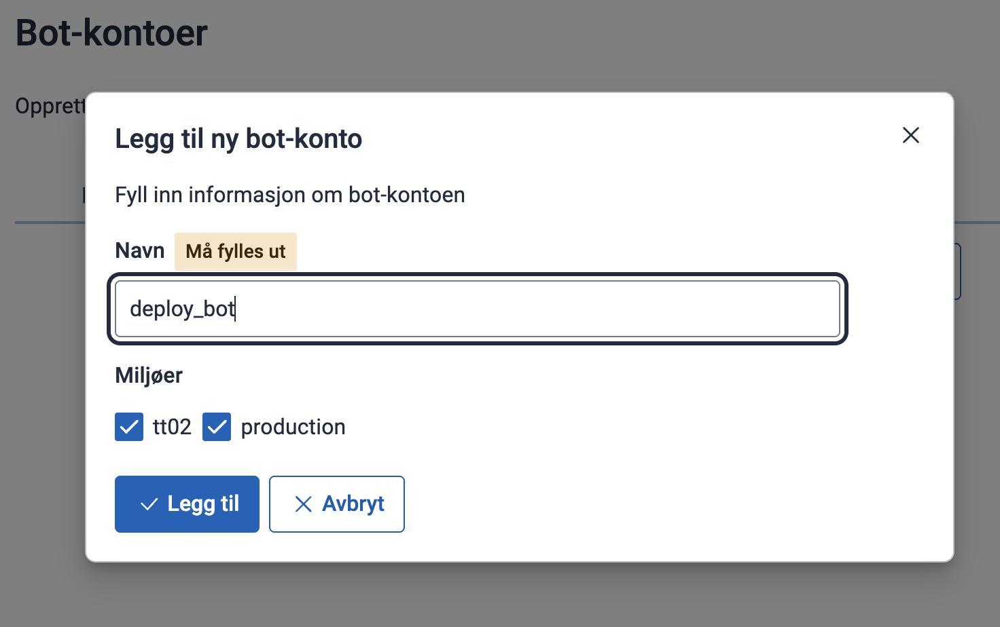
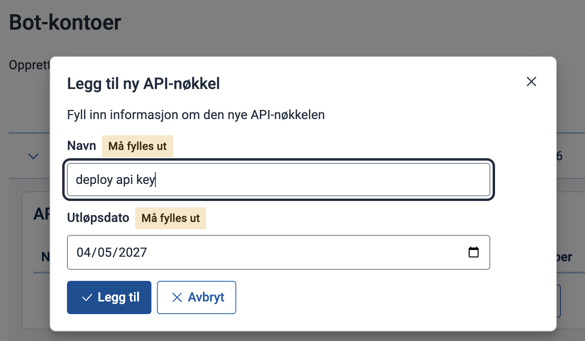
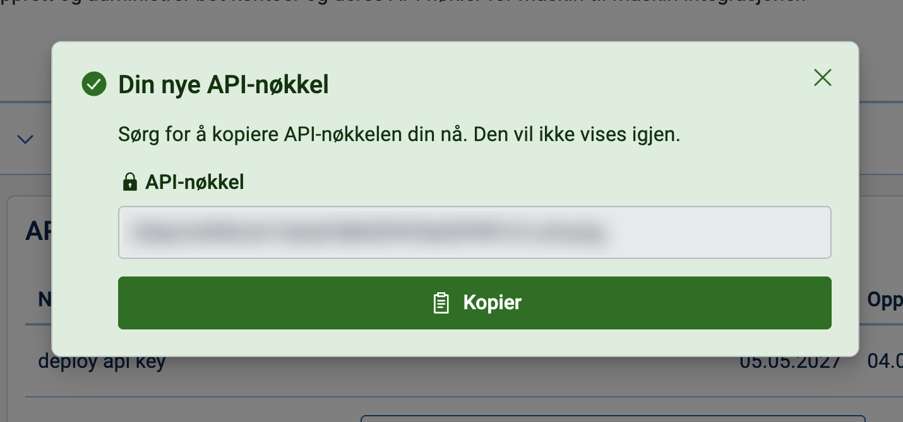

En bot-konto er en konto i Altinn Studio som ikke tilhører en person. Du bruker den når en automatisk prosess skal gjøre oppgaver for organisasjonen din, for eksempel når en arbeidsflyt i Gitea Actions skal bygge og publisere en app.

Med en bot-konto slipper dere å bruke den personlige tilgangsnøkkelen til en ansatt i automatiske prosesser. Tilgangen hører til organisasjonen, ikke til en person. Den virker derfor videre selv om den som opprettet bot-kontoen, bytter rolle eller slutter.

## Dette kan en bot-konto gjøre

En bot-konto bruker en API-nøkkel i stedet for brukernavn og passord. Nøkkelen gir bare tilgang til et utvalg handlinger i Altinn Studio. Med nøkkelen kan en automatisk prosess

- bygge en app og lage en ny versjon (release)
- publisere (deploye) en versjon til et miljø
- ta en app ned fra et miljø (undeploy)
- se status for bygg og publiseringer
- søke i repositoriene til organisasjonen
- hente Gitea Actions-stegene som Altinn tilbyr, se [Bruke API-nøkkelen i Gitea Actions](#bruke-api-nøkkelen-i-gitea-actions)

Bot-kontoen er ikke en fullverdig bruker. Den kan ikke

- pushe kode til repositoriene
- endre apper i Altinn Studio Designer
- logge inn i Altinn Studio eller Gitea slik en vanlig bruker gjør

[[FIX BEFORE MERGE: bekreft at listene over hva bot-kontoen kan og ikke kan gjøre, er fullstendige (endepunkter merket AllowApiKey)]]

## Slik henger bot-kontoen og tilgangene sammen

- **Bot-kontoen er en bruker i Gitea.** Brukernavnet har formen `bot_{org}_{navn}_{fire tilfeldige tegn}`, for eksempel `bot_ttd_deploy_bot_3f9a`. Du finner bot-kontoen i teamene på samme måte som andre brukere.
- **Du oppretter bot-kontoen i Altinn Studio, ikke i Gitea.** Altinn Studio holder styr på hvilken organisasjon bot-kontoen hører til, og hvem som opprettet den. Derfor kan du ikke lage en bot-konto direkte i Gitea.
- **Altinn Studio eier API-nøkkelen.** Bot-kontoen har ikke eget passord eller egen tilgangsnøkkel (PAT) i Gitea. Når en prosess bruker nøkkelen, kontrollerer Altinn Studio den, finner bot-kontoen som nøkkelen hører til, og utfører handlingen på vegne av bot-kontoen.
- **Nøkkelen har alltid en utløpsdato.** Du velger datoen selv, men den kan ikke være mer enn ett år frem i tid.
- **Altinn Studio lagrer ikke selve nøkkelen.** Studio lagrer bare en kodet versjon (en hash), og ingen kan gjøre den om til nøkkelen igjen. Derfor kan heller ikke Altinn Studio vise deg nøkkelen på nytt etter at du har laget den.
- **Team styrer tilgangen, akkurat som for andre brukere.** For å publisere til et miljø må bot-kontoen være medlem av Deploy-teamet for miljøet, for eksempel **Deploy-TT02** eller **Deploy-Production**. [Se oversikt over standardteamene og tilgangene de gir]().

## Før du starter

Du må være medlem av teamet **Owners** i organisasjonen. Bare eiere av organisasjonen kan opprette bot-kontoer og API-nøkler.

## Opprette en bot-konto

Du oppretter bot-kontoen fra innstillingene til organisasjonen i Altinn Studio.

1. Logg inn i Altinn Studio, og klikk på navnet ditt øverst til høyre.
2. Velg organisasjonen din i menyen. Velg organisasjonen, ikke brukeren din, fordi bot-kontoer hører til organisasjonen.
3. Klikk på **Innstillinger** i samme meny.

   

   Du kan også gå rett til
   `https://altinn.studio/settings/{org}/bot-accounts` (erstatt `{org}` med organisasjonskoden din).
4. Åpne fanen **Bot-kontoer**, og klikk på **Legg til ny bot-konto**.
5. Fyll inn
   - **Navn**: et navn som viser hva bot-kontoen skal gjøre, for eksempel `deploy_bot`
   - **Miljøer**: miljøene bot-kontoen skal få publisere til, for eksempel `tt02` og `production`
6. Klikk på **Legg til**.

   

[[FIX BEFORE MERGE: bekreft at valg av miljøer melder bot-kontoen inn i Deploy-teamet for miljøet, og om du kan endre miljøene i ettertid]]

## Lage en API-nøkkel

Når bot-kontoen er klar, lager du en API-nøkkel til den.

1. Klikk på **Legg til ny API-nøkkel** på bot-kontoen.
2. Fyll inn
   - **Navn**: et navn som viser hva nøkkelen er til, for eksempel `deploy api key`
   - **Utløpsdato**: datoen nøkkelen slutter å virke, høyst ett år frem i tid
3. Klikk på **Legg til**.

   

4. Klikk på **Kopier**, og lagre nøkkelen et trygt sted med en gang.

   

{}
Altinn Studio viser nøkkelen bare én gang. Hvis du lukker vinduet uten å kopiere den, må du slette nøkkelen og lage en ny.

Behandle nøkkelen som et passord. Ikke lim den inn i kode, e-post eller chat. Lagre den som en secret i systemet som skal bruke den.
{}

## Bruke API-nøkkelen i Gitea Actions

Altinn tilbyr ferdige Gitea Actions-steg i repositoriet
[als/actions](https://altinn.studio/repos/als/actions):

- `altinn-app-release` lager en ny versjon av appen og venter til bygget er ferdig.
- `altinn-app-deploy` publiserer en eksisterende versjon til et miljø.

Begge stegene trenger API-nøkkelen til bot-kontoen.

### Lagre nøkkelen som en secret i Gitea

Du kan lagre nøkkelen på to nivåer:

- **Repositoriet**: Bare arbeidsflytene i dette repositoriet kan bruke nøkkelen.
- **Organisasjonen**: Alle repositoriene i organisasjonen kan bruke nøkkelen. Velg dette hvis flere apper skal bruke samme bot-konto.

Eksemplene under bruker navnet `ALTINN_STUDIO_API_KEY`. Du kan velge et annet navn, men da må du bruke samme navn i arbeidsflyten.

Slik lagrer du nøkkelen i repositoriet:

1. Åpne app-repoet i Gitea.
2. Klikk på **Settings** → **Actions** → **Secrets**.
3. Klikk på **Add Secret**.
4. Skriv `ALTINN_STUDIO_API_KEY` som navn, og lim inn API-nøkkelen som verdi.
5. Lagre secreten.

Skal hele organisasjonen bruke nøkkelen, gjør du det samme fra innstillingene til organisasjonen i Gitea.

### Sette opp arbeidsflyten

Arbeidsflyten er en fil i app-repoet. Du legger den inn selv, fordi bot-kontoen ikke kan pushe kode eller lage filer i repositoriet.

Arbeidsflyten i eksempelet lager en versjon i én jobb og publiserer den til TT02 i en annen. Hvis publiseringen feiler, kan du kjøre bare den jobben på nytt. Den samme API-nøkkelen henter også stegene fra `als/actions`, så du trenger ikke en egen tilgangsnøkkel til det.

{}
Arbeidsflyten starter med en gang du committer filen til `master`, og deretter hver gang noen pusher til `master`. Kontroller hvilket miljø arbeidsflyten publiserer til før du committer. Dette er særlig viktig hvis bot-kontoen har tilgang til `production`.
{}

1. Åpne app-repoet i Gitea.
2. Klikk på **Add File** → **New File**.
3. Skriv `.gitea/workflows/release-and-deploy.yaml` som filnavn. Gitea lager mappene automatisk når du skriver skråstrekene.
4. Lim inn innholdet fra eksempelet under, og bytt ut `my-app-name` og `ttd` med navnet på appen og organisasjonskoden din.
5. Commit filen til `master`.


.gitea/workflows/release-and-deploy.yaml


```yaml
name: Create Altinn Release and Deploy

on:
  push:
    branches: [ master ]
  workflow_dispatch:

jobs:
  release:
    runs-on: ubuntu-latest
    steps:
      - name: Checkout altinn-actions repo
        run: |
          git clone --branch v3 --depth 1 \
            -c http.extraHeader="X-Api-Key: ${{ secrets.ALTINN_STUDIO_API_KEY }}" \
            ${{ gitea.server_url }}/als/actions.git als/actions

      - name: Create release
        uses: ./als/actions/altinn-app-release
        with:
          app: my-app-name
          org: ttd
          commit-sha: ${{ gitea.sha }}
          api-key: ${{ secrets.ALTINN_STUDIO_API_KEY }}
          release-tag: '${{ gitea.sha }}-tag'
          release-body: 'Release ${{ gitea.sha }}'

  deploy:
    needs: release
    runs-on: ubuntu-latest
    steps:
      - name: Checkout altinn-actions repo
        run: |
          git clone --branch v3 --depth 1 \
            -c http.extraHeader="X-Api-Key: ${{ secrets.ALTINN_STUDIO_API_KEY }}" \
            ${{ gitea.server_url }}/als/actions.git als/actions

      - name: Deploy release
        uses: ./als/actions/altinn-app-deploy
        with:
          app: my-app-name
          org: ttd
          deploy-environment: tt02
          release-tag: '${{ gitea.sha }}-tag'
          api-key: ${{ secrets.ALTINN_STUDIO_API_KEY }}
          wait-for-deploy-status: true
```

`v3` er versjonen av stegene. Du finner alle innstillingene og en oversikt over versjonene i
[README-filen i als/actions](https://altinn.studio/repos/als/actions).

Når arbeidsflyten har publisert appen, viser Altinn Studio bot-kontoen som den som publiserte, ikke personen som committet endringen.

## Fornye eller slette en API-nøkkel

Nøkkelen slutter å virke på utløpsdatoen, og arbeidsflytene som bruker den, feiler fra da av. Lag en ny nøkkel før den gamle går ut, og bytt verdien i secreten i Gitea.

Hvis du tror at noen uvedkommende har fått tak i nøkkelen, sletter du den med en gang og lager en ny.

[[FIX BEFORE MERGE: beskriv hvordan du sletter en API-nøkkel og en bot-konto i Altinn Studio, og om Altinn Studio varsler før en nøkkel går ut]]
