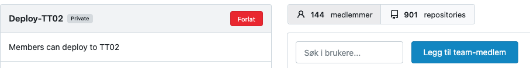
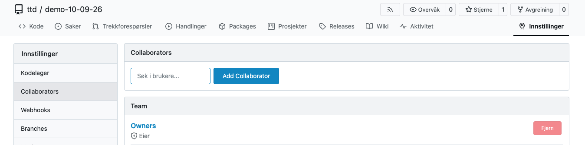

## Styre tilganger i organisasjonen

Som eier av en organisasjon i Altinn Studio kan du styre hva de andre brukerne i organisasjonen har tilgang til.

Gå til `https://altinn.studio/repos/org/{org}/teams/` (erstatt `{org}` med organisasjonskoden din).

Altinn Studio har fire standardteam som bestemmer hva en bruker har lov til å gjøre i organisasjonen. Ved behov kan du som eier legge til eller fjerne brukere i team, opprette nye team og endre innstillingene for eksisterende team.

[Se oversikt over standardteamene og tilgangene de gir]().

### Legge til en bruker i et team

Du må være eier av organisasjonen for å gjøre dette.

1. Gå til `https://altinn.studio/repos/org/{org}/teams/` (erstatt `{org}` med organisasjonskoden din).
2. Klikk på navnet til teamet.
3. Skriv inn Altinn Studio-brukernavnet til brukeren i feltet **Søk i brukere**.
4. Velg brukeren fra listen som dukker opp når du skriver.
5. Klikk på **Legg til team-medlem**.

Brukeren er nå lagt til i teamet.

## Styre tilgangen til ett repositorium

Som eier av organisasjonen kan du også styre hvem som har tilgang til det enkelte repositoriet. Du kan gi tilgang til både hele team og til enkeltbrukere.

1. Gå til det aktuelle repositoriet: `https://altinn.studio/repos/{org}/{app}/` (erstatt `{org}` og `{app}` med organisasjonskoden og app-navnet).
   - Alternativt: Gå til `https://altinn.studio/repos/explore/repos` og søk etter appen din.
2. Klikk på **Innstillinger** til høyre i menyen til repositoriet (ikke i menyen til organisasjonen).
3. Velg **Collaborators** i menyen til venstre.
4. Hvis du vil gi tilgang til én bruker, skriver du brukernavnet i feltet **Søk i brukere** under **Collaborators** og klikker på **Add Collaborator**.
5. Hvis du vil gi tilgang til et team, skriver du navnet på teamet under **Team** og klikker på **Legg til team**.

Vi anbefaler at du bruker team til å styre tilganger, fordi det gir bedre oversikt.

## Fjerne en bruker fra et team

Du trenger brukernavnet til brukeren du vil fjerne.

1. Gå til teamene i organisasjonen din: `https://altinn.studio/repos/org/{org}/teams/` (erstatt `{org}` med organisasjonskoden din).
2. Klikk på navnet til teamet du skal fjerne brukeren fra.
3. Klikk på **Fjern** ved siden av brukeren i listen over medlemmer.

En bruker kan også forlate et team selv ved å klikke på **Forlat** øverst til høyre på teamet.

## Fjerne en bruker fra organisasjonen

Du trenger brukernavnet til brukeren du vil fjerne. Se beskrivelsen over for hvordan du fjerner en bruker fra enkeltteam.

1. Gå til teamene i organisasjonen din: `https://altinn.studio/repos/org/{org}/teams/` (erstatt `{org}` med organisasjonskoden din).
2. Fjern brukeren fra teamene brukeren er medlem av i organisasjonen din.
   - Typiske team er `Devs` for skrivetilgang til appene, `Deploy-<miljø>` for publiseringstilgang for appene, og `Resources-Publish-<miljø>` for tilgang til å publisere ressurser.
   - Hvis organisasjonen din har satt opp en annen teamstruktur, må du sjekke alle team brukeren kan være medlem av.
3. Hvis brukeren har fått tilgang til enkelte repositorier direkte, må du også fjerne den tilgangen. Gå til **Innstillinger** → **Collaborators** i repositoriet, og klikk på **Fjern** ved siden av brukeren.
4. Sjekk at brukeren ikke lenger tilhører organisasjonen din ved å gå til `https://altinn.studio/repos/{brukernavn}` og kontrollere at organisasjonen din (med logo) ikke lenger vises under brukerens profilbilde på venstre side.
