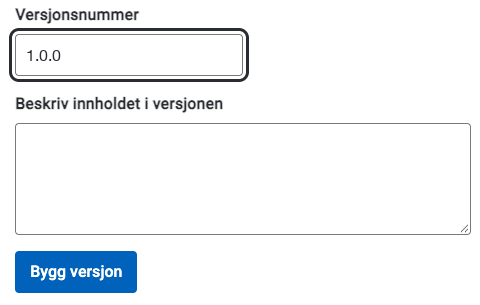
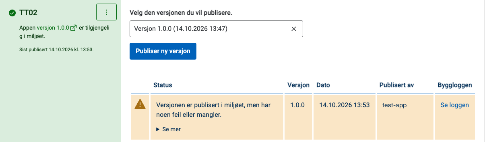

Du bygger appen og publiserer den i testmiljøet fra fanen **Publiser** i Altinn Studio.

## Bygge appen

Før du kan publisere appen i testmiljøet, må du samle alle filene den trenger, i en pakke. Det gjør du ved å _bygge_ appen.

{}
Bygget bruker filene fra app-repositoriet. Hvis du har gjort endringer på en app i Altinn Studio, må du dele dem med repositoriet for at endringene skal bli med i bygget. Du gjør dette ved å klikke på **Del dine endringer** i verktøylinjen øverst i Altinn Studio.
{}

Når appen er klar til test, åpner du den i Altinn Studio og går til fanen **Publiser**.

På høyre side ser du et panel for å bygge appen.

{}
Du kan bare bygge en ny versjon hvis du har gjort endringer i appen siden forrige bygg. Hvis du vet du har gjort endringer, men ikke får til å bygge, kan du sjekke om du har klikket på **Del dine endringer**.
{}

1. Skriv inn et versjonsnummer i feltet **Versjonsnummer**. Versjonsnummeret må være unikt, det vil si at du ikke kan ha brukt det før for denne appen.
2. Beskriv versjonen i feltet **Beskriv innholdet i versjonen**.
3. Klikk på **Bygg versjon** for å starte bygget.

Du ser status for bygget under **Tidligere bygg av appen**. Når bygget er ferdig, ser du en grønn hake ved **Bygglogg**. Da er versjonen klar, og du kan publisere den i testmiljøet.

## Publisere appen i testmiljøet

Når du har bygget appen, kan du publisere den i testmiljøet. Det gjør du også fra fanen **Publiser**. Der ser du en oversikt over tilgjengelige miljøer, i tillegg til en oversikt over hvilke versjoner av appen som finnes i de forskjellige miljøene.

Hvis du ikke har tilgang til å publisere til et miljø, ser du meldingen «Du har ikke rettigheter til å publisere til …» under miljøet. Da må eierne i organisasjonen din gi deg tilgang. Les mer om [tilganger i Altinn Studio]().

1. Velg versjonen du vil publisere i nedtrekkslisten **Velg den versjonen du vil publisere**, som du finner under miljøet.
2. Klikk på **Publiser ny versjon**.
3. Klikk på **Ja** for å bekrefte at du vil publisere versjonen.
   

Når publiseringen er ferdig, blir miljøet grønt, og du ser teksten «Appen versjon … er tilgjengelig i miljøet». I tabellen ved siden av ser du status, versjon, dato, hvem som publiserte, og en lenke til byggloggen. Du kan publisere en ny versjon, eller gå tilbake til en eldre versjon hvis du vil det.

## Teste appen i testmiljøet

Åpne appen i testmiljøet: Gå til fanen **Publiser** og klikk på lenken **versjon …** under navnet på miljøet. Logg inn med **TestID** og en testperson.

Instansene du lager, finner du i innboksen i Arbeidsflate til aktøren du valgte. I TT02 finner du Arbeidsflate på https://af.tt02.altinn.no/.
