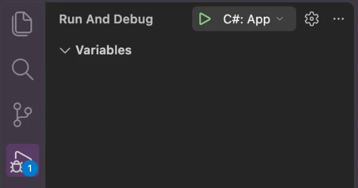
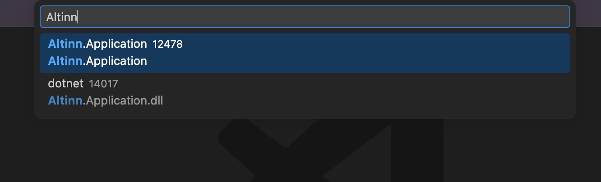
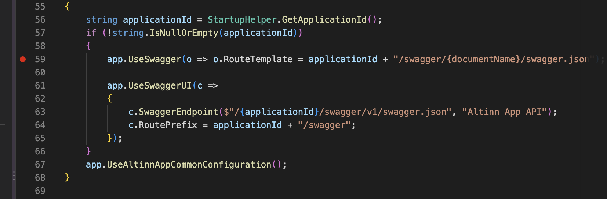

Denne veiledningen forutsetter at du har [klonet appen og satt opp lokal utvikling](), og at den lokale testplattformen kjører (`studioctl env up`). Du trenger også utvidelsen **C# Dev Kit** i Visual Studio Code.

## Feilsøke i Visual Studio Code

### Alternativ 1: Starte appen fra Visual Studio Code

Dette er den enkleste metoden. Visual Studio Code starter appen og kobler feilsøkeren til i én og samme prosess.

1. Åpne mappen til appen i Visual Studio Code.
2. Klikk på **Run and Debug** i menyen til venstre.
3. Velg **C#: App** i nedtrekkslisten, og klikk på den grønne avspillingsknappen. Hvis **C#: App** ikke står i listen, velger du **C#** og deretter prosjektet **App**.
   
4. Appen starter. Du ser verktøylinjen for feilsøking øverst, og loggene i **Debug Console**.
5. Åpne [local.altinn.cloud:8000](http://local.altinn.cloud:8000) i nettleseren, og start appen.

### Alternativ 2: Koble til en app som allerede kjører

Bruk dette alternativet hvis du har startet appen med `studioctl run`.

1. Start appen fra mappen til appen:
   ```bash
   studioctl run
   ```
2. Trykk på **Cmd + Shift + P** (**Ctrl + Shift + P** på Windows) i Visual Studio Code.
3. Skriv «Attach to a .NET», og velg **Debug: Attach to a .NET 5+ or .NET Core process**. Ikke velg **Attach** fra Docker-utvidelsen, som kobler til containere.
4. Skriv **Altinn** i feltet, og velg prosessen som kjører **Altinn.Application**. Startet du appen med `studioctl run`, heter den vanligvis **dotnet**, med **Altinn.Application.dll** under.
   

## Legge til stoppunkter og analysere koden

1. Klikk til venstre for linjenummeret der du vil at feilsøkeren skal stoppe, eller trykk på **F9**. Da ser du en rød prikk.
   
2. Når appen kommer til linjen, stopper feilsøkeren. Da kan du se verdiene under **Variables** i **Run and Debug**, og finne ut hvordan koden fungerer.

Les mer om [feilsøking i dokumentasjonen til Visual Studio Code](https://code.visualstudio.com/docs/debugtest/debugging).
