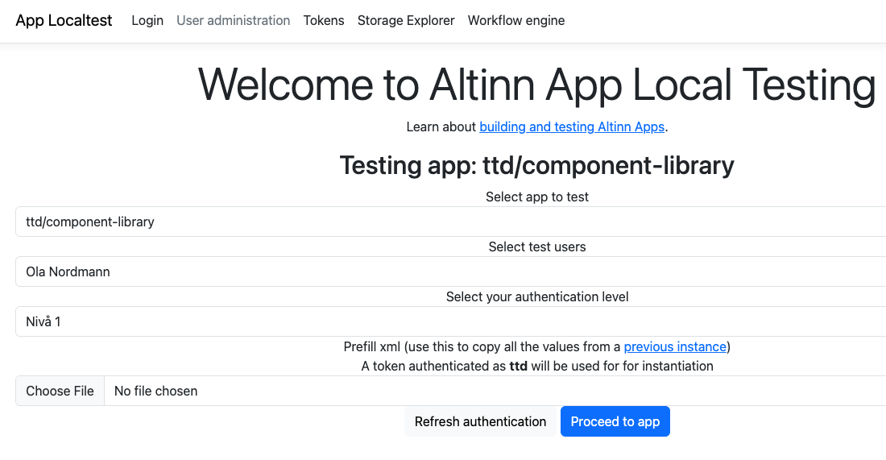
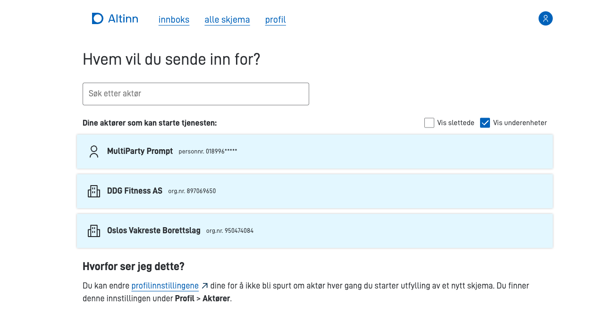

## Velge app og testbruker

Åpne localtest på [local.altinn.cloud:8000](http://local.altinn.cloud:8000), og velg appen under **Select app to test**. Du ser dette valget også når du kjører bare én app. Velg deretter bruker under **Select test users** og autentiseringsnivå under **Select your authentication level**. Klikk på **Proceed to app** for å åpne appen som testbrukeren.



## Standardbrukere

Disse testbrukerne kan du velge i localtest.

### Sophie Salt

Sophie er en svært driftig dame som bor i Oslo. Hun har startet en kjede med treningssentre som heter DDG Fitness, og til nå har hun startet tre underenheter i Oslo, Bergen og Trondheim.
Sophie har rollen DAGL og underrollene for DDG Fitness AS og underenhetene.

I tillegg er hun ekspert på helse og har startet sitt eget konsulentfirma for helsetjenester. Sophie har rollen LEDE og tilknyttede roller for EAS Health Consulting.

Hun er også styremedlem i borettslaget der hun bor, Oslos Vakreste Borettslag. Sophie har rollen MEDL og tilknyttede roller for borettslaget.

#### Avgivere

| Avgiver                                                                                                                       | Roller                                                                                                                                        |
| ----------------------------------------------------------------------------------------------------------------------------- | --------------------------------------------------------------------------------------------------------------------------------------------- |
| [01039012345 Sophie Salt](https://github.com/Altinn/altinn-studio/blob/main/src/Runtime/localtest/testdata/Register/Person/01039012345.json)        | [Privatperson](https://github.com/Altinn/altinn-studio/blob/main/src/Runtime/localtest/testdata/authorization/roles/User_1337/party_501337/roles.json)              |
| [897069650 DDG Fitness AS](https://github.com/Altinn/altinn-studio/blob/main/src/Runtime/localtest/testdata/Register/Org/897069650.json)            | [Daglig leder + knytninger](https://github.com/Altinn/altinn-studio/blob/main/src/Runtime/localtest/testdata/authorization/roles/User_1337/party_500000/roles.json) |
| [897069651 DDG Fitness Oslo](https://github.com/Altinn/altinn-studio/blob/main/src/Runtime/localtest/testdata/Register/Org/897069651.json)        | [Daglig leder + knytninger](https://github.com/Altinn/altinn-studio/blob/main/src/Runtime/localtest/testdata/authorization/roles/User_1337/party_500001/roles.json) |
| [897069652 DDG Fitness Bergen](https://github.com/Altinn/altinn-studio/blob/main/src/Runtime/localtest/testdata/Register/Org/897069652.json)          | [Daglig leder + knytninger](https://github.com/Altinn/altinn-studio/blob/main/src/Runtime/localtest/testdata/authorization/roles/User_1337/party_500002/roles.json) |
| [897069653 DDG Fitness Trondheim](https://github.com/Altinn/altinn-studio/blob/main/src/Runtime/localtest/testdata/Register/Org/897069653.json)     | [Daglig leder + knytninger](https://github.com/Altinn/altinn-studio/blob/main/src/Runtime/localtest/testdata/authorization/roles/User_1337/party_500003/roles.json) |
| [897069631 EAS Health Consulting](https://github.com/Altinn/altinn-studio/blob/main/src/Runtime/localtest/testdata/Register/Org/897069631.json)     | [Styreleder + knytninger](https://github.com/Altinn/altinn-studio/blob/main/src/Runtime/localtest/testdata/authorization/roles/User_1337/party_500600/roles.json)   |
| [950474084 Oslos Vakreste Borettslag](https://github.com/Altinn/altinn-studio/blob/main/src/Runtime/localtest/testdata/Register/Org/950474084.json) | [Styremedlem + knytninger](https://github.com/Altinn/altinn-studio/blob/main/src/Runtime/localtest/testdata/authorization/roles/User_1337/party_500700/roles.json)  |

### Pengelens Partner

Pengelens Partner er regnskapsføreren for selskapet DDG Fitness AS.

#### Avgivere

| Avgiver                                                                                                                      | Roller                                                                                                                             |
| ---------------------------------------------------------------------------------------------------------------------------- | ---------------------------------------------------------------------------------------------------------------------------------- |
| [01899699552 Pengelens Partner](https://github.com/Altinn/altinn-studio/blob/main/src/Runtime/localtest/testdata/Register/Person/01899699552.json) | [Privatperson](https://github.com/Altinn/altinn-studio/blob/main/src/Runtime/localtest/testdata/authorization/roles/User_1001/party_510001/roles.json)   |
| [897069650 DDG Fitness AS](https://github.com/Altinn/altinn-studio/blob/main/src/Runtime/localtest/testdata/Register/Org/897069650.json)           | [Regnskapsfører](https://github.com/Altinn/altinn-studio/blob/main/src/Runtime/localtest/testdata/authorization/roles/User_1001/party_500000/roles.json) |

### Gjentagende Forelder

Gjentagende Forelder er revisor for selskapet DDG Fitness AS.

#### Avgivere

| Avgiver                                                                                                                         | Roller                                                                                                                           |
| ------------------------------------------------------------------------------------------------------------------------------- | -------------------------------------------------------------------------------------------------------------------------------- |
| [17858296439 Gjentagende Forelder](https://github.com/Altinn/altinn-studio/blob/main/src/Runtime/localtest/testdata/Register/Person/17858296439.json) | [Privatperson](https://github.com/Altinn/altinn-studio/blob/main/src/Runtime/localtest/testdata/authorization/roles/User_1002/party_510002/roles.json) |
| [897069650 DDG Fitness AS](https://github.com/Altinn/altinn-studio/blob/main/src/Runtime/localtest/testdata/Register/Org/897069650.json)              | [Revisor](https://github.com/Altinn/altinn-studio/blob/main/src/Runtime/localtest/testdata/authorization/roles/User_1002/party_500000/roles.json)      |

### Ola Nordmann

Ola Nordmann er en privatperson som bare kan representere seg selv.
Han er bosatt på Stokmarknes.

#### Avgivere

- [01017512345 Ola Nordmann](https://github.com/Altinn/altinn-studio/blob/main/src/Runtime/localtest/testdata/Register/Person/01017512345.json)

### MultiParty Prompt

MultiParty Prompt får spørsmål om hvem brukeren vil sende inn for, når appen starter. De andre standardbrukerne går rett inn i appen. Bruk MultiParty Prompt når du vil teste aktørvalget.



### Andre brukere

For å teste skjemaer om barn og oppvekst, for eksempel barnehage og skole, har vi lagt til noen egne brukere.

| Avgiver                          | Barn | Inntekt |
| -------------------------------- | ---- | ------- |
| 01899699552 Pengelens Partner    | 0    | Lav     |
| 17858296439 Gjentagende Forelder | 3    | Middels |
| 08829698278 Rik forelder         | 2    | Høy     |

**Merk:** Disse er fra Tenors testdatasett, men ligger der med andre navn.

### Systemer og systembrukere

Med nyere versjoner av localtest kan du teste apper med systembrukere lokalt.
Localtest har et innebygd system og en systembruker som er knyttet til 950474084 Oslos Vakreste Borettslag.
Du kan hente et token med `/Home/GetTestSystemUserToken` i localtest, eller åpne siden **Tokens** (`/Home/Tokens`).

### Instansdelegering

Den siste versjonen av localtest støtter instansdelegering. Brukere og avgivere du delegerer fra og til må ha en `partyUuid` knyttet til seg. Se eksempelfilen nedenfor.

## App-spesifikke brukere

Hvis standardsettet med brukere ikke passer for å teste appen din lokalt, kan du sørge for at appen din svarer med et JSON-dokument på adressen `/[org]/[appId]/testData.json`. Den enkleste måten er å legge filen på `App/wwwroot/testData.json`.

Du kan for eksempel:
- Bruke andre organisasjonsnummer eller fødselsnummer, slik at oppslag i API-er som appen er avhengig av fungerer.
- Teste autorisasjonsreglene med andre roller enn det standardbrukerne har.

Vil du bruke flere testpersoner eller virksomheter, for eksempel de samme som i TT02, kan du hente dem fra Tenor testdata og velge dem på siden **User administration** i localtest. Der kan du laste dem ned som `testData.json`.

### JSON-struktur

Det finnes et [JSON-skjema](https://altinncdn.no/schemas/json/test-users/test-users.schema.v1.json) som hjelper deg å skrive en `testData.json`-fil i verktøy som Visual Studio Code. Du finner alle standardbrukerne i localtest i filen [testData.json](./testData.json).


App/wwwroot/testData.json


```json
{
  "$schema": "https://altinncdn.no/schemas/json/test-users/test-users.schema.v1.json",
  "persons": [
    {
      "partyId": 512345,
      "partyUuid": "48153af4-265f-4b35-8ed9-232fafbc716e",
      "ssn": "01017512345",
      "firstName": "Ola",
      "middleName": "",
      "lastName": "Nordmann",
      "customClaims": [
        {
          "type": "some:extra:claim",
          "value": "claimValue",
          "valueType": "http://www.w3.org/2001/XMLSchema#string"
        }
      ],
      "partyRoles": {
        "512345": [
          {
            "type": "altinn",
            "value": "regna"
          },
          {
            "type": "altinn",
            "value": "dagl"
          },
          {
            "type": "altinn",
            "value": "priv"
          }
        ]
      },
      "addressCity": "Stokmarknes",
      "addressHouseLetter": null,
      "addressHouseNumber": "7",
      "addressMunicipalName": "Hadsel",
      "addressMunicipalNumber": "1866",
      "addressPostalCode": "8450",
      "addressStreetName": "Bl\u00E5b\u00E6rveien",
      "mailingAddress": "Bl\u00E5b\u00E6reveien 7",
      "mailingPostalCity": "Stokmarknes",
      "mailingPostalCode": "8450",
      "mobileNumber": "87654321",
      "telephoneNumber": "12345678",
      "email": "test@test.com",
      "userId": 12345,
      "language": "nb",
      "userName": "OlaNordmann"
    },
    {
      "partyId": 501337,
      "partyUuid": "e9dd7d91-32d8-4933-a108-07562762d572",
      "ssn": "01039012345",
      "firstName": "Sophie",
      "middleName": "",
      "lastName": "Salt",
      "customClaims": [
        {
          "type": "some:extra:claim",
          "value": "claimValue",
          "valueType": "http://www.w3.org/2001/XMLSchema#string"
        }
      ],
      "partyRoles": {
        "500000": [
          {
            "type": "altinn",
            "value": "DAGL"
          },
          {
            "type": "altinn",
            "value": "UTINN"
          }
        ],
        "501337": [
          {
            "type": "altinn",
            "value": "PRIV"
          },
          {
            "type": "altinn",
            "value": "UTINN"
          }
        ],
        "500700": [
          {
            "type": "altinn",
            "value": "DAGL"
          },
          {
            "type": "altinn",
            "value": "UTINN"
          }
        ]
      },
      "addressCity": "Oslo",
      "addressHouseLetter": null,
      "addressHouseNumber": "9",
      "addressMunicipalName": "Oslo",
      "addressMunicipalNumber": "0301",
      "addressPostalCode": "0151",
      "addressStreetName": "Grev Wedels Plass",
      "mailingAddress": "Grev Wedels Plass 9",
      "mailingPostalCity": "Oslo",
      "mailingPostalCode": "0157",
      "mobileNumber": "87654321",
      "telephoneNumber": "12345678",
      "email": "1337@altinnstudiotestusers.com",
      "userId": 1337,
      "language": "nn",
      "userName": "SophieDDG"
    }
  ],
  "orgs": [
    {
      "partyId": 500000,
      "partyUuid": "77cab4d6-84bb-4eb2-91bd-710415a72d8a",
      "orgNumber": "897069650",
      "parentPartyId": null,
      "name": "DDG Fitness",
      "businessAddress": "Sofies Gate 1",
      "businessPostalCity": "By",
      "businessPostalCode": "0170",
      "eMailAddress": "central@ddgfitness.no",
      "faxNumber": "92110000",
      "internetAddress": "http://ddgfitness.no",
      "mailingAddress": "Sofies Gate 1",
      "mailingPostalCity": "Oslo",
      "mailingPostalCode": "0170",
      "mobileNumber": "92010000",
      "telephoneNumber": "12345678",
      "unitStatus": null,
      "unitType": "AS"
    },
    {
      "partyId": 500700,
      "partyUuid": "117e86a4-117f-41b0-8f2d-c383e2a69f9e",
      "orgNumber": "950474084",
      "parentPartyId": null,
      "name": "Oslos Vakreste Borettslag",
      "businessAddress": "Sofies Gate 2",
      "businessPostalCity": "By",
      "businessPostalCode": "0170",
      "eMailAddress": "epost@setra.no",
      "faxNumber": "92110000",
      "internetAddress": "http://setrabrl.no",
      "mailingAddress": "Sofies Gate 2",
      "mailingPostalCity": "Oslo",
      "mailingPostalCode": "0170",
      "mobileNumber": "92010000",
      "telephoneNumber": "12345678",
      "unitStatus": null,
      "unitType": "BRL"
    }
  ],
  "systems": [
    {
      "id": "913312465_sbs",
      "name": "Sluttbrukersystem",
      "systemUsers": [
        {
          "id": "d111dbab-d619-4f15-bf29-58fe570a9ae6",
          "orgNumber": "950474084",
          "actions": [
            "read",
            "write",
            "instantiate",
            "sign",
            "confirm",
            "reject",
            "delete"
          ]
        }
      ]
    }
  ]
}
```
